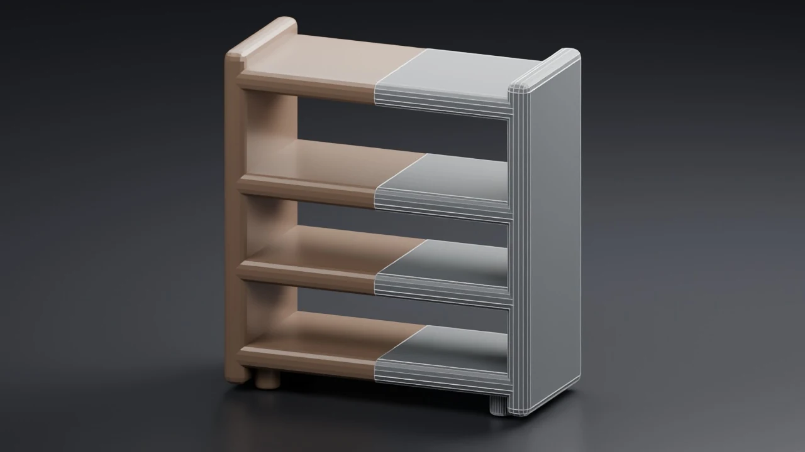

---

group: "furniture-product-page-best-practices"
title: "Que mettre sur une fiche produit de meuble ?"
description: "Créez une page produit de meuble avec des dimensions vérifiées, des variants clairs, des détails de livraison et une galerie utile."
date: 2026-12-05
updated: 2026-12-05
keyword: "fiche produit meuble"
cta: "Vérifiez les angles de votre produit dans l’aperçu gratuit."
---

Donnez aux acheteurs les informations nécessaires pour choisir et recevoir le meuble. Placer la variante sélectionnée, le prix, les dimensions et l’expédition près des boutons de commande. Utilisez la galerie pour montrer le matériau et la construction. Ajoutez une vue 3D où une caractéristique difficile à voir est mieux comprise.

## Qu’est-ce qu’un acheteur doit voir avant d’ajouter au panier ?

Affichez le nom, le revêtement choisi, la disponibilité et l’estimation de livraison ensemble. Placer la largeur, la profondeur et la hauteur globales dans un bloc facilement accessible. Inclure des mesures pratiques, comme la hauteur du siège ou la surface de pose avec les tiroirs ouverts, si elles ont été vérifiées.

## Comment vérifier une variante ?

Sélectionnez le revêtement sur mobile et vérifiez l’image principale, le prix, la disponibilité, la livraison et le modèle pour s’assurer qu’ils correspondent à ce SKU. Testez une variante en rupture de stock et une autre qui est livrée différemment. Gardez les informations sur l’assemblage et le transport facilement accessibles.

## Qu’est-ce qu’il faut vérifier avant de publier ?

| Question                                      | Placer la réponse                                          |
| --------------------------------------------- | ---------------------------------------------------------- |
| Qu’est-ce exactement que je viens d’acheter ? | Sélecteur de variante et photo actuelle                    |
| Quelles sont les dimensions vérifiées ?       | Bloc de spécifications et schéma étiqueté                  |
| Comment arrivera-t-il ?                       | Informations sur la livraison, l’emballage et l’assemblage |

<!-- IMAGE PENDING: Photograph or capture the example described in the brief. -->

**Source** [Shopify · produit média](https://help.shopify.com/en/manual/products/product-media), [Google Merchant Center · données produit](https://support.google.com/merchants/answer/7052112), [GS1 · spécifications image produit](https://www.gs1.org/standards/gs1-product-image-specification-standard/current-standard).

[Guide associé](/fr/guides/modeles-3d-e-commerce)

[Comment créer un modèle 3D](/learn/how-to-make-a-3d-model)

## Questions fréquentes

### Doit-on avoir un modèle 3D pour chaque produit ?

Commencez par des pièces où la rotation explique un côté caché ou une construction. Gardez les photos et les spécifications disponibles quel que soit le support du visiteur. Incluez les dimensions de l’emballage sur la fiche produit pour informer sur les changements d’assemblage ou de livraison.

### Inclure-je les dimensions de l’emballage ?

Incluez les dimensions de l’emballage si l’assemblage ou la livraison change. Sélectionnez la variante puis vérifiez la hauteur, la largeur et la profondeur dans le bloc de spécifications. Erreur courante : confondre les dimensions du colis avec celles du meuble assemblé.

### Quelle page dois-je tester en premier ?

Testez la page de détail d’un meuble avec plusieurs finitions. Sélectionnez un revêtement et vérifiez que le prix, la disponibilité et la livraison s’actualisent. Un oubli de mise à jour du bloc de spécifications peut masquer une erreur de variantes.
