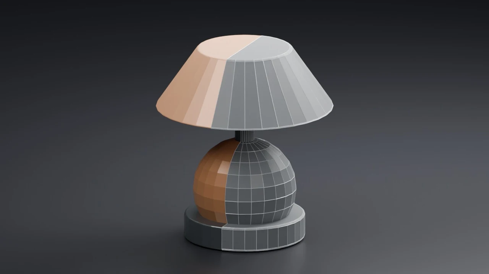
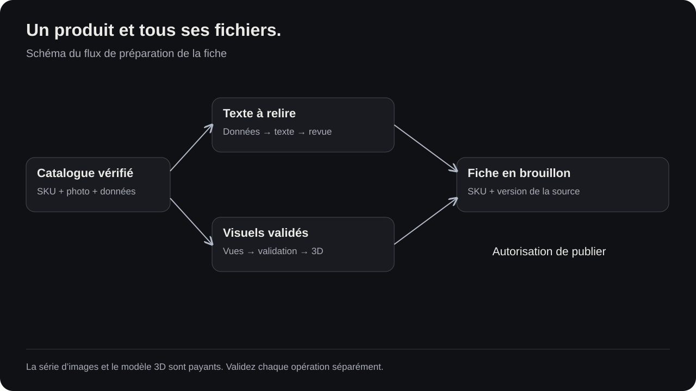
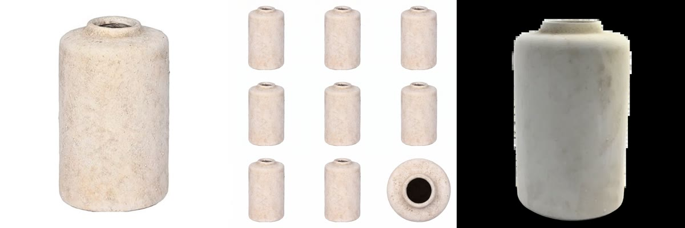

---

group: "n8n-product-pages-images-3d"
title: "Créer des fiches produit avec n8n, images et 3D"
description: "Créez des fiches produit avec n8n. Réunissez les données vérifiées, les images et le modèle 3D dans un brouillon, après validation des dépenses."
date: 2026-11-18
updated: 2026-11-19
keyword: "fiche produit n8n"
cta: "Vérifiez les angles de votre produit dans l’aperçu gratuit."
---

Pour créer une fiche produit avec n8n, partez de données vérifiées et traitez le texte, les visuels et le modèle 3D dans des branches distinctes. Réunissez les fichiers par SKU et version avant d’enregistrer la fiche en brouillon, puis consignez l’autorisation de dépense et la validation de publication.

> **Une fiche produit finale nécessite plus qu'une description.** Gardez les faits du produit, les fichiers d'image, le modèle 3D et l'état de publication ensemble. Un bon résultat est une étape vers une fiche produit approuvée.

## Quel est le résultat attendu ?

Pour une lampe de bureau en céramique, la fiche à valider contient un texte vérifié, les vues retenues, le fichier GLB et l’identifiant du brouillon. GLB est un contenant binaire pour un modèle 3D, décrit dans la [documentation Khronos glTF](https://www.khronos.org/gltf/). Une vidéo de rotation est un autre livrable.

| Livrable                     | Source de vérité                             | Vérification d'acceptation                                 |
| ---------------------------- | -------------------------------------------- | ---------------------------------------------------------- |
| Titre et description         | Faits du fournisseur plus règles éditoriales | Aucun matériau, dimension ou certification inventé         |
| Images du produit            | Ensemble visuel accepté                      | Même produit, même finition et même variant                |
| Fichier interactif 3D        | Construction approuvée                       | Le fichier s'ouvre, tourne et correspond à l'objet accepté |
| Brouillon du CMS             | Mappage SKU-produit                          | Produit et variant corrects, toujours non publiés          |
| Enregistrement de traitement | IDs enregistrés et approbation               | Une autre exécution peut reprendre le travail              |

L'[image n8n vers modèle Shopify](https://n8n.io/workflows/11695-generate-product-descriptions-from-images-and-publish-to-shopify-using-ai/) illustre la partie copie. Ajouter 3D nécessite son propre état de tâche, revue et livraison du fichier. Ce recette décrit cette architecture . Ce n'est pas un rapport d'une déploiement de boutique effectué.

## Que contient la fiche produit avant publication ?

Commencez par un objet connu afin de vérifier le type de fichier livré à chaque étape. Ce vase de la galerie easyrender montre l'image d'origine, la planche de vues générée et le modèle exporté. Utilisez ces fichiers comme référence lors de la configuration du workflow.

| Champ à revue          | Exemple d'entrée                                               |
| ---------------------- | -------------------------------------------------------------- |
| Identifiant d'exemple  | `VASE-DEMO-01`                                                 |
| Image de référence     | [Ouvrir la photo source](/showcase/vase.jpg)                   |
| Vues à revue           | [Ouvrir la planche de vues générée](/showcase/vase-angles.jpg) |
| Modèle pour la galerie | [Ouvrir le modèle d'exemple GLB](/showcase/vase.glb)           |
| Statut du listing      | Exemple de brouillon                                           |

**Vérifiez que les trois actifs soient attribués au même SKU.** Ouvrez le modèle séparément et conservez la photo source disponible lors de la vérification de la forme et du fini. Cet exemple utilise des actifs existants pour montrer ce que doit recevoir un revue.

## Qu’avons-nous vérifié dans n8n ?

Dans n8n 2.48.5, nous avons volontairement changé l’ordre des fichiers de trois références de test. Le workflow a associé les données par SKU et par version source, téléchargé les deux GLB publics approuvés, puis vérifié leurs en-têtes binaires et les tailles déclarées. Le fauteuil est resté en attente, car son modèle correspondait à une version antérieure.

| SKU           | Version source    | Résultat                                |
| ------------- | ----------------- | --------------------------------------- |
| VASE-DEMO-01  | v2                | Brouillon avec un GLB de 400 792 octets |
| TABLE-DEMO-01 | v3                | Brouillon avec un GLB de 326 872 octets |
| CHAIR-DEMO-01 | v3 avec modèle v2 | En attente de vérification              |

L’essai couvre l’assemblage et la validation de fichiers existants. La génération d’images, la création 3D payante et la mise en ligne dans une boutique demandent un essai distinct. [Importer le workflow de démonstration](../evidence/n8n-local-draft-workflow.json), [voir le résultat de l’exécution](../evidence/n8n-local-draft-result.json).

## Quels éléments doivent provenir de votre catalogue ?

Créez une fiche d’entrée avec le SKU, la version source et les données vérifiées. Laissez vides les champs inconnus. Prévoyez trois validations distinctes : les images, la dépense pour la 3D et l’autorisation de publier. Utilisez ces champs : `sku`, `source_version`, `name`, `material`, `dimensions`, `image_url` et `locale`.

| Champ                | Valeur d'exemple                       | Pourquoi cela compte                                             |
| -------------------- | -------------------------------------- | ---------------------------------------------------------------- |
| `sku`                | `LAMP-CERAMIC-01`                      | Associe le texte, les images et le modèle                        |
| `source_version`     | `photo-v2`                             | Distingue une nouvelle photo d'un retry                          |
| `material`           | Ceramique confirmée par le fournisseur | Évite que des suppositions visuelles deviennent des affirmations |
| `dimensions`         | Enregistrement vérifié du fournisseur  | Garde les mesures indépendantes du modèle généré                 |
| `publication_status` | `draft`                                | Sépare la création du fichier de la publication                  |

Pour la branche texte, demandez à votre modèle de texte retourné titre, description, points, texte alternatif et `missing_facts`. Instruisez-le d'utiliser uniquement les champs factuels fournis pour les spécifications. Redirigez les faits manquants obligatoires vers une revue au lieu de les laisser complétés par le modèle.

### Quel contenu doit contenir le prompt et la sortie ?

Envoyez le enregistrement validé à votre nœud de génération de texte, avec l'instruction suivante. Gardez les identifiants API séparés de ceux du service visuel. Si la sortie ne peut pas être analysée ou ne correspond pas aux champs requis, redirigez-la vers une étape de révision avant qu'elle ne parvienne au CMS.

> Rédigez un brouillon de fiche produit dans la langue demandée en utilisant seulement les données fournies. Renvoyez title, description, bullets, alt_text et missing_facts. Ne déduisez aucun matériau, aucune mesure, aucune compatibilité ni aucune certification à partir de la photo. Omettez du texte toute caractéristique inconnue et indiquez son nom dans missing_facts. Ne publiez rien.

| Champ de sortie | Type                     | Exemple tiré du registre de lampe                                 |
| --------------- | ------------------------ | ----------------------------------------------------------------- |
| `title`         | Texte                    | Lampe de bureau en céramique                                      |
| `description`   | Texte                    | Lampe de bureau en céramique pour un bureau ou un meuble de côté. |
| `bullets`       | Liste de texte           | Corps en céramique, uniquement quand confirmé par le fournisseur  |
| `alt_text`      | Texte                    | Vue d'ensemble de la lampe de bureau en céramique                 |
| `missing_facts` | Liste des noms de champs | `dimensions`, `bulb_compatibility` en cas d'absence               |

Considérez cela comme un schéma de validation, pas une promesse que le modèle respectera toujours. Pour ce cas d'usage illustratif, la compatibilité des ampoules inconnues n'est pas intégrée dans le projet. Tous les cinq champs, des tableaux pour les deux listes et un SKU source inchangé doivent être présents avant de fusionner la branche texte avec les résultats visuels.

## Comment générer des images et 3D à partir du même produit ?

Utilisez le nœud [HTTP Request](https://docs.n8n.io/integrations/builtin/core-nodes/n8n-nodes-base.httprequest/) intégré à n8n pour les appels API. Enregistrez la clé dans un credential avec le nom d'en-tête `Authorization` et la valeur `Bearer YOUR_API_KEY`. Le placeholder est remplacé dans le credential, jamais dans une exportation partagée ou dans un fiche produit.

1. Lisez `GET https://easyrender.ai/api/credits`. Affichez le coût actuel de l'ensemble d'images, le solde de compte et le produit demandé avant l'approbation. La création de l'ensemble d'images est payante . Elle est distincte de la route d'aperçu gratuite.
2. Après approbation, appelez `POST /api/product-views` avec un JSON contenant `image_url`, `name` et un `prompt` facultatif. Enregistrez immédiatement le `id` retourné sous forme de `view_set_id`.
3. Effectuez une requête périodique sur `GET /api/product-views/{id}` en utilisant cet identifiant enregistré. Une configuration initiale correspond à un délai de 15 secondes avec une date limite fixe . Respectez les réponses de limite de vitesse. Arrêtez lorsque `failed` est retourné, et vérifiez les vues individuelles avant d'accepter l'ensemble.
4. Téléchargez les images acceptées depuis `GET /api/product-views/{id}/views/{view}`, en utilisant chaque identifiant de vue retourné. Utilisez le même credential d'API et enregistrez les réponses sous forme de fichiers.
5. Appelez `POST /api/product-views/{id}/render` uniquement après que l'ensemble soit prêt et accepté. Enregistrez son `renderId`. Cela crée ou réutilise un brouillon . Il ne déclenche pas la création payante de 3D.
6. Lisez les données du rendu et vérifiez le coût restant en crédits, calculé avec `max(0, renderCredits - credits)`. Autorisez le montant, puis envoyez `POST /api/renders/{id}/render` avec l’entier approuvé dans `maxCredits`.
7. Attendez jusqu'à ce que `status` soit `ready` et `hasModel` soit `true`, puis téléchargez `GET /api/renders/{id}/model?download=1` sous forme de fichier.

Le [schéma de l’API](https://easyrender.ai/api/openapi.json) détaille les routes et leurs champs. La requête de création des vues ne propose pas de champ `maxCredits`. Validez la dépense dans le workflow et utilisez une clé dédiée avec un plafond de crédits.

Pour évaluer un premier produit sans acheter de planche de vues, utilisez l’[API de prévisualisation gratuite](https://easyrender.ai/api/openapi.json). Le workflow appelle `POST /api/renders`, attend la validation et déclenche la génération du modèle 3D dans une étape séparée.

<!-- IMAGE PENDING: unique real screenshot of product-view review and generated files, captured without credentials or customer data. -->

## Comment maintenir les deux branches (texte et visuel) synchronisées ?

Transmettez le même `sku` et `source_version` dans les deux branches. Enregistrez `view_set_id`, `render_id` et la version de texte mise à jour avec elles. Fusionnez par ces identifiants, et non par position dans une liste : une requête d'image lente ne doit pas associer un modèle de lampe à la description d'un autre produit.

| État de copie                     | État visuel             | Action suivante                                           |
| --------------------------------- | ----------------------- | --------------------------------------------------------- |
| Prêt                              | En traitement           | Enregistrer la copie et attendre le travail existant      |
| Faiblesse des données fournisseur | Prêt                    | Demander les faits . Conserver les fichiers               |
| Approuvé                          | Approuvé                | Préparer un brouillon pour le CMS                         |
| Approuvé                          | Rejeté                  | Conserver le texte . Réviser uniquement la tâche visuelle |
| Version précédente de la source   | Version source actuelle | Vérifiez le mésalignement avant de combiner               |

Ne décrivez pas les vues générées comme des photographies supplémentaires de la lampe physique. Gardez les photographies originales accessibles au revendeur et ajoutez des légendes adaptées à chaque élément. Pour préparer la source elle-même, suivez le [guide photo à 3D](/learn/how-to-make-a-3d-model-from-photos).

## Comment les fichiers arrivent-ils sur Shopify ou un autre CMS ?

Dans n8n, récupérez le fichier du modèle avec une requête authentifiée, puis importez-le avec le mécanisme prévu par la plateforme. Utilisez la clé easyrender pour récupérer le modèle et les identifiants de la boutique pour l’importer.

Le [guide média de Shopify](https://shopify.dev/docs/apps/build/product-merchandising/products-and-collections/manage-media) sépare le téléchargement, le traitement et l'attache à un produit. Suivez cette séquence pour la version de l'API utilisée par votre boutique. Enregistrez l'identifiant de fichier et de produit retourné, et confirmez que le traitement est terminé avant de considérer le colis livré.

Commencez par un produit en brouillon ou un changement non publié. Vérifiez ses images, le chargement du modèle et la mise en correspondance des variants dans le thème réel. Une plateforme acceptant un fichier ne prouve pas que la page produit l'affiche correctement . Le [guide e-commerce 3D](/fr/guides/modeles-3d-e-commerce) couvre ce contrôle sur la page de vente.

## Qu'est-ce qui brise généralement cette automatisation ?

| Symptôme                                        | Cause probable                                                         | Solution                                                                         |
| ----------------------------------------------- | ---------------------------------------------------------------------- | -------------------------------------------------------------------------------- |
| Le texte copié invente un matériau              | La sortie de vision est traitée comme des données fournisseur          | Restreindre les spécifications aux champs vérifiés                               |
| L'ensemble des images commence deux fois        | La requête POST payante a été renvoyée après la perte de la réponse    | Vérifier si la demande existe avant de renvoyer la requête                       |
| Modèle inexact sur un produit                   | Les branches fusionnées par la position dans la liste                  | Joindre par SKU et version source                                                |
| Shopify ne peut pas récupérer le modèle         | Un point d'accès privé a été fourni comme média public                 | Récupérer le fichier avec une requête authentifiée, puis l’importer dans Shopify |
| La génération ne démarre jamais                 | Un draft view-set est mal interprété comme une génération complétée    | Approvez et appelez l'opération de génération séparée                            |
| Le polling s'arrête mais la tâche continue      | La date limite du workflow est mal interprétée comme un échec de tâche | Enregistrez l'ID et relancez les vérifications ultérieures                       |
| L'image ancienne persiste lors d'un relancement | Aucun suivi des révisions de média                                     | Enregistrez l'ID du média de destination et la version source                    |

## Comment savez-vous que le workflow mérite d'être étendu ?

Exécutez une lampe à travers toutes les branches et comparez le draft final avec son enregistrement d'entrée. Enregistrez le temps passé à la révision, le nombre de corrections manuelles et les crédits net utilisés. Ensuite, traitez un petit ensemble de produits distincts avant de laisser un flux de planification alimenter le workflow sans surveillance.

Notre implémentation sépare l'ID view-set, l'ID de rendu et la disponibilité du modèle final. Cela donne à cette recette trois points d'arrêt au lieu d'un indicateur de succès générique. Le nombre de paquets de produits révisés et livrés constitue l'indicateur final . Un nœud HTTP vert n'est qu'un signal intermédiaire.

Pour une méthode de production plus large, reportez-vous au [guide de création 3D](/learn/how-to-make-a-3d-model). Pour un grand catalogue, enregistrez les identifiants et les montants autorisés par SKU afin de pouvoir reprendre une tâche précise.

## Questions fréquentes

### n8n peut-il créer une fiche produit à partir d’une seule photo ?

Il peut coordonner le travail, mais l'image n'est pas suffisante pour vérifier les spécifications du produit. Fournissez des données fiables du catalogue, choisissez vos services texte et visuels, revoyez leurs sorties et créez un brouillon de CMS. Gardez les mesures, les matériaux et l'approbation de publication séparés de ce que modélise une image 3D.

### Les images et le modèle 3D sont-ils gratuits ?

La prévisualisation est gratuite. La création des vues du produit consomme des crédits. La génération du modèle 3D a ensuite son propre coût. Vérifiez le montant proposé pour votre compte avant chaque autorisation et incluez les éventuels frais du modèle de langage et de l’hébergement de n8n dans votre budget.

### Ai-je besoin d'un nœud natif EasyRender dans n8n ?

Non, vous n'avez pas besoin d'un nœud EasyRender natif dans n8n. Le nœud HTTP Request utilise une fonctionnalité intégrée et le contrat REST publié. Commencez par le nœud intégré, puis évaluez un nœud dédié EasyRender pour vos opérations exactes et votre disponibilité actuelle.

### Le workflow publie-t-il automatiquement les produits ?

Seulement si vous ajoutez et autorisez cette étape. Ce recette se termine par un brouillon de CMS revu et des identifiants de médias enregistrés. En gardant la publication séparée, vous pouvez vérifier ensemble la variante du produit, le texte et les fichiers avant de modifier une liste en ligne, et vous permettre de réessayer la livraison sans régénérer le travail visuel.
