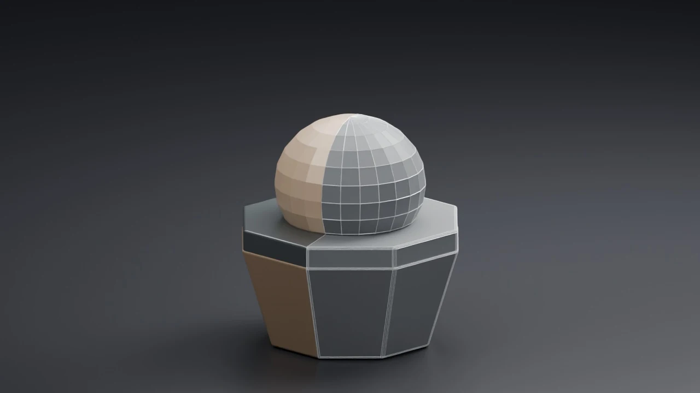

---

group: "glb-vs-usdz"
title: "GLB ou USDZ pour le web et la RA sur Apple ?"
description: "Choisissez GLB pour le navigateur ou USDZ pour Apple Quick Look et vérifiez les deux vues avec le même produit."
date: 2026-12-10
updated: 2026-12-10
keyword: "GLB vs USDZ"
cta: "Vérifiez les angles de votre produit dans l’aperçu gratuit."
---

Utilisez un GLB comme point de départ pour un modèle interactif dans un navigateur et un USDZ lorsque vous avez besoin d’Apple Quick Look. Proposez les deux formats si la même page propose ces deux expériences. Testez les fichiers séparément sur les appareils cibles et comparez l’orientation, les matériaux et le chemin de retour vers la page de produit.

## Quel fichier est nécessaire pour chaque composante de la page ?

| Destination                     | Fichier typique  | Vérification                             |
| ------------------------------- | ---------------- | ---------------------------------------- |
| Visualiseur de produit en ligne | GLB              | Se charge et se tourne avec des textures |
| Apple Quick Look                | USDZ             | Ouvre sur un appareil compatible         |
| Appareil non compatible         | Photo ou affiche | L’information produit reste utilisable   |

## Comment vérifier la correspondance ?

Nommez les deux fichiers pour la même référence SKU et version. Ouvrez le GLB dans le visualiseur en ligne et utilisez l’action de la page pour ouvrir le USDZ sur un appareil Apple. Comparez le fini sous lumière neutre et confirmez que vous retournez à la même variante.

## Qu’est-ce qu’il faut vérifier avant de publier ?

| Problème                                           | Vérification                                                |
| -------------------------------------------------- | ----------------------------------------------------------- |
| Visualiseur en ligne fonctionne, Quick Look échoue | URL de livraison USDZ et appareil                           |
| La couleur semble différente                       | Matériel et éclairage de l'environnement                    |
| La variante incorrecte s'affiche                   | Les deux références d'actif sont présentes sur le SKU actif |

<!-- IMAGE PENDING: Photograph or capture the example described in the brief. -->

**Source** [Khronos · spécification glTF 2.0](https://registry.khronos.org/glTF/specs/2.0/glTF-2.0.html), [OpenUSD · spécification USDZ](https://openusd.org/release/spec_usdz.html), [Apple · Quick Look](https://developer.apple.com/quick-look-gallery/), [model-viewer · documentation](https://modelviewer.dev/docs/).

[Guide associé](/learn/usdz-file)

[Comment créer un modèle 3D](/learn/how-to-make-a-3d-model)

## Questions fréquentes

### Une page peut utiliser les deux formats ?

Vous pouvez utiliser à la fois GLB et USDZ sur une page en fournissant chaque format à son destination respectives et en vérifiant les contrôles visibles. Conservez une image statique pour les utilisateurs qui ne peuvent pas utiliser le lecteur. Vérifiez les tailles des fichiers et les temps de chargement dans les environnements web et AR d'Apple.

### Est-ce que GLB est un format pour tous les lecteurs AR ?

GLB est un format supporté par les visualiseurs en ligne mais pas par tous les lecteurs AR. Ouvrez le GLB dans le visualiseur et vérifiez qu’il se charge avec des textures. Un appareil non compatible ou un mauvais URL peut empêcher l’ouverture du USDZ.

### Dois-je comparer uniquement les tailles des fichiers ?

Utilisez un GLB pour le visualiseur en ligne et un USDZ pour Apple Quick Look. Nommez les fichiers avec le même SKU et version pour garantir la correspondance. Vérifiez que le modèle se tourne dans le GLB et s’ouvre sur l’appareil avec le USDZ, sans erreur de couleur ou de variante.
