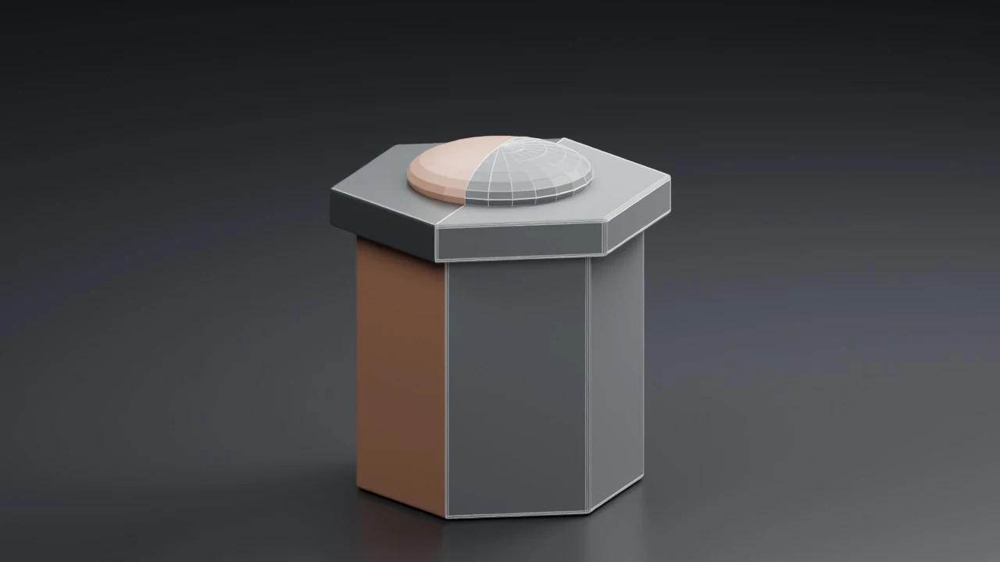
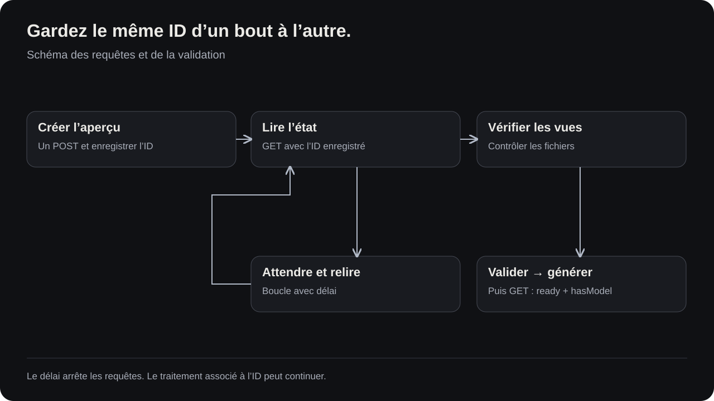

---

group: "n8n-image-to-3d-workflow"
title: "Intégrer la conversion d’images en 3D dans n8n"
description: "Connectez n8n à une API de conversion d’images en 3D 3D. Créez une prévisualisation, enregistrez l’ID de tâche, validez la génération et téléchargez…"
date: 2026-11-26
updated: 2026-11-26
keyword: "image vers 3D n8n"
cta: "Vérifiez les angles de votre produit dans l’aperçu gratuit."
---

Pour créer un modèle 3D à partir d’une image dans n8n, lancez l’aperçu avec un nœud HTTP Request et enregistrez l’identifiant de la tâche. Vérifiez les vues avant d’autoriser la génération payante et de télécharger le GLB. En cas de délai dépassé, reprenez la tâche existante.

> **Enregistrez l’ID avant d’ajouter l’automatisation.** Si vous connaissez l’identifiant de la tâche associée à l’image, vous pouvez la reprendre. Si le seul enregistrement est une cellule vide, un redémarrage pourrait engendrer un travail inutile.

## Quel méthode de connexion devriez-vous choisir ?

Utilisez REST lorsque la séquence est fixe. Utilisez un agent lorsque quelqu’un doit interpréter une requête ou choisir parmi des outils. Un nœud commun peut simplifier la mise en place, mais il ne doit pas déterminer si vous pouvez mettre en œuvre un flux complet.

| Méthode                       | Meilleure adaptation                                | Vérifiez avant de choisir                                       |
| ----------------------------- | --------------------------------------------------- | --------------------------------------------------------------- |
| Request HTTP intégré          | Séquence explicite avec entrées et sorties visibles | Credentials, forme du corps et branches de statut               |
| Nœud commun                   | Opérations prises en charge avec un setup simplifié | Disponibilité d’installation et couverture d’opération          |
| Client MCP attaché à un agent | Requêtes nécessitant le choix d’un outil            | Support de transport, outils autorisés et contrôles de dépenses |

Ce guide utilise le [nœud HTTP Request](https://docs.n8n.io/integrations/builtin/core-nodes/n8n-nodes-base.httprequest/) et le [contrat REST d’easyrender](/image-to-3d-api). Vous pouvez suivre le flux avec les nœuds intégrés. Pour choisir les actions par conversation, consultez le [guide sur l’agent n8n et MCP](/fr/guides/client-mcp-n8n).

## Qu’est-ce que vous devez avoir avant d’ajouter le premier nœud ?

Choisissez une photo claire d'un ventilateur de bureau. L'API accepte des JPEG, PNG ou WebP jusqu'à 4 MiB. Pour une image publique HTTPS, utilisez `image_url` . Pour un fichier local ou privé, téléchargez-le via l'endpoint de fichier authentifié et utilisez son `upload_id` à la place.

Créez une clé API dans Connectors. Un workflow de prévisualisation nécessite `write` pour être créé et `read` pour être inspecté. Ajoutez uniquement `spend` à l'identifiant de connexion utilisé pour une opération payante approuvée. Enregistrez la clé comme credentiel d'authentification d'en-tête dans n8n : `Authorization` est le nom de l'en-tête et `Bearer YOUR_API_KEY` est sa valeur.

| Valeur à sauvegarder  | Exemple                     | D'où provient cette valeur                          |
| --------------------- | --------------------------- | --------------------------------------------------- |
| Enregistrement source | `FAN-DESK-01`               | Votre catalogue                                     |
| Révision de la photo  | `front-v1`                  | Votre gestion des sources                           |
| Clé de création       | `FAN-DESK-01-front-v1`      | Clé stable pour ce type d'entrée spécifique         |
| `render_id`           | `id` retourné effectivement | Réponse de prévisualisation                         |
| Plafond d'approbation | Un entier approuvé          | Le montant actuel de la demande plus votre décision |

L'URL de la photo doit pointer vers les mêmes octets pendant un retry. Si la source change, créez une nouvelle révision de manière intentionnelle. Avant de tester le connecteur, utilisez le [guide de préparation de la photo](/learn/how-to-make-a-3d-model-from-photos) pour éliminer les problèmes d'entrée évitables.

## Étape 1 : comment créer une prévisualisation ?

Ajoutez un déclencheur manuel et un nœud de modification de champs pour votre enregistrement source. Configure ensuite la première requête HTTP comme suit. Associez l'URL de votre photo accessible à l'entrée image.

| Paramètres de requête HTTP | Valeur                                                          |
| -------------------------- | --------------------------------------------------------------- |
| Méthode                    | `POST`                                                          |
| URL                        | `https://easyrender.ai/api/renders`                             |
| Authentication             | Votre credential d'authentification par en-tête                 |
| En-tête                    | `Idempotency-Key` avec la clé de création enregistrée           |
| Type de contenu du corps   | JSON                                                            |
| Champ du corps             | `image_url` mappé à partir du enregistrement source             |
| Champ du corps             | `name` mappé à partir du nom du produit                         |
| Champ du corps             | `isPublic` défini comme boolean `false`                         |
| Format de réponse          | JSON . Le corps uniquement pour les chemins de champ ci-dessous |

Enregistrez la valeur retournée `id` avant de continuer. Avec les en-têtes/statuts désactivés, c’est la valeur `id` du corps de réponse. Si vous activez l’option réponse complète, adaptez les mappages à `body.id` . Ne mélangez pas les deux formes de réponse entre les nœuds.

La clé de création est 1–128 : caractères ASCII imprimables sans espaces. L’utilisation de la même clé avec un enregistrement d’entrée identique permet de récupérer le même rendu . Un changement d’entrée entraîne un conflit. Ce contrat d’idempotence s’applique à la création de prévisualisation, pas à chaque POST dans le service. Gardez-la stable après une réponse perdue.

## Étape 2 : comment attendre sans relancer ?

Ajoutez un [nœud d'attente](https://docs.n8n.io/integrations/builtin/core-nodes/n8n-nodes-base.wait/) avec un intervalle de temps, suivi de `GET https://easyrender.ai/api/renders/{saved_render_id}`. Un intervalle de 15 secondes et un délai de workflow de 20 minutes sont des paramètres initiaux raisonnables pour tester, pas des temps de génération garantis. Enregistrez le délai avant d’entrer dans la boucle.

| État retourné                       | Branchement du workflow                                     |
| ----------------------------------- | ----------------------------------------------------------- |
| `drafting`                          | Attente, puis GET l’ID existant                             |
| `preview_ready`                     | Arrêtez la boucle de prévisualisation et demandez un examen |
| `rendering`                         | Continuez le polling limité de la build autorisée           |
| `ready` et `hasModel=true`          | Téléchargez le modèle                                       |
| `failed`                            | Enregistrez l'erreur et arrêtez cette tentative             |
| Deadline atteinte ou état inattendu | Enregistrez l'ID et l'état pour la réconciliation           |

Consultez la rendu individuelle, pas uniquement l'endpoint de liste. Le [contrat API](https://github.com/easyrenderai/easyrender.ai/blob/main/docs/api.md) précise que la liste ne déplace pas les tâches. Un URL présent dans une réponse n'est pas preuve que l'artefact correspondant est prêt.

## Étape 3 : qu'est-ce exactement que le reviseur doit approuver ?

Ouvrez le lecteur propriétaire à `https://easyrender.ai/r/{saved_render_id}`. Vérifiez `hasSheet` avant de marquer une image comme feuille d'angle : l'asset de prévisualisation peut encore être la photo source. Si vous demandez une feuille payante ou une révision, autorisez-la séparément et conservez son coût dans le même enregistrement produit.

Rafraîchissez la rendu et `GET /api/credits`. Associez la décision à l'ID de rendu, à la révision source et aux crédits autorisés. Le solde de la build reste à `max(0, renderCredits - credits)`, plutôt qu'un prix fixe supposé copié dans le workflow.

Après l'approbation, envoyez `POST https://easyrender.ai/api/renders/{saved_render_id}/render` avec le champ JSON `maxCredits` défini sur l'entier autorisé. Un délai ou une approbation rejetée doit être envoyé dans une branche d'arrêt. Ne reliez pas ces conditions à l'action payante par défaut.

<!-- IMAGE PENDING: unique screenshot of HTTP Request settings and a credential-free status output from a real n8n run. -->

## Étape 4 : comment télécharger le GLB ?

Après `ready` et `hasModel=true`, demandez `/api/renders/{saved_render_id}/model?download=1` avec les credentials propriétaire. Sélectionnez une réponse de fichier et un champ de sortie comme `model`. Envoyez cette sortie binaire à votre étape de stockage ou de téléchargement commercial.

La [référence du format Khronos](https://www.khronos.org/gltf/) explique pourquoi GLB est adaptée pour livrer un modèle. Prévoyez trois destinations distinctes : la page d'aperçu du propriétaire, l'endpoint de téléchargement authentifié et le fichier uploadé dans votre boutique. Ces liens ne sont pas interchangeables.

Les URLs de modèles privés nécessitent une authentification. Pour Shopify, utilisez la séquence d'upload et de traitement de média [précisée par Shopify](https://shopify.dev/docs/apps/build/product-merchandising/products-and-collections/manage-media) après avoir téléchargé le fichier. Ne mettez jamais une clé API dans une URL pour la rendre accessible à la boutique.

## Quels échecs devez-vous gérer explicitement ?

| Symptôme                     | Cause à vérifier                                         | Rétablissement                                                                      |
| ---------------------------- | -------------------------------------------------------- | ----------------------------------------------------------------------------------- |
| HTTP 401                     | Clé erronnée, expirée ou révoquée                        | Corrigez les identifiants . Conservez l'ID de la tâche                              |
| HTTP 403                     | Portée manquante ou limite de clé épuisée                | Examinez le code d'erreur et les limites de clé autorisées                          |
| HTTP 402                     | Solde insuffisant de crédits de compte                   | Arrêtez les dépenses et demandez une décision de budget                             |
| HTTP 409 lors de la création | Clé réutilisée avec un input différent                   | Recouvrez la requête précédente ou versionnez intentionnellement la nouvelle source |
| HTTP 429                     | Limite de vitesse/limites de concurrence                 | Lisez `Retry-After` et reportez la prochaine requête                                |
| Un POST payant expire        | Résultat inconnu                                         | Vérifiez la tâche enregistrée . Ne la répétez pas de manière automatique            |
| Le fichier contient du JSON  | La réponse d'erreur est enregistrée sous forme de modèle | Vérifiez l'état et le type de contenu avant le stockage                             |

Pour le pacing, [n8n documente la gestion des limites de vitesse](https://docs.n8n.io/integrations/builtin/handle-rate-limits.md). Évitez les tentatives de rétention générale sur les nœuds payants. Les lectures sécurisées et les mutations incertaines nécessitent des chemins de récupération différents, même si les deux affichent un marqueur rouge d'exécution.

## Comment testez-vous le flux avant d'utiliser un catalogue ?

Testez d'abord la lecture des credentials et la création d'un aperçu avec une seule photo. Vérifiez que le enregistrement contient l'ID retourné et que le redémarrage avec la même clé de création ne génère pas un autre rendu. Arrêtez-vous à la revue jusqu'à ce que vous ayez un budget explicite pour la génération.

Ensuite, vérifiez les branches en utilisant des fixtures de réponse représentatives : `drafting`, `preview_ready`, `ready`, `failed` et une erreur de limite de vitesse. Les vérifications avec des fixtures valident votre routage, pas le service de rendu en direct. Un dernier test authentifié reste nécessaire pour prouver que le flux complet configuré dans n8n fonctionne.

Le schéma déployé a été vérifié pour ce guide . Aucun run payant n'a été utilisé pour affirmer un temps de complétion ou un taux de réussite. Concernant les choix de méthodes sous-jacents, voir [comment créer un modèle 3D](/learn/how-to-make-a-3d-model). Étendez à des lots uniquement après qu'un modèle accepté ait atteint sa destination cible.

## Questions fréquentes

### La création d'un rendu déclenche-t-elle également un modèle payant ?

La création d'un rendu ne déclenche pas le modèle payant. La création d'un aperçu retourne un ID de rendu et démarre la phase aperçu . Le build 3D payant est une action séparée, soumise à une autorisation distincte. Enregistrez l'ID, vérifiez le résultat disponible, et confirmez le coût avant de procéder à la suspension du workflow sans perdre de progrès.

### Puis-je utiliser une photo qui n'est pas publiquement hébergée ?

Oui. Envoyez le fichier à l'endpoint d'upload authentifié, puis utilisez l'ID d'upload retourné comme source d'aperçu. Ce référentiel est lié à l'owner et expire après une heure, donc créez le rendu dans ce délai et enregistrez son ID de rendu distinct pour une vérification ultérieure.

### Reçoit n8n immédiatement le modèle final ?

Non. La création et la génération retournent des informations de tâche pendant le traitement. Poller l'ID de rendu enregistré et exiger à la fois un état prêt et la disponibilité du modèle avant de télécharger. Si votre workflow atteint sa limite de temps, conservez la tâche pour des vérifications ultérieures, plutôt que de considérer la limite comme une preuve de défaillance.

### Puis-je automatiser les téléchargements de USDZ avec le même endpoint ?

L'endpoint du modèle dans cette recette retourne un GLB. Le contrat REST ne définit pas un endpoint de conversion en USDZ, donc l'ajout d'une extension de fichier à l'URL ne créera pas ce rendu. Utilisez le flux d'exportation supporté par le lecteur ou une étape de conversion testée séparément lorsque votre destination nécessite spécifiquement un USDZ.
