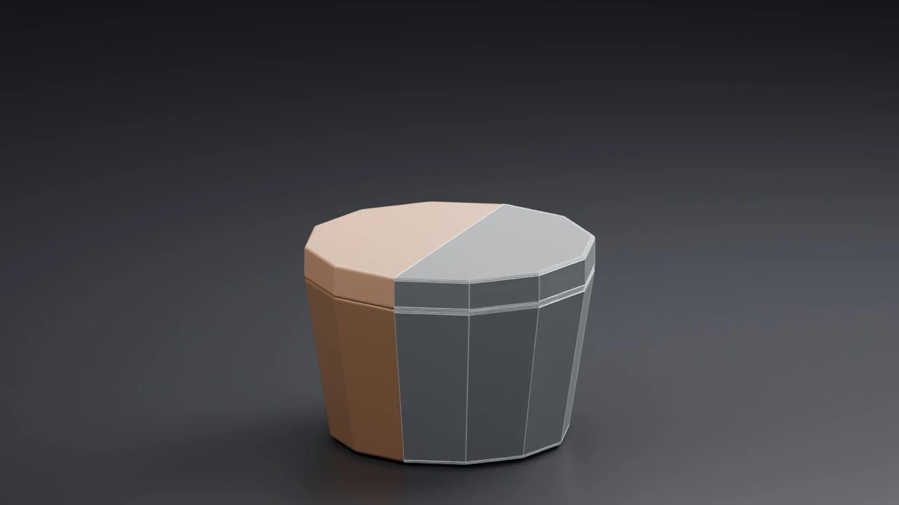
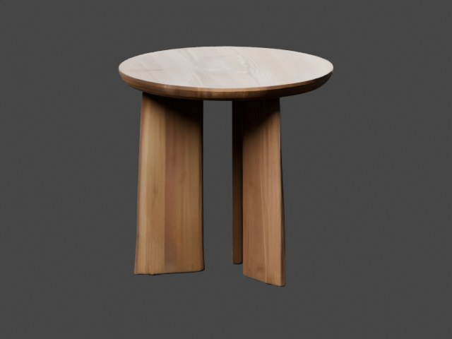

---

group: "low-poly-vs-high-poly"
title: "Low poly ou high poly pour un visualiseur produit ?"
description: "Choisissez la détails de maillage en fonction de la distance de la caméra, de la silhouette et du dispositif cible, et non d'un seuil de triangles."
date: 2026-12-16
updated: 2026-12-16
keyword: "low poly vs high poly"
cta: "Vérifiez les angles de votre produit dans l’aperçu gratuit."
---

Choisissez le low poly si le produit a une silhouette simple et un seul matériau. Comparez deux versions à la taille réelle avec le même cadre et appareil. Le mistake courant est de garder trop de triangles pour les détails de surface sans vérifier la silhouette en profil.

## Quels détails doivent rester en géométrie ?

Gardez les bords des pieds de chaise, les ouvertures des poignées et le bord d'un récipient si ces éléments influencent la silhouette ou la parallaxe. Appliquez une peinture ou un baking pour les graines de surface lorsque celles-ci ne modifient pas le contour. Vérifiez également les bords en ombre et les réflexions, ainsi que le maillage.

## Comment choisir un cible ?

Notre table de café publique a 16,228 triangles et notre table de chevet a 69,910.. Les deux possèdent un seul matériau. Ces sont deux objets différents, donc aucun de ces nombres n'est un budget universel. Pour une décision, comparez deux exports de l'objet même, avec le même cadre, le même matériau et le même appareil.

## Qu'est-ce qu'il faut vérifier avant de publier ?

| Où cela compte         | Garder ou tester                                 |
| ---------------------- | ------------------------------------------------ |
| Silhouette externe     | Vérifiez le contour en face et en profil         |
| Matériel et ouvertures | Conservez les espaces réels et les intersections |
| Grain de surface       | Testez les détails de texture au zoom serré      |

<!-- IMAGE PENDING: Photograph or capture the example described in the brief. -->

**Source** [Blender · Modificateur Decimate](https://docs.blender.org/manual/en/latest/modeling/modifiers/generate/decimate.html), [Khronos · spécification glTF 2.0](https://registry.khronos.org/glTF/specs/2.0/glTF-2.0.html), [model-viewer · documentation](https://modelviewer.dev/docs/).

[Guide associé](/fr/guides/fichier-glb)

[Comment créer un modèle 3D](/learn/how-to-make-a-3d-model)

## Questions fréquentes

### Y a-t-il une limite standard de basse poly ?

Fixez une limite de polygone basé sur votre page cible, la caméra et les spécifications du dispositif. Testez la vitesse de chargement et de rotation sur les appareils supportés . Vérifiez le taux de cadence et le temps de chargement des textures pour une interaction fluide. Vérifiez les performances sur le dispositif le moins performant de votre public cible.

### Qu'est-ce que je devrais simplifier en premier ?

Commencez par les zones cachées ou les surfaces planes avec trop de triangles. Sélectionnez une zone à réduire, exportez deux versions avec même cadre et appareil. Vérifiez la silhouette en face et en profil pour éviter de perdre la forme.

### Un map normal sauve-t-il les détails de la silhouette ?

Utilisez un map normal pour les détails superficiels . Il ne sauve pas les détails de la silhouette. Gardez la géométrie de base où la forme modifie l'outline ou crée une ouverture visible. Vérifiez que la silhouette du modèle à faible polygone reste nette et visible dans le lecteur 3D.
