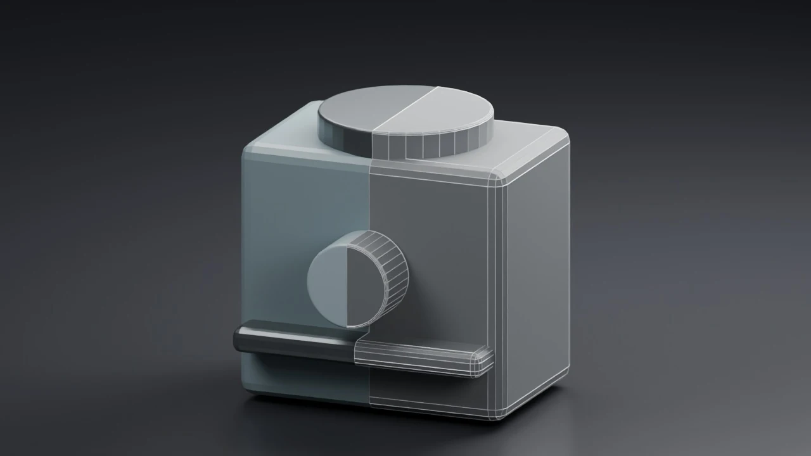

---

group: "best-ai-3d-model-generators"
title: "Quel générateur de modèles 3D par IA essayer ?"
description: "Choisissez quel générateur IA 3D tester pour un produit, une conception ou un actif éditable et comparez avec un seul input."
date: 2026-12-17
updated: 2026-12-17
keyword: "meilleurs générateurs 3D IA"
cta: "Vérifiez les angles de votre produit dans l’aperçu gratuit."
---

Choisissez votre générateur de modèles 3D par IA selon le fichier que vous devez livrer. Vérifiez la source acceptée, le format d’export et les possibilités de contrôle. Faites un essai avec des objets identiques pour comparer les résultats et le travail de retouche.

## Quels outils conviennent pour un premier test ?

| Tâche                                                  | Liste de candidats à examiner       | Première vérification                                   |
| ------------------------------------------------------ | ----------------------------------- | ------------------------------------------------------- |
| Prévisualisez un produit avant de construire le modèle | EasyRender                          | Comparez le prélude de vue avec des photos de référence |
| Comparez la génération basée sur des photos            | Meshy, Tripo ou Rodin               | Options d'entrée et détails produits visibles           |
| Transférez le modèle à une autre application           | Quel outil de la liste de candidats | Téléchargez et réouvrez le format requis                |

## Comment comparer les candidats de manière équitable ?

Utilisez un objet simple et un autre plus complexe avec des parties fines ou un ouverture visible. Gardez les photos sources et enregistrez ce que chaque tentative a utilisé. Enregistrez une vue avant, côté et arrière commune, puis inspectez les textures et les ouvertures dans votre outil cible.

Enregistrez si le fichier final est disponible dans le plan utilisé. Calculez le nombre d'essais, le temps de révision et le temps de nettoyage par élément approuvé. Le [registre de test Meshy et Tripo](/benchmarks/2026-11-15/measurements.json) indique les paramètres et mesures à capturer.

## Qu'est-ce qu'il faut vérifier avant de publier ?

| Besoin                             | Test d'acceptation                                                               |
| ---------------------------------- | -------------------------------------------------------------------------------- |
| Préservé l'identité du produit     | Vérifiez l'alignement, le nombre de pièces et le fini par rapport aux références |
| Remettez le travail à un modéliste | Ouvrez l'export avec ses matériaux                                               |
| Assurez une livraison cohérente    | Répétez sur un élément plus complexe                                             |

<!-- IMAGE PENDING: Photograph or capture the example described in the brief. -->

**Source** [Meshy · image to 3D](https://docs.meshy.ai/en/webapp/image-to-3d), [Tripo · image to 3D](https://developers.tripo3d.com/en/docs/generation-image-to-model/standard), [Hyper3D · Rodin](https://docs.hyper3d.ai/en/api-specification/rodin-gen2-5), [Khronos · glTF 2.0 specification](https://registry.khronos.org/glTF/specs/2.0/glTF-2.0.html).

[Guide complémentaire](/fr/comparatifs/tripo)

[Comment créer un modèle 3D](/learn/how-to-make-a-3d-model)

## Questions fréquentes

### Puis-je me baser sur une galerie de démos ?

Utilisez une galerie de démos pour tester des modèles 3D avant de choisir. Comparez le prélude de vue avec des photos de référence pour valider la qualité. Erreur courante : oublier de vérifier l’ouverture ou les textures dans l’outil cible.

### Dois-je tester une version gratuite ou payante ?

Vérifiez séparément les fonctionnalités de génération, d'exportation et d'utilisation. Comparez des exécutions avec des paramètres documentables. Un aperçu et un fichier utilisable sont des résultats différents.

### Sont deux produits de test suffisants ?

Testez EasyRender pour prévisualiser un produit avant de construire le modèle. Comparez le prélude de vue avec des photos de référence pour valider la fidélité. Un oubli fréquent est de négliger les détails d’ouverture ou de texture dans la comparaison.
