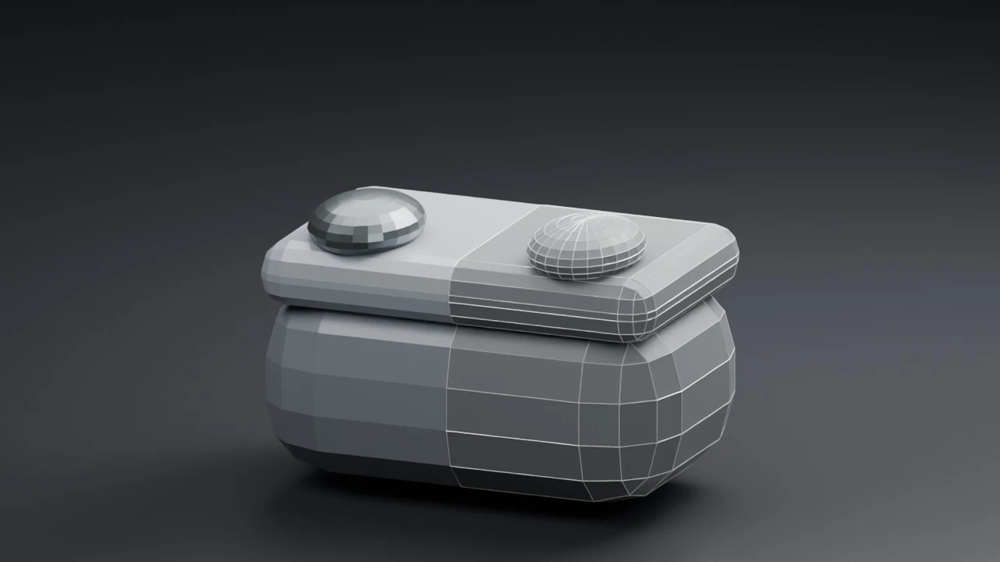
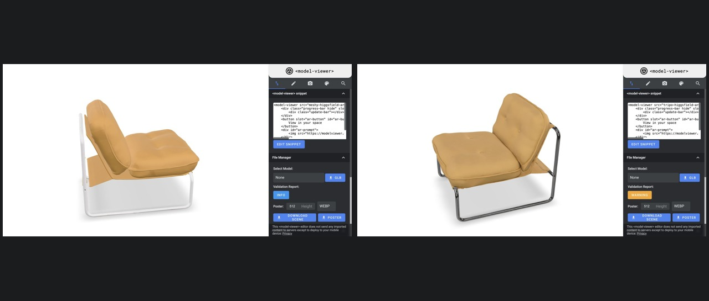

---

group: "meshy-vs-tripo"
title: "Meshy ou Tripo pour vos photos produit ?"
description: "Comparez Meshy et Tripo sur la même photo de produit. Vérifiez les silhouettes, les détails, les matériaux et ce que vous pouvez exporter."
date: 2026-11-23
updated: 2026-11-23
keyword: "Meshy vs Tripo"
cta: "Vérifiez les angles de votre produit dans l’aperçu gratuit."
publishAt: "2026-11-23"
---

Comparez Meshy et Tripo avec la même photo de produit non cropée, puis évaluez le résultat selon la vue que vous avez réellement besoin. Pour un modèle de boutique, vérifiez d'abord la silhouette et l'arrière avant d'évaluer le rendu. La décision repose sur le fichier exporté si votre prochain pas est Shopify, Blender ou un autre lecteur.

## Dans quel cas choisir Meshy ou Tripo ?

- **Commencez par Meshy** si vous voulez comparer une photo et plusieurs vues directement dans l’application web. Placez d’abord la vue de face, puis ajoutez jusqu’à trois photos de la même finition. [Guide Meshy sur les images sources](https://docs.meshy.ai/en/webapp/image-to-3d).
- **Commencez par Tripo** si votre flux distingue déjà les vues de face, de dos et de côté, ou si vous devez retoucher un maillage en quadrilatères. L’API accepte des vues nommées et propose un modèle à topologie native en quadrilatères. [API multivue Tripo](https://developers.tripo3d.com/en/docs/generation-multiview-to-model/standard), [modèle Tripo P2](https://developers.tripo3d.com/en/models/p2).

Avec une seule photo et un GLB à livrer, ouvrez les deux fichiers dans le même visualiseur avant de choisir. Regardez d’abord le dos, les pièces fines et les matériaux.

## Quel facteur ferait de ce outil la meilleure option ?

| Si la tâche est…                             | Prenez votre décision sur…                                   |
| -------------------------------------------- | ------------------------------------------------------------ |
| Affichez le produit sous un autre angle      | Silhouette, ouvertures et pieds reconnaissables              |
| Correspondre à un rendu de catalogue         | Continuité de texture et détails visibles dans la photo      |
| Transférer un modèle à une autre application | Résultat réel, taille du fichier et résultat après ouverture |
| Maintenir les coûts de production bas        | Crédits et temps d'édition par modèle accepté                |

## Quels éléments avons-nous mesurés à partir de la même photo ?

Nous avons envoyé la même photo d'un canapé à Meshy et à Tripo sur 15 en novembre et avons ouvert les deux fichiers dans le même lecteur externe. Les exécutions ont utilisé des crédits Higgsfield déjà disponibles sur le compte. Les paramètres enregistrés diffèrent en matière de PBR et de gestion de la texture.

| Fichier GLB enregistré |    Octets | Triangles | PBR activé |
| ---------------------- | --------: | --------: | ---------- |
| Meshy 7                | 2,824,116 |    27,415 | Non        |
| Tripo H3.1             | 3,846,052 |    27,067 | Oui        |

Traitez le tableau comme un enregistrement de ces deux fichiers. Pour une décision d'achat fondée sur le maillage, la fidélité du matériau ou la vitesse, exécutez les deux outils avec des paramètres identiques et utilisez la même caméra. [Ouvrez l'enregistrement de mesure](/benchmarks/2026-11-15/measurements.json)

## Comment reproduire cette comparaison ?

Utilisez une photo avec un référent en arrière-plan ou en profile pour la revue. Enregistrez la date, le mode, la révision et le nombre d'images d'entrée pour les deux outils. Capturer les mêmes angles face, arrière et côté.

Marquez chaque critère comme confirmé, incertain ou erroné. Si un export est disponible, ouvrez-le dans un lecteur séparé et notez les paramètres du lecteur. Considérez l'accès au fichier comme un critère distinct.

## Qu'est-ce que vous devez vérifier avant de publier ?

| Examinez                       | Enregistrez                                          |
| ------------------------------ | ---------------------------------------------------- |
| La silhouette face et latérale | Où l'alignement diverge                              |
| L'arrière et le dessous        | Quels éléments structurels pourraient être confirmés |
| Export                         | Si le fichier a été ouvert avec des textures         |

**Source** [Meshy · image à 3D](https://docs.meshy.ai/en/webapp/image-to-3d), [Tripo · image à 3D](https://developers.tripo3d.com/en/docs/generation-image-to-model/standard), [Khronos · spécification glTF 2.0](https://registry.khronos.org/glTF/specs/2.0/glTF-2.0.html)

[Guide complémentaire](/fr/comparatifs/meshy)

[Comment créer un modèle 3D](/learn/how-to-make-a-3d-model)

## Questions fréquentes

### Quel outil devrais-je essayer en premier ?

Commencez par Meshy si vous devez transférer un modèle à une autre application. Testez le résultat réel en ouvrant le fichier GLB dans un lecteur externe. Un mauvais contrôle des triangles ou du PBR peut masquer des défauts de texture.

### Peux-je comparer un écran avec un modèle exporté ?

Utilisez les écrans pour ce qui est visible dans chaque service. Réservez les jugements sur la structure du maillage, les cartes de matériaux et la compatibilité en aval aux fichiers que vous pourriez inspecter séparément. Capturez les mêmes angles face, arrière et côté pour comparer fidèlement les résultats des deux outils.

### Qu'est-ce qu'un image d'entrée équitable ?

Donnez à chaque outil l’image identique à la même taille. Enregistrez une vue de référence pour évaluer le rendu en retour lorsque vous l’avez. Effectuez un essai séparé si vous souhaitez également comparer un entrée multi-vue.
