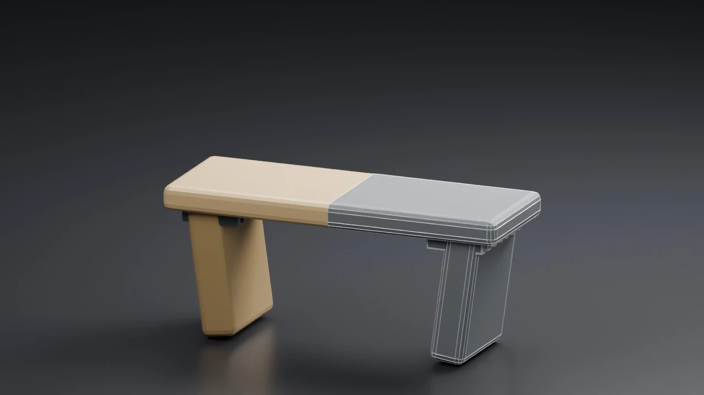
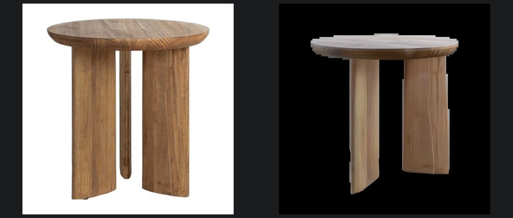

---

group: "furniture-model-from-photo"
title: "Créer un modèle 3D de meuble depuis une photo"
description: "Préparez une photo de meuble, vérifiez les angles générés et inspectez le modèle avant de l'utiliser dans un catalogue."
date: 2026-11-27
updated: 2026-11-27
keyword: "modèle 3D de meuble depuis une photo"
cta: "Vérifiez les angles de votre produit dans l’aperçu gratuit."
---

Commencez par une photo nette montrant le côté frontal, un côté latéral et les pieds du meuble. Examinez les angles générés pour les parties caractéristiques avant de construire le modèle. Après l’exportation, ouvrez séparément le GLB réel et vérifiez la silhouette, les surfaces et les détails à l’échelle que les acheteurs verront.

## Quelle image devez-vous utiliser en premier ?

Utilisez une vue en trois-quarts avec le meuble isolé. Laissez de l’espace sous les pieds et évitez les objets qui cachent l’emprise. Verrouillez l’exposition afin qu’un plan de table lumineux conserve des détails et que les éléments en métal sombres restent visibles. Conservez des photos réelles des surfaces restantes pour vérification.

## Comment acceptez-vous le modèle ?

Comparez la prévisualisation avec la source et vos vues de référence. Comptez les pieds, les poignées et les ouvertures. Ouvrez le modèle généré, tournez-le et vérifiez les joints et le dessous. Notre GLB public de table de cuisine comporte des triangles 16,228 et nécessite 322,876 bytes. Mesurez votre fichier contre le budget de destination.

## Qu’est-ce que vous devez vérifier avant de le publier ?

| Vérifiez                        | Acceptez lorsque                                    |
| ------------------------------- | --------------------------------------------------- |
| Le nombre de pièces est correct | Les parties visibles correspondent à la référence   |
| Fin du modèle                   | Le produit reste reconnaissable sous lumière neutre |
| Exportation                     | Le fichier s’ouvre dans le lecteur prévu            |

**Source** [Khronos · spécification glTF 2.0](https://registry.khronos.org/glTF/specs/2.0/glTF-2.0.html), [Khronos · validateur glTF](https://github.com/KhronosGroup/glTF-Validator), [Shopify · création de modèles 3D](https://help.shopify.com/en/partners/manage-clients-stores/creating-media/3d-models/creating-3d-models).

[Guide associé](/learn/how-to-make-a-3d-model-from-photos)

[Comment créer un modèle 3D](/learn/how-to-make-a-3d-model)

## Questions fréquentes

### Dois-je photographier le dos séparément ?

Le conservez comme référence si le dos comporte des éléments importants. Un angle généré est une prédiction. Utilisez des photos physiques pour les détails qui doivent être confirmés.

### Qu’est-ce que je fais si un pied fin est intégré dans l’arrière-plan ?

Si une patte fine s'efface dans l'arrière-plan, adaptez l'arrière-plan ou la luminosité pour définir son bord. Gardez une distance de prise de vue suffisante pour capturer l'ensemble de l'objet lorsque les pattes s'écartent. Ensuite, vérifiez que le bord de la patte est clairement visible dans la photo avant de modéliser.

### Quel fichier dois-je envoyer à l'atelier ?

Commencez par le format accepté par la destination. Testez le fichier transféré lui-même et conservez les photos de référence ainsi que la version modifiable d'origine. Envoyez le fichier GLB du modèle 3D avec les photos de référence du dos, en veillant à ce que les pieds et les détails soient clairement visibles.
