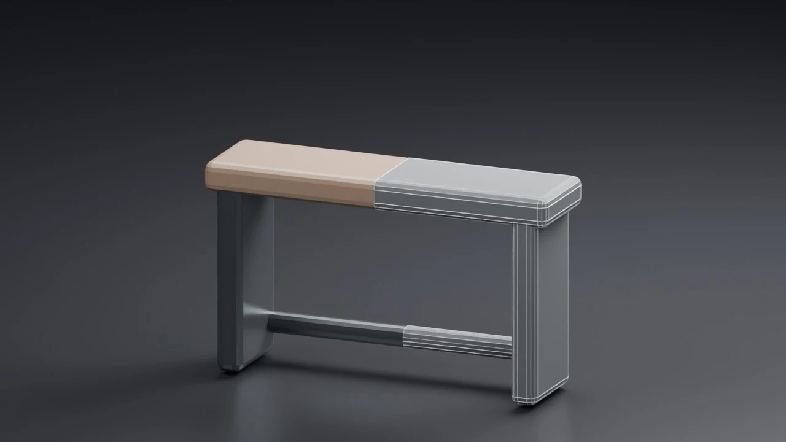
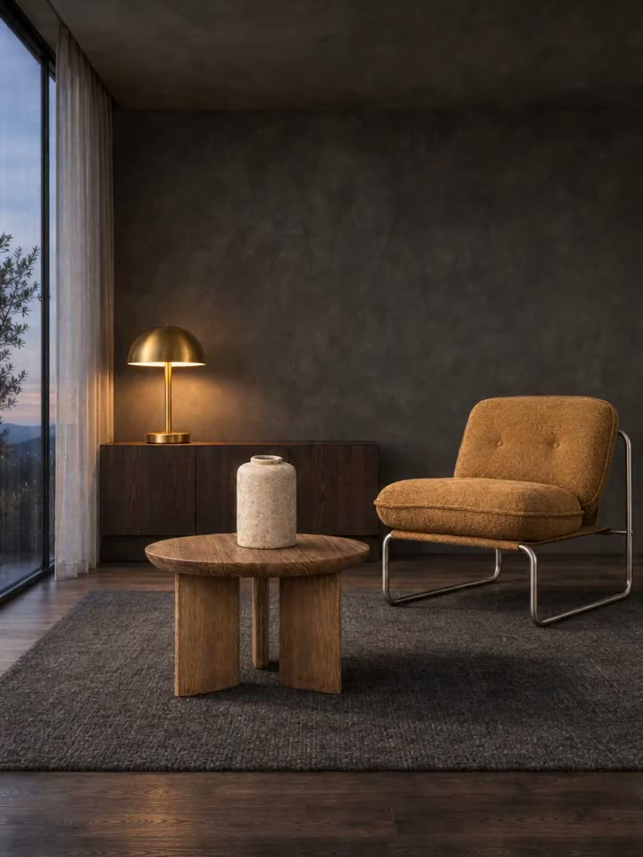

---

group: "3d-furniture-models-home-staging"
title: "Placer des meubles 3D dans une scène de home staging"
description: "Placer un modèle de meuble existant dans une scène de pièce, puis vérifiez la proportion, le contact avec le sol et l’éclairage."
date: 2026-12-08
updated: 2026-12-08
keyword: "modèles 3D meubles home staging"
cta: "Vérifiez les angles de votre produit dans l’aperçu gratuit."
---

Ajoutez un modèle de meuble à une scène de pièce existante en vérifiant d'abord son orientation et son point d'origine. Utilisez des dimensions indépendamment validées pour le positionner dans l'éditeur. Adaptez la lumière, placez l'objet sur le sol et vérifiez la scène depuis la caméra finale et une vue secondaire.

## Comment préparez-vous l'objet ?

Ouvrez une copie dans votre éditeur de scène. Vérifiez la direction considérée comme avant et assurez-vous que le point d'origine rend la position prévisible. Fixez les unités selon le cahier des charges du projet et utilisez les spécifications mesurées du produit lorsque la précision dimensionnelle est cruciale.

## Comment faites-vous pour que la mise en scène semble réaliste ?

Placez le meuble avec un objet neutre ou de référence pour évaluer la proportion. Adaptez la direction de la lumière et vérifiez les contacts depuis la caméra. Rotatif la vue pour confirmer qu'il ne traverse pas les murs ni les meubles voisins. Enregistrez l'objet isolé comme un actif pour les variantes.

## Quelles vérifications devez-vous effectuer avant la publication ?

| Problème                         | Solution                                                                   |
| -------------------------------- | -------------------------------------------------------------------------- |
| Le meuble semble flotter         | Vérifiez la face inférieure et l'ombre de contact                          |
| Le meuble overlap un mur         | Vérifiez la position depuis le haut                                        |
| La scène ressemble à un showroom | Utilisez des accessoires qui soutiennent le décor sans masquer les preuves |

<!-- IMAGE PENDING: Photograph or capture the example described in the brief. -->

**Source** [Blender · Asset Browser](https://docs.blender.org/manual/en/latest/editors/asset_browser.html), [Blender · units](https://docs.blender.org/manual/en/latest/scene_layout/scene/properties.html#units), [Khronos · glTF 2.0 specification](https://registry.khronos.org/glTF/specs/2.0/glTF-2.0.html).

[Bibliothèque de modèles (EN)](/models)

[Comment créer un modèle 3D](/learn/how-to-make-a-3d-model)

## Questions fréquentes

### Peux-je utiliser un modèle depuis une bibliothèque ?

Oui, vous pouvez utiliser un modèle depuis une bibliothèque, à condition qu’il dispose de droits adaptés et soit au format compatible. Vérifiez le modèle en termes de détail, d’orientation et de distance de vision finale. Ensuite, vérifiez le format du fichier et assurez-vous qu’il correspond aux exigences d’importation du logiciel de staging.

### Ai-je besoin de mesures sources précises ?

Vous n’avez pas besoin de mesures sources précises si le meuble est utilisé uniquement pour l’apparence. Pour une précision dimensionnelle, utilisez des mesures vérifiées et consultez la fiche dimensionnelle officielle du produit pour confirmer que l’échelle du modèle 3D correspond à celle du catalogue. Vérifiez l’échelle du modèle contre le catalogue avant le staging.

### Comment montrer des options au client ?

Montrez au client différents modèles de meubles 3D dans la même pièce, avec une caméra et une lumière cohérentes. Sélectionnez un modèle à la fois, en modifiant uniquement le meuble pour comparer les dispositions. Ensuite, vérifiez que tous les modèles 3D soient correctement échelonnés et alignés sur les dimensions de la pièce avant de les partager.
