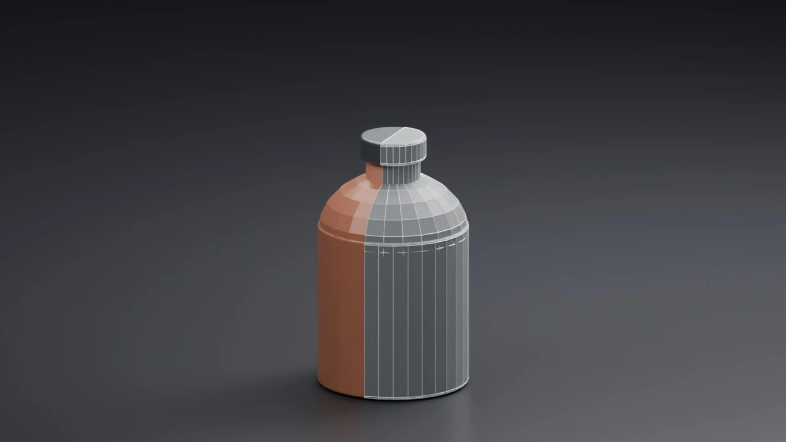

---

group: "ai-product-photography"
title: "Photos produit par IA : que créer et vérifier ?"
description: "Utilisez l'IA pour des images de produits adaptées et vérifiez la forme, la couleur, l'étiquette et la variante avant la publication."
date: 2026-12-11
updated: 2026-12-11
keyword: "photo produit IA"
cta: "Vérifiez les angles de votre produit dans l’aperçu gratuit."
---

Utilisez des photos de produits générées par IA pour des modifications vérifiables, comme un fond ou une présentation. Conservez une référence réelle pour la forme, l'étiquette, le fini et la couleur. Comparez chaque candidat avec cette référence avant de la publier, en particulier lorsque l'image montre un côté non photographié ou suggère une fonctionnalité.

## Quels retouches sont pratiques à vérifier ?

Commencez par une seule photo de produit claire et un changement spécifique, comme un fond neutre. Comparez l'original et le candidat à la même échelle. Vérifiez l'étiquette à résolution pleine et la silhouette à l'échelle réduite.

Si vous générez une autre vue, comparez les détails visibles avec une photographie réelle lorsque celle-ci est disponible. Ne publiez pas le résultat dans la galerie factuelle si vous ne pouvez pas vérifier une fonctionnalité critique.

## Comment gérez-vous les variants ?

Utilisez une image de source distincte pour chaque finition si la couleur ou la construction change. Indiquez le SKU de source et la révision de génération. Revoyez le tout en parallèle avec des photos réelles dans un contact sheet et vérifiez les règles actuelles du canal.

## Qu'est-ce que vous devez vérifier avant de publier ?

| Changement                       | Vérification d'acceptation                            |
| -------------------------------- | ----------------------------------------------------- |
| Fond nouveau                     | Bord propre et étiquette intégrale                    |
| Angle apparemment nouveau        | Fonctionnalités visibles correspondent à la référence |
| Couleur ou traitement de matière | Variant correct et finition conforme                  |

<!-- IMAGE PENDING: Photograph or capture the example described in the brief. -->

**Source** [Google Merchant Center · Product Studio](https://support.google.com/merchants/answer/13708167), [Google Merchant Center · image link](https://support.google.com/merchants/answer/6324350), [Shopify · product photography](https://help.shopify.com/en/manual/products/product-media/product-photography).

[Guide associé](/fr/guides/photographie-produit-e-commerce)

[Comment créer un modèle 3D](/learn/how-to-make-a-3d-model)

## Questions fréquentes

### Puis-je conserver l'image originale comme enregistrement ?

Oui. Enregistrez l'image d'origine à côté de la version publiée et indiquez lequel SKU elle correspond. Cela facilite les révisions et les corrections ultérieures.

### Dois-je utiliser des étiquettes générées ?

Gardez des informations factuelles lisibles et basées sur le produit réel. Comparez l'écriture agrandie et remplacez l'image si l'étiquette contient des informations erronées.

### Peux-je évaluer uniquement en taille pleine ?

Vous devez évaluer en taille pleine pour les détails et vérifier la taille miniature pour la reconnaissance. Vérifiez toujours que l'image s'adapte bien dans un carrousel de produits et testez l'image en taille pleine contre le layout du carrousel afin de garantir que les détails du produit restent lisibles. Assurez-vous que le texte et les caractéristiques clés sont visibles dans les deux tailles.
