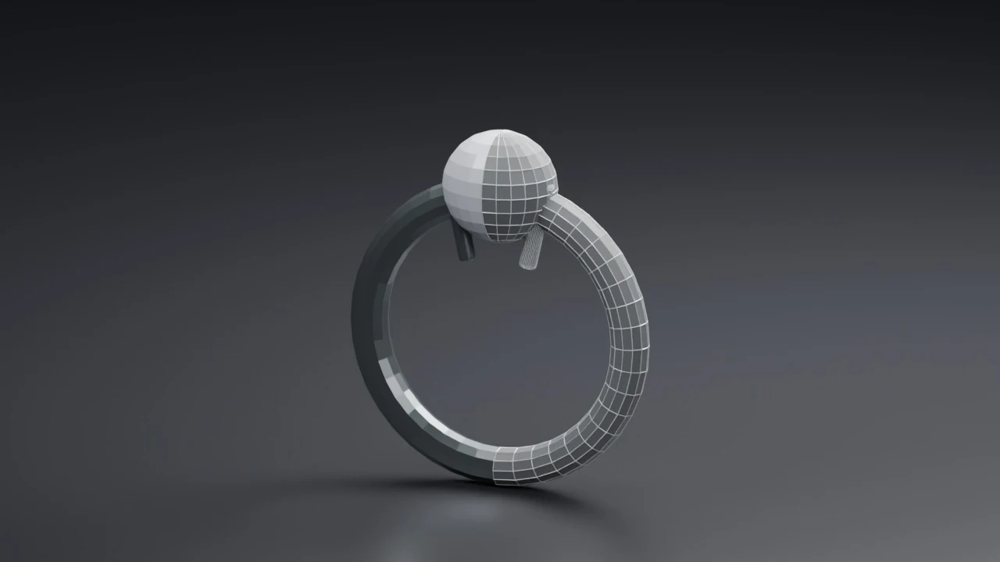

---

group: "jewelry-photography"
title: "Photographier des bijoux en maîtrisant les reflets"
description: "Photographiez des bijoux avec des bords lisibles, des réflexions métalliques contrôlées et un détail répétable."
date: 2026-12-07
updated: 2026-12-07
keyword: "photographie bijoux"
cta: "Vérifiez les angles de votre produit dans l’aperçu gratuit."
---

Lorsque vous photographiez des bijoux polis, définissez ce que le métal reflète. Placez un diffuseur entre la lumière et l'objet pour un éclat large, et utilisez une petite carte noire pour définir l'edge. Examinez les pierres, les prongs et les gravures en grand format avant de passer au suivant.

## Comment obtenir un reflet homogène ?

Commencez sur une surface neutre. Augmentez la taille de la source lumineuse par rapport à l'objet avec un diffuseur, puis déplacez-la jusqu'à ce que le reflet délimite le métal. Utilisez une petite carte noire où deux bords polis se rejoignent.

Fixez le tripode et vérifiez le focus sur la pierre la plus proche ou sur l'ancrage. Si vous modifiez l'aperture pour une profondeur, réexaminez les gravures en détail avant de prendre toutes les versions.

## Quels détails devez-vous réserver dans le cadre ?

Conservez une vue principale, une vue de l'ancrage et un zoom sur le setting ou la marque. Verrouillez la couleur et le cadre pour les variantes, puis comparez les fichiers les uns aux autres.

## Qu'est-ce que vous devez vérifier avant de publier ?

| Symptôme                               | Correction                                                                |
| -------------------------------------- | ------------------------------------------------------------------------- |
| Le reflet blanc cache les gravures     | Déplacez le diffuseur ou réduisez légèrement l'exposition                 |
| L'argent ressemble à une forme blanche | Ajoutez un reflet d'edge sombre                                           |
| Le setting est flou                    | Adaptez le plan de focus ou utilisez un bon niveau de profondeur de champ |

<!-- IMAGE PENDING: Photograph or capture the example described in the brief. -->

**Source** [GIA · gem and jewelry photography](https://www.gia.edu/gem-photography), [Shopify · product photography](https://help.shopify.com/en/manual/products/product-media/product-photography), [GS1 · product image specification](https://www.gs1.org/standards/gs1-product-image-specification-standard/current-standard).

[Guide complémentaire](/fr/guides/photographie-produit-e-commerce)

[Comment créer un modèle 3D](/learn/how-to-make-a-3d-model)

## Questions fréquentes

### Dois-je utiliser un light tent ?

Il peut simplifier les reflets. Ajoutez une carte noire ou déplacez partiellement la diffusion lorsque le tente quitte l’objet sans bord lisible.

### Comment devrais-je vérifier la couleur de la pierre précieuse ?

Utilisez une carte noire avec deux bords polis pour vérifier la couleur de la pierre. Placez le diffuseur à distance et ajustez la lumière pour un reflet homogène. Un reflet blanc peut cacher les gravures : vérifiez que le diffuseur n’altère pas la couleur réelle.

### Quel est l’angle idéal de mise en scène ?

Choisissez la vue qui met en évidence la forme et la pierre ou le détail principal. Ajoutez une deuxième photo pour le fermoir ou l’arrière. Placez une petite carte noire sous l’objet pour mieux définir les reflets du métal et éviter les dégradés indésirables.
