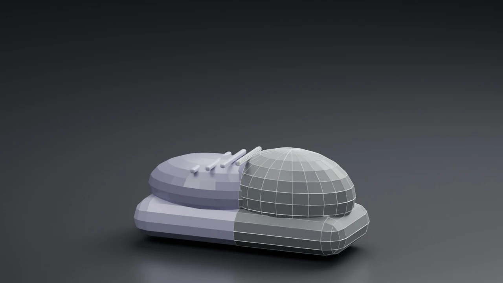

---

group: "shoe-photography"
title: "Photographier des chaussures pour une fiche produit"
description: "Photographiez le profil, la semelle, la partie inférieure et la construction d'une chaussure dans une séquence répétable."
date: 2026-12-14
updated: 2026-12-14
keyword: "photographier des chaussures"
cta: "Vérifiez les angles de votre produit dans l’aperçu gratuit."
---

Commencez une galerie de chaussures avec la vue qui identifie le modèle le mieux. Puis ajoutez la vue de l’extérieur, du talon, de la semelle et des détails qui expliquent le matériau ou le système de fermeture. Gardez la caméra et le cadre cohérents entre les couleurs pour que les images soient faciles à comparer dans un tableau de produit.

## Comment photographier les quatre vues utiles ?

Utilisez un appareil à basse hauteur pour la vue de l’extérieur. Tournez la chaussure pour la vue du talon et maintenez-la à la même hauteur. Montrez la semelle plane devant la caméra pour le relief des motifs, puis passez à un plan rapproché de la fermeture ou du motif de soudure.

## Comment assurer la cohérence entre les paires et les variants ?

Marquez la position de la chaussure et utilisez le même cadre pour la photo principale. Vérifiez que le lacet, les étiquettes et les côtés identifient la même référence SKU et couleur. Dans une image de paire, gardez les deux chaussures en focus sans cacher un détail important.

## Qu’est-ce qu’il faut vérifier avant de publier ?

| Vue            | Ce qu’il faut montrer                       |
| -------------- | ------------------------------------------- |
| Vue extérieure | Pointe, semelle intermédiaire et couverture |
| Partie arrière | Forme du talon et du lacet                  |
| Semelle        | Motifs et bord du matériau                  |
| Détail         | Fermeture, couture ou texture               |

<!-- IMAGE PENDING: Photograph or capture the example described in the brief. -->

**Source** [Zalando · guide des images de chaussures](https://partner.zalando.com/university/article/shoes-image-guide), [Shopify · photographie de produit](https://help.shopify.com/en/manual/products/product-media/product-photography), [GS1 · spécifications d’image de produit](https://www.gs1.org/standards/gs1-product-image-specification-standard/current-standard).

[Guide complémentaire](/fr/guides/photographie-produit-e-commerce)

[Comment créer un modèle 3D](/learn/how-to-make-a-3d-model)

## Questions fréquentes

### Dois-je montrer les deux chaussures dans la première image ?

Suivez les règles du marché et choisissez la vue qui rend le modèle clair. Une vue de paire peut montrer l’ensemble. Prenez une photo de la semelle en plan rapproché avec le motif visible pour bien souligner les détails du relief.

### Peux-je réutiliser mon cliché de semelle ?

Oui, vous pouvez réutiliser le cliché de semelle si le talon est identique entre les variants. Prenez une photo de la semelle en plan rapproché avec le motif visible. Erreur courante : oublier de vérifier la forme et le relief du motif sur la semelle.

### Comment photographier un chaussier noir ?

Utilisez une lumière large et un réflecteur pour garder les coutures et le tissu visibles. Zoomez et vérifiez la texture sombre avant de passer au modèle suivant. Ensuite, testez la texture du chaussier sous une lumière de 45 degré et vérifiez la visibilité des coutures sur fond neutre.
