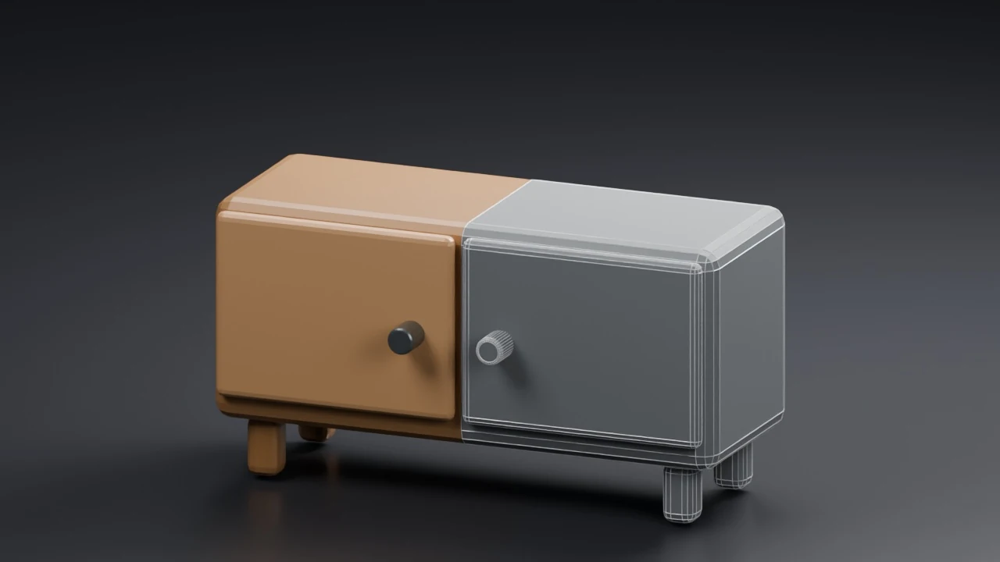

---

group: "furniture-photography"
title: "Comment photographier des meubles pour les vendre"
description: "Planifiez et filmez une galerie de meubles qui montre la forme, les matériaux et la construction que les acheteurs doivent voir."
date: 2026-11-19
updated: 2026-11-19
keyword: "photographier des meubles"
cta: "Vérifiez les angles de votre produit dans l’aperçu gratuit."
---

Commencez par une photo de trois quarts qui montre la façade et la profondeur du meuble. Ajoutez une vue de face, un côté ou l’arrière et un détail de la finition. Gardez le même cadrage entre les variantes pour faciliter la comparaison des matériaux et des couleurs.

## Comment éclairer un meuble de grande taille ?

Placer une fenêtre ou une lumière diffusée importante d'un côté, légèrement en avant par rapport au meuble. Éteindre les lumières de la pièce si elles ont une couleur différente. Utilisez un tableau blanc en face de la lumière pour souligner les zones sombres sans flatter la texture.

Placez votre appareil à une distance suffisante pour voir l'ensemble du meuble, puis ajustez sa hauteur jusqu'à ce que les bords verticaux apparaissent droits. Marquez la position du tripode et du meuble sur le sol. Utilisez ces repères pour chaque couleur ou tissu.

## Quels clichés devez-vous prendre avant de déplacer l'installation ?

Utilisez l'image principale pour montrer la silhouette. Une vue frontale explique le devant, et une vue latérale montre la profondeur et la forme des pieds ou des bras. Photographiez les portes et tiroirs ouverts pour montrer ce que l'acheteur peut utiliser.

Prenez des zooms sur les éléments de fixation et les matériaux après les vues complètes. Photographiez une jointure ou une assemblage, ainsi que le tissu ou la texture. Insérez les dimensions mesurées dans un schéma étiqueté ou dans les spécifications.

## Qu'est-ce qu'il faut vérifier avant de publier ?

| Problème                                              | Solution                                                      |
| ----------------------------------------------------- | ------------------------------------------------------------- |
| Le dessus semble plus large que la base               | Déplacez le appareil en arrière et maintenez-le horizontal    |
| L'œuvre en chêne semble jaune dans la photo latérale  | Éteignez la lumière mixte et verrouillez le blanc d'équilibre |
| L'arrière apparaît uniquement dans une photo de pièce | Ajoutez une vue arrière complète et non obstruée              |

<!-- IMAGE PENDING: Photograph or capture the example described in the brief. -->

**Source** [Shopify · product photography](https://help.shopify.com/en/manual/products/product-media/product-photography), [Google Merchant Center · image link](https://support.google.com/merchants/answer/6324350), [GS1 · product image specification](https://www.gs1.org/standards/gs1-product-image-specification-standard/current-standard).

[Guide complémentaire](/fr/guides/photographie-produit-e-commerce)

[Comment créer un modèle 3D](/learn/how-to-make-a-3d-model)

## Questions fréquentes

### Peux-je photographier des meubles avec un téléphone ?

Oui, un téléphone permet de photographier des meubles avec un objectif principal en lumière naturelle. Placez le téléphone à distance pour voir l’ensemble, puis ajustez la hauteur jusqu’à ce que les bords soient droits. Un mauvais éclairage ou un angle trop serré peut créer des distorsions ou des ombres inégales.

### Dois-je montrer la pièce autour du meuble ?

Utilisez une photo de pièce pour montrer un contexte possible. Gardez une photo de produit distincte où l'outline, la base et la finition sont clairs. Le tableau des spécifications doit inclure les mesures.

### Tous les variants ont-ils besoin de la même galerie ?

Répétez l'angle principal lorsque la finition ou la construction change. Réutilisez les images de détails uniquement lorsque la partie photographiée est effectivement identique. Indiquez la couleur ou l'assemblage correspondant à l'image.
