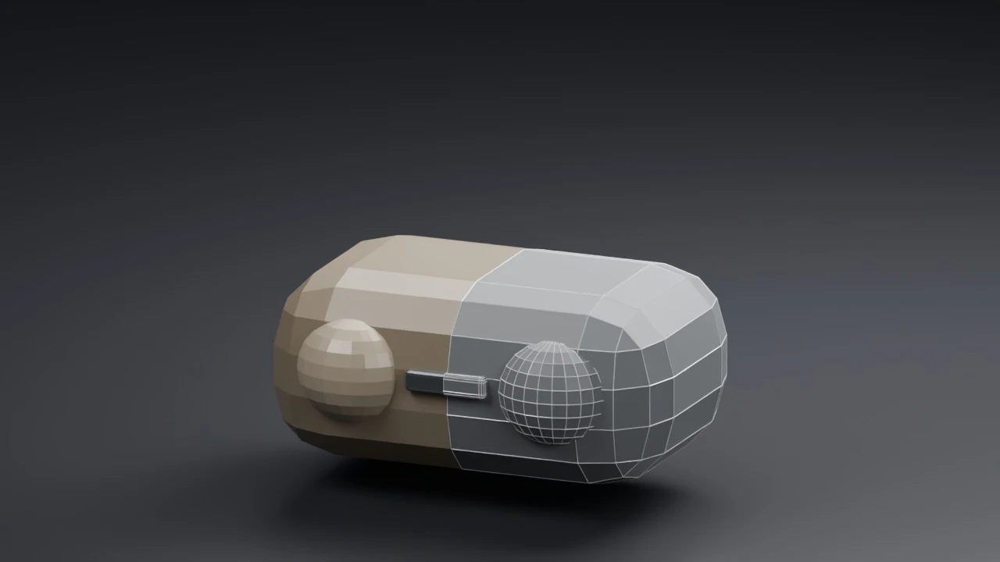

---

group: "3d-modeling-cost"
title: "Combien coûte un modèle 3D de produit ?"
description: "Calculez le coût d’un modèle 3D validé en tenant compte des essais, de la prise de vue, des corrections et de l’export."
date: 2026-12-03
updated: 2026-12-03
keyword: "prix modélisation 3D produit"
cta: "Vérifiez les angles de votre produit dans l’aperçu gratuit."
---

Estimez le coût d'un modèle 3D de produit 3D à partir du livrable que vous avez besoin. Comptez la capture, le modélisation ou la génération, les corrections et l'export que vous allez effectivement utiliser. Comparez les options par coût par modèle approuvé. Un coût bas par tentative peut devenir coûteux lorsque plusieurs tentatives échouent à un même contrôle d'acceptation.

## Qu'est-ce que vous incluez dans la demande ?

Précisez l'application cible, le format, les matériaux, le nombre de variants et si une animation ou une source éditable est requise. Fournissez au modéliste assez de photos et une référence claire pour chaque détail que vous allez inspecter. Demandez quelles révisions et quelles licences sont couvertes par la demande.

## Comment comparez-vous les coûts entre méthodes ?

Divisez le total dépensé sur un petit pilote par le nombre de modèles utilisables. Si un pilote hypothétique de quatre éléments coûte $120 à produire et $40 à réviser et corriger, et que trois modèles sont validés, le coût est d'environ $53.33 par actif accepté. Ce calcul est un exemple, pas un tarif.

## Qu'est-ce qu'il faut vérifier avant la publication ?

| Méthode                         | Éléments principaux                                         |
| ------------------------------- | ----------------------------------------------------------- |
| Génération basée sur des photos | Tentatives, révision et corrections                         |
| Modélisation commandée          | Cahier des charges, heures ou tarif fixe, tours de révision |
| Actif d'un fournisseur existant | Licence, nettoyage et re-exportation                        |

<!-- IMAGE PENDING: Photograph or capture the example described in the brief. -->

**Source** [Upwork · tarifs des modéleurs 3D](https://www.upwork.com/hire/3d-modelers/cost/), [Shopify · création de modèles 3D](https://help.shopify.com/en/partners/manage-clients-stores/creating-media/3d-models/creating-3d-models), [Khronos · spécification glTF 2.0](https://registry.khronos.org/glTF/specs/2.0/glTF-2.0.html).

[Guide associé](/fr/comparatifs/modeleur-3d-ou-ia)

[Comment créer un modèle 3D](/learn/how-to-make-a-3d-model)

## Questions fréquentes

### Dois-je prévoir des révisions ?

Oui. Convainquez-vous du nombre de tours et de ce qui constitue une correction. Incluez le temps de révision de votre équipe dans le pilote, même s'il ne figure pas sur la facture.

### Puis-je utiliser une seule demande pour l'ensemble du catalogue ?

Vous ne pouvez pas utiliser une seule demande pour l’ensemble du catalogue. Spécifiez l’application cible, le format, les matériaux et le nombre de variants. Un oubli de détail comme le nombre de variants entraîne des révisions inattendues et des coûts supplémentaires.

### Qu'est-ce qu'on fait si nous possédons déjà du CAD ?

Si vous disposez déjà de CAD, vérifiez les droits de réutilisation et confirmez les détails nécessaires. Préparez le CAD pour un lecteur web en nettoyant la géométrie, en affectant des matériaux et en l'exportant séparément. Vérifiez que le format et les paramètres d'exportation de votre fichier CAD correspondent aux exigences du lecteur web.
