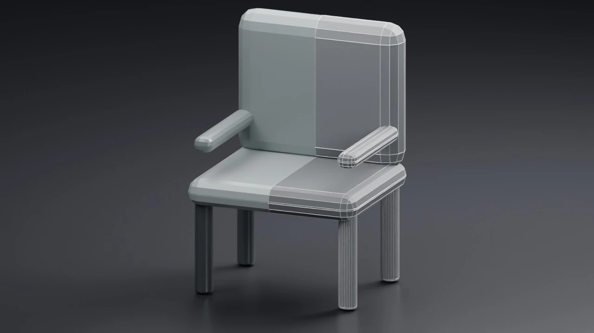

---

group: "augmented-reality-furniture"
title: "Vérifier un meuble en réalité augmentée"
description: "Vérifiez la position, l’apparence et le parcours mobile vers la page produit de meuble."
date: 2026-12-01
updated: 2026-12-01
keyword: "réalité augmentée meubles"
cta: "Vérifiez les angles de votre produit dans l’aperçu gratuit."
---

Vérifiez un modèle de meuble en réalité augmentée sur un téléphone compatible avant de le lier depuis la page produit. Testez l'entrée, l'orientation, la position sur le sol et le retour au navigateur. Gardez les dimensions vérifiées dans les spécifications du produit et utilisez la session AR pour évaluer la présentation visuelle.

## Quel parcours testez-vous ?

Ouvrez la page destinée au client sur le téléphone cible et cliquez sur le même contrôle que l’utilisateur utilisera. Sur les appareils Apple, vérifiez que l’asset s’ouvre en Quick Look si disponible. Pour les autres routes, vérifiez les paramètres de mode AR et les exigences du dispositif documentés.

## Qu’est-ce que vous devez enregistrer ?

Utilisez un sol dégagé et une bonne lumière. Placez le modèle, faites le tour et enregistrez s’il fait face à la direction attendue et s’il semble posé sur le sol. Retournez sur la page produit et confirmez que la version active est toujours correcte.

## Qu’est-ce que vous devez vérifier avant de publier ?

| Problème                   | Diagnostic                                               |
| -------------------------- | -------------------------------------------------------- |
| L’objet apparaît tourné    | Vérifiez l’orientation exportée et la position de départ |
| L’action AR est manquante  | Dispositif, navigateur et mode lecteur                   |
| Le mauvais article s’ouvre | Vérifiez l’URL source de la version active               |

<!-- IMAGE PENDING: Photograph or capture the example described in the brief. -->

**Source** [Apple · Quick Look](https://developer.apple.com/quick-look-gallery/), [model-viewer · documentation](https://modelviewer.dev/docs/), [Apple · Preparing 3D Content for RealityKit](https://developer.apple.com/documentation/arkit/previewing-a-model-with-ar-quick-look).

[Guide associé](/learn/usdz-file)

[Comment créer un modèle 3D](/learn/how-to-make-a-3d-model)

## Questions fréquentes

### Les acheteurs ont-ils encore besoin des dimensions du produit ?

Oui. Fournissez les dimensions vérifiées par le fabricant et vérifiez qu’elles correspondent à la version sélectionnée. Utilisez la réalité augmentée pour un contexte visuel.

### Qu’est-ce que les téléphones non pris en charge doivent voir ?

Gardez les photos de produit et, le cas échéant, le lecteur web accessible. Vérifiez que la page propose toujours les informations sur le produit et les boutons de commande d’achat. Utilisez la réalité augmentée pour visualiser le meuble depuis un appareil non pris en charge, en veillant à ce qu’il soit correctement positionné sur le sol.

### Puis-je tester uniquement sur un bureau ?

Vous pouvez tester le modèle de meuble en réalité augmentée sur un ordinateur de bureau pour des vérifications initiales. Exécutez la route réelle sur un téléphone supporté avant de publier un point d’entrée en réalité augmentée. Vérifiez l’affichage, la position et le parcours mobile pour s’assurer de l’exactitude.
