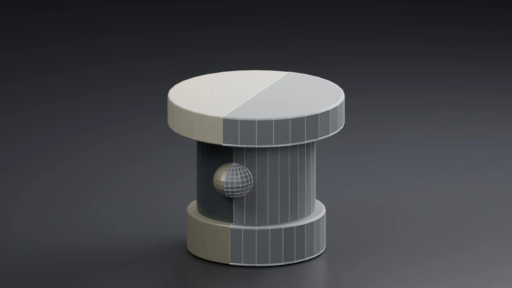

---

group: "woocommerce-3d-models"
title: "Ajouter un visualiseur 3D dans WooCommerce"
description: "Configurez un visualiseur de produit WooCommerce 3D avec un fichier GLB, une image de sauvegarde et un test d'acceptation mobile."
date: 2026-11-29
updated: 2026-11-29
keyword: "visualiseur 3D WooCommerce"
cta: "Vérifiez les angles de votre produit dans l’aperçu gratuit."
---

Ajoutez un visualiseur 3D à un produit WooCommerce sur un site de staging. Utilisez une extension si vous avez besoin d'un workflow administrateur, ou ajoutez un visualiseur web si vous gérez le template. Gardez une photo de produit disponible et testez la galerie sur les thèmes et les appareils utilisés par vos clients.

## Comment choisir l'intégration ?

Vérifiez que l'extension supporte votre fichier et son emplacement avant de l'acheter ou de l'installer. Un template personnalisé peut utiliser un composant comme model-viewer, hébergé avec votre GLB et un poster. Vérifiez que le choix des variants et les boutons d'achat fonctionnent toujours.

## Qu'est-ce que vous testez avec un produit ?

Téléchargez un modèle petit d'abord. Ouvrez le produit en session incognito, vérifiez le poster, interagissez avec le visualiseur et ajoutez le bon variant au panier. Sur une connexion mobile lente, confirmez que la photo et les détails du produit restent utilisables.

## Qu'est-ce que vous vérifiez avant de publier ?

| Échec                                            | Vérifiez                                                      |
| ------------------------------------------------ | ------------------------------------------------------------- |
| Le modèle retourne 403                           | URL publique ou autorisations de hôteing                      |
| Le visualiseur remplace l'ensemble de la galerie | Emplacement de l'extension et du thème                        |
| La page saute au chargement                      | Donnez un rapport d'aspect défini au poster et au visualiseur |

<!-- IMAGE PENDING: Photograph or capture the example described in the brief. -->

**Source** [WooCommerce · Arty 3D Viewer](https://woocommerce.com/document/arty-3dmodelviewer/), [WooCommerce · adding products](https://woocommerce.com/document/managing-products/add-product/), [model-viewer · documentation](https://modelviewer.dev/docs/).

[Guide associé](/fr/guides/modeles-3d-e-commerce)

[Comment créer un modèle 3D](/learn/how-to-make-a-3d-model)

## Questions fréquentes

### Ai-je besoin d'un plugin ?

Utilisez un plugin pour une galerie gérée par l'administrateur, ou choisissez un composant lorsque vous pouvez maîtriser le template et le hôteing. Testez la maintenance ainsi que le premier upload. Téléchargez un modèle petit avant de l'installer pour vérifier la compatibilité et le fonctionnement du visualiseur 3D.

### Le GLB est-il suffisant pour tous les modes AR ?

Vérifiez les modes et la compatibilité appareil du visualiseur choisi. Testez un appareil représentatif avant de proposer une action AR aux clients. Téléchargez d’abord un modèle petit pour vérifier le fonctionnement du visualiseur 3D avant de proposer l’expérience AR aux clients.

### Où doit apparaître le 3D ?

Placez-le de manière claire aux côtés des photos. Privilégiez les photos et les outils de commande sur un écran étroit et faites du rotation une option. Testez le visualiseur 3D sur un appareil représentatif avant de proposer une action AR aux clients.
