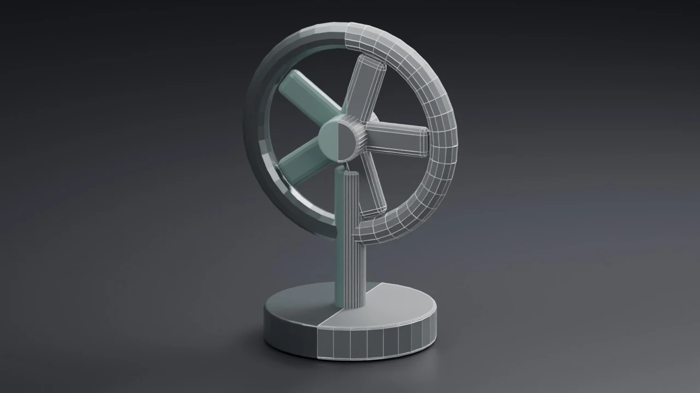

---

group: "sketchfab"
title: "Alternative a Sketchfab per pubblicare modelli 3D"
description: "Scegli una pagina con modello ospitato o un viewer self-hosted in base all'accesso, all'embed e alla manutenzione."
date: 2026-12-06
updated: 2026-12-06
keyword: "alternative a Sketchfab"
cta: "Controlla le diverse viste del tuo prodotto nell’anteprima gratuita."
publishAt: "2026-12-06"
---

Scegli un'alternativa a Sketchfab in base al modo in cui le persone devono raggiungere il modello. Un viewer ospitato può fornire una pagina condivisibile del modello. Un viewer self-hosted ti dà il controllo sull'ubicazione e sull'hosting. Confronta l'accesso anonimo, il comportamento di embed e la consegna del modello con un singolo file rappresentativo prima di procedere con una collezione.

## Qual è l'opzione che si adatta a ciascun compito di pubblicazione?

| Compito                                                       | Punto di partenza | Verifica                                    |
| ------------------------------------------------------------- | ----------------- | ------------------------------------------- |
| Condividi una pagina con modello ospitato                     | p3d.in            | Accesso anonimo e autorizzazioni            |
| Mostra una scena con controlli personalizzati di condivisione | Vectary           | Accesso, impostazioni di embed e limiti     |
| Possiedi la pagina e ospita il file                           | model-viewer      | Hosting dell'asset, fallback e manutenzione |

## Come confrontare questi strumenti su un modello identico?

Carica un singolo GLB con texture nota e apri ogni collegamento in un browser senza login. Verifica rotazione, prestazioni su mobile e l'accessibilità dell'originale. Testa l'embed effettivo in un bozzetto della pagina obiettivo, inclusi i tuoi setttaggi di consenso per il visitatore.

## Cosa verificare prima della pubblicazione?

| Domanda                                                   | Test                                                                           |
| --------------------------------------------------------- | ------------------------------------------------------------------------------ |
| Possono i revisori aprirlo?                               | Browser privato e un secondo dispositivo                                       |
| Può il viewer essere integrato in una pagina di prodotto? | Inserisci l'embed in una pagina in fase di bozza                               |
| Puoi trasferirti più avanti?                              | Mantieni la versione locale e registrati le opzioni di esportazione o download |

<!-- IMAGE PENDING: Photograph or capture the example described in the brief. -->

**Fonte** [Sketchfab · viewer API](https://sketchfab.com/developers/viewer), [Vectary · sharing](https://help.vectary.com/documentation/sharing-exporting-embedding/sharing), [p3d.in · account FAQ](https://p3d.in/faq/account), [model-viewer · documentation](https://modelviewer.dev/docs/).

[Biblioteca dei modelli (EN)](/models)

[Come creare un modello 3D](/it/guide/come-creare-un-modello-3d)

## Domande frequenti

### Quando un viewer embed è eccessivo?

Usa un viewer embed soltanto quando gli utenti devono ruotare o esaminare il modello 3D in contesto. Verifica se il tuo pubblico necessita di interazione oltre la visualizzazione e assicurati che l'embed mantenga prestazioni costanti. Passo successivo: testa l'embed con un piccolo gruppo di utenti prima del lancio completo.

### Posso usare lo stesso GLB ovunque?

Puoi usare lo stesso GLB ovunque, a patto che la destinazione lo supporti e che il file rimanga entro i limiti di dimensione. Verifica prima le modalità di gestione delle texture e i limiti di dimensione dei file su ogni piattaforma. Testa con un solo GLB durante il periodo di prova per confermare la compatibilità.

### Come decidere tra versione ospitata e self-hosted?

Confronta chi gestisce il viewer, l'URL dell'asset e i diritti di accesso. Testa come una fallita caricatura del 3D venga ripristinata con l'immagine del poster. Testa l'embed con un piccolo gruppo di utenti prima del lancio completo per valutare l'interazione e le prestazioni sul dispositivo target.
