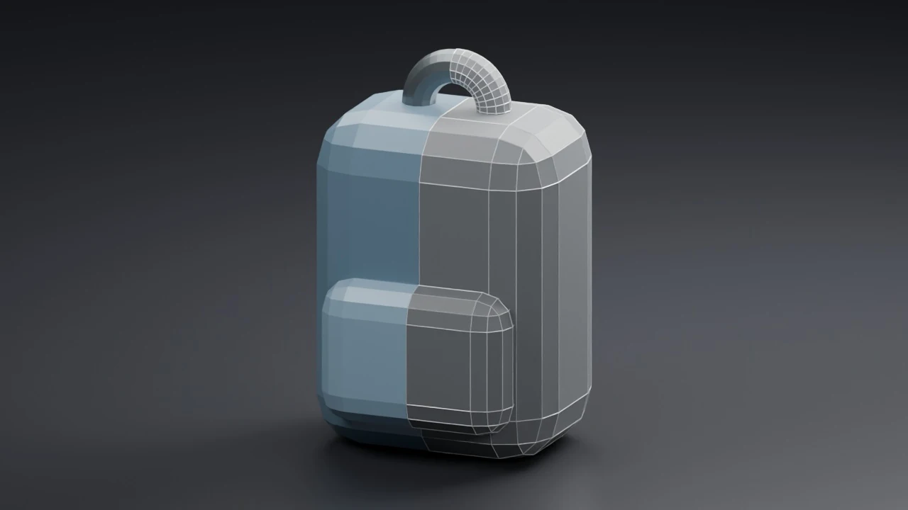

---

group: "product-photography-angles"
title: "Quali angolazioni usare nelle foto di prodotto"
description: "Scegli una vista principale e una secondaria che rispondano a domande sul taglio, costruzione e utilizzo."
date: 2026-11-21
updated: 2026-11-21
keyword: "angolazioni fotografia prodotto"
cta: "Controlla le diverse viste del tuo prodotto nell’anteprima gratuita."
---

Scegli ogni foto del prodotto per rispondere a una domanda. Parti da una vista che spiega la forma, poi aggiungi gli angoli che mostrano come il prodotto si unisca o funzioni. Una vista da dietro, un ingrandimento o una foto con il prodotto aperto spesso risponde meglio di un’angolazione frontale simile.

## Qual è l’angolo da scegliere per primo?

Parti dal tre quarti per un oggetto il cui profilo è importante, come una borsa o un divano. Usa il frontale quando il volto, la forma o l’informazione stampata identificano l’oggetto più velocemente. Controlla il crop alla dimensione del thumbnail.

Lascia spazio intorno al prodotto per il crop del sito. Mantieni la stessa composizione e inquadramento nell’angolo principale per le varianti, e aggiungi immagini dettagliate quando i materiali o i componenti differiscono.

## Quali vuoti dovrebbero essere risolti dalle prossime foto?

Scrivi tre domande che un acquirente potrebbe fare senza tenere l’oggetto. Assegna a ciascuna una vista. Per una borsa, mostra il retro, l’apertura e l’attacco del manico. Per un calzino, aggiungi il tacco. Per l’arredamento, mostra il retro o il basso se la costruzione conta.

Posiziona le risposte in ordine di importanza. Un ingrandimento è più utile quando una vista più ampia dice al lettore dove si trova il dettaglio.

## Cosa controllare prima di pubblicare?

| Vista                                        | Domanda che essa risponde                                            |
| -------------------------------------------- | -------------------------------------------------------------------- |
| Frontale o a tre quarti                      | Che cosa è questo oggetto e quale forma ha?                          |
| Dalla parte posteriore, laterale o inferiore | Come è costruito il pezzo che non vedo?                              |
| Aperto o in uso                              | Cosa posso fare con esso?                                            |
| Dettaglio                                    | Qual è l'aspetto del materiale o del meccanismo in vista da lontano? |

<!-- IMAGE PENDING: Photograph or capture the example described in the brief. -->

**Fonte** [Shopify · fotografie di prodotto](https://help.shopify.com/en/manual/products/product-media/product-photography), [Google Merchant Center · collegamento all'immagine](https://support.google.com/merchants/answer/6324350), [GS1 · specifiche per l'immagine del prodotto](https://www.gs1.org/standards/gs1-product-image-specification-standard/current-standard).

[Guida correlata](/it/guide/fotografia-prodotto-ecommerce)

[Come creare un modello 3D](/it/guide/come-creare-un-modello-3d)

## Domande frequenti

### Quante foto devo usare?

Inizia con una vista principale e aggiungi tutte le risposte utili che la galleria ancora necessita. Elimina duplicati vicini. Verifica i requisiti dei destinatari dove pubblichi lo stesso prodotto.

### Quando una vista frontale retta è preferibile?

Usa una vista frontale retta quando il volto, la forma o l’informazione stampata identificano l’oggetto. Inserisci il prodotto nel centro con spazio intorno per il crop del thumbnail. Controlla che il crop sia completo e che non sia tagliato il testo sull’etichetta.

### Può un modello 3D sostituire la foto del retro?

Un modello 3D non può sostituire la foto del retro se contiene caratteristiche che il cliente deve verificare. Usa entrambe quando la foto reale conferma dettagli e il modello fornisce contesto. Verifica che la foto del retro mostri tutte le caratteristiche chiave in modo chiaro e che sia stata scattata con illuminazione coerente.
