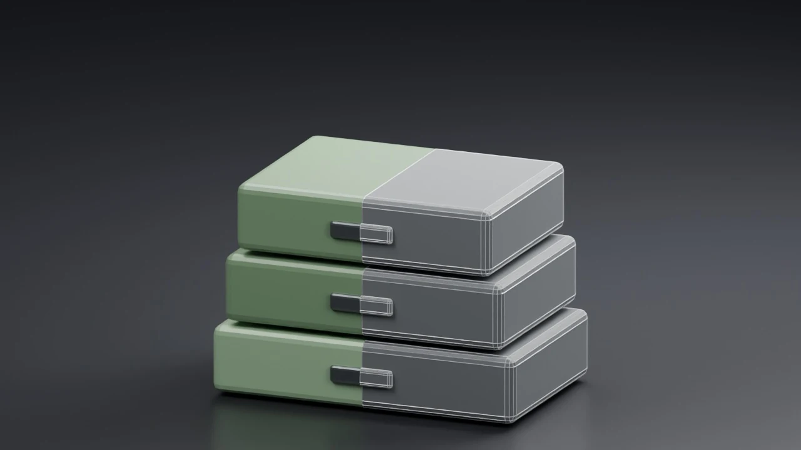
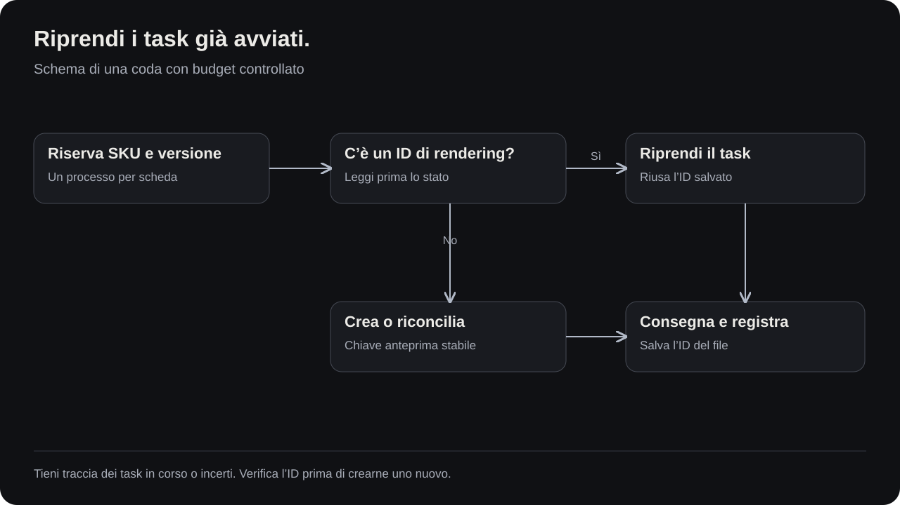

---

group: "n8n-batch-3d-catalog"
title: "Automatizzare un catalogo 3D con n8n"
description: "Converti le righe del catalogo in modelli 3D approvati con n8n. Traccia le versioni SKU, riprendi i lavori, gestisci il budget e consegna i file senza…"
date: 2026-12-09
updated: 2026-12-09
keyword: "automatizzare catalogo prodotti n8n"
cta: "Controlla le diverse viste del tuo prodotto nell’anteprima gratuita."
---

Per automatizzare un catalogo 3D con n8n, assegna a ogni prodotto uno stato salvato. Registra SKU, versione della foto, chiave di creazione, ID del rendering e approvazione. Riprendi i task in corso, limita il lavoro parallelo e consegna i modelli verificati al prodotto corretto.

> **Un risultato vuoto non significa che nulla sia avvenuto.** L'operazione potrebbe ancora essere in esecuzione, in attesa di revisione o mancare la risposta finale. Ripristina lo stato prima di effettuare un altro richiesta pagata.

## Preferire un ciclo su foglio o l'endpoint catalogo?

Usa il processo per prodotto quando ogni modello richiede una decisione di anteprima individuale. Usa l'API catalogo quando il proprietario ha approvato un batch definito, il suo totale spesa e la condivisione necessaria per i media del negozio. Queste scelte creano diversi confini di revisione e privacy.

| Route                             | Scegli quando                                               | Approvazione per mantenere                                                |
| --------------------------------- | ----------------------------------------------------------- | ------------------------------------------------------------------------- |
| Anteprima e costruzione per SKU   | Una persona esamina ogni prodotto per primo                 | Revisione della versione originale, ID del render e limite di costruzione |
| Invio tramite API catalogo        | Un batch definito può avviarsi dopo l'approvazione iniziale | Elenco esatto degli elementi, negozio, limite totale e condivisione       |
| Delivery di modelli già esistenti | I modelli esistono già e richiedono solo la trasmissione    | Decisione di destinazione e pubblicazione                                 |

Il [guida n8n per singolo prodotto](/it/guide/immagine-in-3d-n8n) è il punto di partenza per la prima route. Il [contratto API catalogo](https://github.com/easyrenderai/easyrender.ai/blob/main/docs/api.md) documenta la seconda. Non chiamare l'endpoint batch e aspettare che si pausi al punto di anteprima manuale.

## Cosa deve contenere ogni riga di origine?

Per una serie di vasi in ceramica, mantieni l'identità del prodotto separata dallo stato dell'automazione. Una nuova foto di un vaso esistente rappresenta una nuova revisione della fonte, non necessariamente un nuovo prodotto. Conserva l'ID di render precedente fino a quando non sostituisci deliberatamente il media approvato.

| Campo                  | Ruolo                                     | Esempio o regola                                            |
| ---------------------- | ----------------------------------------- | ----------------------------------------------------------- |
| `sku`                  | Identità del prodotto                     | `VASE-ROUND-01`                                             |
| `source_version`       | Input esatto previsto                     | `photo-v3`                                                  |
| `image_url`            | Fonte stabile                             | Immagine pubblica via HTTPS, quando si usa un input URL     |
| `creation_key`         | Identità di preview per il retry          | Stabile per SKU e revisione della fonte                     |
| `render_id`            | Job del servizio                          | Persiste immediatamente dopo la creazione                   |
| `workflow_state`       | Lo stato della tua coda                   | Nuovo, in attesa di revisione, inviato, incerto, consegnato |
| `approved_credits`     | Limite massimo di costruzione autorizzato | Intero non negativo verificato                              |
| `destination_media_id` | Recupero della consegna                   | Salvato dopo che il negozio ha accettato il file            |

Questi campi della coda appartengono al tuo sistema. Non sono campi aggiuntivi da inviare a `/api/renders`. Mantieni lo stato del servizio separato, perché `preview_ready` e lo stato del tuo business "rejetato" descrivono cose diverse.

## Come processi le righe senza creare duplicati?

1. Seleziona i record di fonte idonei, poi assegna un SKU/revisione prima di creare il lavoro. Una regola di unicità nel database è preferibile quando più lavoratori possono eseguire il processo. Una semplice cella di stato in un foglio di calcolo non costituisce un lock atomico.
2. Se esiste `render_id`, leggi il render e prosegui dal suo stato. Non ricreala perché `destination_media_id` è vuoto.
3. Se non esiste un ID ma la creazione è stata tentata, riprova la creazione del preview con lo stesso `Idempotency-Key` salvato e input invariato. Salva l'ID restituito prima di procedere.
4. Attendi il preview e salva la decisione di revisione. Solo il ramo approvato può avviare la costruzione pagata, utilizzando il proprio `maxCredits` autorizzato.
5. Controlla lo stesso lavoro fino al completamento, all'errore o al termine del workflow. Un termine salva il record per il riconciliazione. Non genera automaticamente un altro tentativo.
6. Scarica e consegna il modello. Salva l'identificativo media di destinazione prima di segnalare la consegna della riga sorgente.

Per la prima implementazione, usa un singolo worker e elabora un elemento alla volta. n8n offre il [Loop Over Items](https://docs.n8n.io/integrations/builtin/core-nodes/n8n-nodes-base.splitinbatches/) per supportare batching esplicito. Mantieni i scheduler senza sovrapposizione, poi aumenta la concorrenza solamente dopo aver misurato i limiti del servizio e il comportamento di recupero personalizzato.

## Come devi gestire lo spending nel batch?

Un limite per chiamata approvato non garantisce da solo un budget totale per diverse operazioni. Mantieni una riserva atomica per ogni operazione pagata in corso, e inclusa anche le richieste non risolte nel montante già impegnato. Altrimenti due lavoratori possono vedere lo stesso limite disponibile.

| Componente budget  | Conta quando                              | Rilascia o riconcilia quando                          |
| ------------------ | ----------------------------------------- | ----------------------------------------------------- |
| Totale approvato   | L'utente approva il batch                 | Viene modificato esplicitamente il range o il budget  |
| Crediti riservati  | Un lavoratore richiede un'azione pagata   | L'outcom finale è riconciliato                        |
| Spesa confermata   | Il servizio registra il credito           | Un rimborso verificato viene registrato separatamente |
| Outcom sconosciuto | La risposta viene persa dopo la richiesta | Un lavoro esistente o prova di supporto lo risolve    |

Leggi il preventivo in tempo reale e il saldo residuo del render prima di procedere. Ferma il processo in caso di fondi insufficienti o superamento del limite chiave. Un rimborso del wallet e il limite massimo di debito per la chiave hanno comportamenti diversi. Non riassetti le tue ipotesi sul budget chiave solo perché il saldo è aumentato.

Usa le indicazioni sul limite di velocità di [n8n](https://docs.n8n.io/integrations/builtin/handle-rate-limits.md) per leggere in modo sicuro. Per un 429, rispetta il valore del `Retry-After` presente nella risposta. Per una mutazione pagata che ha timeout, verifica il risorsa prima di riprovare. Un backoff da solo non rende una richiesta duplicata sicura.

## Che cosa cambia quando si usa l'API catalogo?

Richiedi `GET /api/catalog/quote?items=N` per il numero esatto di elementi previsti. Mostra all'utente l'elenco degli elementi, il preventivo, lo store di destinazione e le implicazioni di condivisione. La richiesta richiede `write`, `spend` e `share`, piuttosto che solo i ruoli di lettura/scrittura utilizzati per il preview.

| Campo di richiesta | Valore richiesto                                          |
| ------------------ | --------------------------------------------------------- |
| `platform`         | `shopify`, `woocommerce`, `prestashop` o `other`          |
| `store`            | Identificativo stabile per lo store di destinazione       |
| `maxCredits`       | Limite massimo totale autorizzato per questa richiesta    |
| `items`            | Al massimo 100 elementi per richiesta nel formato attuale |
| Ogni elemento      | `externalId`, `title`, `imageUrl`. Opzionale `note`       |

Invia una volta a `POST /api/catalog`, poi usa `GET /api/catalog?platform=...&store=...` per esaminare e avanzare la coda già autorizzata. Gestisci esplicitamente `needs_credits`, `needs_info` e `failed`. Mantieni i valori della piattaforma e dello store identici quando ripristini lo stesso batch.

La richiesta del catalogo condivide i collegamenti al modello per l'uso dello store. Seleziona il per-prodotto se non è autorizzato. Distinguere la generazione dei modelli del catalogo dalla scrittura delle pagine prodotto in un CMS del venditore: il connettore store deve comunque avere un passaggio di consegna testato.

<!-- IMAGE PENDING: unique real screenshot of catalog rows with saved job IDs and a recovered execution. Use synthetic SKUs and no customer data. -->

## Come sai che un prodotto è stato consegnato correttamente?

È necessario che la revisione di origine, l'ID di render, l'ID del prodotto di destinazione e l'ID del media siano in accordo. Scarica il GLB privato con le credenziali API, poi caricalo utilizzando il flusso supportato dal negozio. La disponibilità di un modello nel generatore non è la stessa della sua disponibilità sulla pagina del prodotto.

Per Shopify, segui la [documentazione sull'elaborazione e l'aggiunta del media](https://shopify.dev/docs/apps/build/product-merchandising/products-and-collections/manage-media). Verifica lo storefront finale dopo l'elaborazione. Se il solo errore riguarda il delivery, riprova quel passaggio con il file esistente, piuttosto che generare un nuovo modello.

Il GLB consegnato deve aprire in un viewer compatibile; [Khronos descrive il formato](https://www.khronos.org/gltf/). Registrare la dimensione del file e lo stato di destinazione per le tue uscite accettate. Non inferire benefici di velocità o conversione dal numero di job completati.

## Quali errori di batch richiedono un percorso di recupero specifico?

| Sintomo                                              | Causa probabile                                                    | Soluzione                                                        |
| ---------------------------------------------------- | ------------------------------------------------------------------ | ---------------------------------------------------------------- |
| Lo stesso SKU viene eseguito due volte               | Orari sovrapposti o nessun claim                                   | Serializza il lavoro o usa un claim atomico                      |
| L'anteprima esistente viene sostituita               | La cella finale vuota viene usata come unica regola di elegibilità | Verifica l'ID salvato e lo stato del workflow prima              |
| Il prodotto sbagliato viene aggiornato               | L'ordine delle righe è cambiato                                    | Usa ID esterni stabili per la corrispondenza                     |
| Il totale speso supera le aspettative                | Le prenotazioni concorrenti vengono ignorate                       | Traccia il consumo commesso e sconosciuto insieme                |
| Ogni tick riprova un errore                          | Lo stato operativo viene trattato come transitorio                 | Ferma e risolvi crediti, input o permessi                        |
| Modello pronto ma la pagina è vuota                  | Elaborazione o distribuzione del media è fallita                   | Riprendi l'upload/attachment, mantieni il render                 |
| Una nuova fonte riutilizza l'approvazione precedente | La revisione non fa parte della decisione                          | È richiesta un'approvazione per la versione corrente della fonte |

## Che cosa dovrebbe coprire il primo test di accettazione?

Usa un piccolo campione: un prodotto valido, un'immagine intenzionalmente invalida e un record con un ID di render esistente. Verifica che la riga invalida venga interrotta, il lavoro esistente venga ripreso e il record valido vada in revisione. Questo testa il comportamento della coda prima di autorizzare un batch pagato.

Successivamente simulare una risposta di creazione persa e un'interruzione di consegna con fixture. Poi eseguire un run completo autorizzato prima di abilitare il scheduling senza supervisione. Lo schema pubblico e il contratto del repository sono stati verificati per questo documento. Non vengono affermati risultati di batch live né risparmi di costo.

Misura i modelli revisionati consegnati per SKU/revisione unica, interventi manuali, lavori non risolti e crediti netti per modello accettato. Per il flusso dell'asset, usa [come creare un modello 3D](/it/guide/come-creare-un-modello-3d) e la guida [sull'asset product-page](/it/guide/schede-prodotto-n8n).

## Domande frequenti

### Un campo vuoto per il modello-link è sufficiente per selezionare il nuovo lavoro?

No. Il modello potrebbe ancora essere in elaborazione, in attesa di revisione o in attesa di consegna dopo un successo nell'elaborazione. Salva un ID del lavoro e lo stato del flusso prima di iniziare ulteriori operazioni. Solo un record senza tentativi precedenti o incerti deve entrare in un nuovo percorso di creazione, utilizzando la revisione di origine stabile e la chiave.

### Posso elaborare l'intero catalogo in parallelo?

Inizia con una concorrenza limitata e un budget approvato. I lavoratori paralleli necessitano di affermazioni atomiche e prenotazioni condivise di credito, inclusi gli invii incerti il cui risultato non è ancora noto. Aumentare i lavoratori senza tali controlli può duplicare i compiti o superare il totale previsto, anche se ogni richiesta individuale ha il proprio limite.

### Richiede l'API del catalogo la condivisione pubblica?

Richiede lo scope di condivisione perché il flusso del catalogo rende disponibili i collegamenti ai modelli per l'uso da parte del negozio. Questo necessita di autorizzazione esplicita, insieme alla lista degli elementi e al limite di spesa. Usa anteprime private per prodotto quando vuoi una revisione individuale prima di decidere quali asset vengano costruiti, consegnati o condivisi.

### Dovrei rigenerare un modello dopo un'errore durante l'upload in negozio?

Di solito il passaggio di generazione è già completato. Mantieni l'ID di render e recupera il download o l'upload destinato invece. Salva l'identificativo multimediale restituito dal negozio e lo stato di elaborazione in modo da distinguere un trasferimento fallito, un allegato in attesa e un modello mancante, senza dover pagare un'altra generazione.
