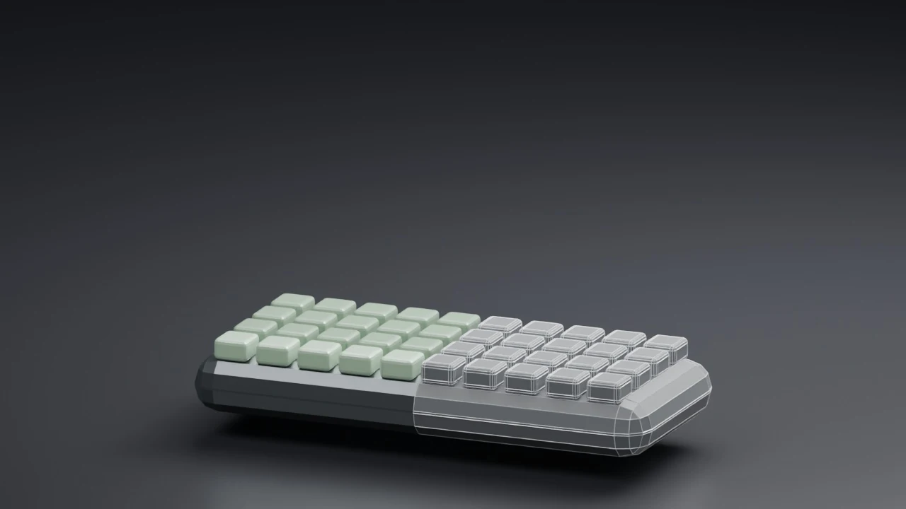
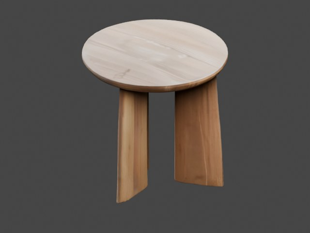

---

group: "compress-glb"
title: "Come comprimere un GLB mantenendo i dettagli"
description: "Trova cosa rende il tuo GLB grande, riduci geometria o texture e confronta il risultato nello stesso visualizzatore."
date: 2026-11-28
updated: 2026-11-28
keyword: "comprimere GLB"
cta: "Controlla le diverse viste del tuo prodotto nell’anteprima gratuita."
---

Per comprimere un GLB mantenendo i dettagli, riduci la dimensione delle texture se le immagini sono predominanti o semplifica la geometria se il mesh è più significativo. Esporta una copia e confronta i due file nello stesso viewer. Accetta il file più piccolo solo dopo aver verificato angoli, spigoli e dettagli superficiali che il pubblico vedrà.

## Cosa ha modificato la semplificazione di un modello?

Abbiamo importato il nostro tavolo da caffè in Blender 5.2.3 e l'abbiamo esportato due volte con le stesse impostazioni GLB. Applicando un rapporto di Decimate di 0.5, i triangoli 16,228 sono passati a 8,114.. Gli due esporti sono passati da 1,687,180 a 863,068 bytes, circa 49% in meno.

Questi sono i valori dei due esporti in Blender. L'originale del sito utilizza un encoding preparato separatamente, quindi rappresenta una base diversa.

## Come scegliere l'ottimizzazione successiva?

Per un modello pesante in geometria, prova una modifica geometrica e controlla angoli e intersezioni. Per un modello ricco di texture, prova una mappa più piccola e verifica i dettagli fini. Testa estensioni di texture compressa nel viewer di destinazione prima di inserirla in catalogo.

## Cosa dovresti verificare prima di pubblicare?

| Sintomo                                | Azione successiva                                                        |
| -------------------------------------- | ------------------------------------------------------------------------ |
| I etichette si sfuocano                | Ripristina la risoluzione della texture prima di modificare la geometria |
| Gli spigoli cambiano vicino alle gambe | Riduci la forza della decimazione                                        |
| Il nuovo file non si apre              | Verifica le estensioni richieste e l'output del validator                |

<!-- IMAGE PENDING: Photograph or capture the example described in the brief. -->

**Fonte** [Khronos · specifica glTF 2.0](https://registry.khronos.org/glTF/specs/2.0/glTF-2.0.html), [Khronos · KHR_texture_basisu](https://github.com/KhronosGroup/glTF/tree/main/extensions/2.0/Khronos/KHR_texture_basisu), [Blender · modifica Decimate](https://docs.blender.org/manual/en/latest/modeling/modifiers/generate/decimate.html), [Khronos · Validator glTF](https://github.com/KhronosGroup/glTF-Validator).

[Guida correlata](/learn/glb-file)

[Come creare un modello 3D](/it/guide/come-creare-un-modello-3d)

## Domande frequenti

### Quanto deve essere piccolo un GLB?

Fai il GLB il più piccolo possibile senza perdere dettagli visibili o prestazioni. Testa sull'attrezzo reale e sulla pagina, verificando i byte trasmessi, il tempo di caricamento e la chiarezza delle funzionalità essenziali. Successivamente, verifica la dimensione del file e le prestazioni del visualizzatore prima dell'implementazione.

### Avere meno triangoli significa sempre meno byte?

Meno triangoli non significa sempre meno byte, poiché i texture, l'encoding del buffer e gli attributi influiscono sulla dimensione del file. Ottimizza la geometria prima, poi verifica la dimensione del file GLB e il numero di triangoli in un visualizzatore. Confronta esportazioni complete con le stesse impostazioni per verificare l'efficienza del compressione.

### Devo sovrascrivere la versione originale?

Mantieni la versione originale e un registro delle impostazioni di esportazione. Prova un file di consegna separato in modo da poter ripristinare i dettagli senza ripetere il lavoro di modellazione iniziale. Prova una mappa di texture più piccola prima di inserirla nel catalogo.
