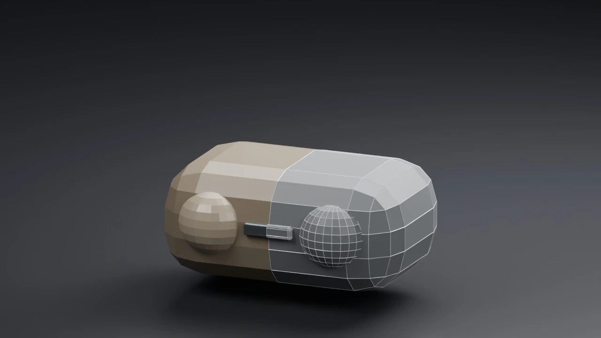

---

group: "3d-modeling-cost"
title: "Quanto costa creare un modello 3D di prodotto?"
description: "Quanto vi costa creare un modello 3D approvato 3D, inclusi tentativi, acquisizione, revisioni e l'esportazione finale?"
date: 2026-12-03
updated: 2026-12-03
keyword: "costo modello 3D prodotto"
cta: "Controlla le diverse viste del tuo prodotto nell’anteprima gratuita."
---

Stima il costo di un modello 3D a partire dal file che devi consegnare. Conta foto, modellazione o generazione, correzioni ed esportazione. Confronta le alternative per modello approvato e registra i tentativi scartati, perché incidono sul costo di ogni file che arriva in catalogo.

## Cosa includi nel preventivo?

Specifica l'applicazione target, il formato, i materiali, il numero di varianti e se è richiesta animazione o una versione modificabile. Fornisci al modellatore abbastanza fotografie e un riferimento chiaro per ogni caratteristica da verificare. Chiedi quante revisioni e quali licenze sono coperte dal preventivo.

## Come confronti i costi tra i diversi metodi?

Dividi l'importo totale speso in un piccolo pilota per il numero di modelli che puoi utilizzare. Se un pilota ipotetico di quattro elementi costa $120 da produrre e $40 per revisione e correzione, e tre modelli vengono accettati, il costo è intorno a $53.33 per ogni asset approvato. Questo calcolo è un esempio, non un tasso.

## Cosa verificare prima di pubblicare?

| Metodo                           | Elementi principali                               |
| -------------------------------- | ------------------------------------------------- |
| Generazione basata su foto       | Tentativi, revisione e correzioni                 |
| Modellaggio commissionato        | Breve, ore o preventivo fissa, round di revisione |
| Attivo in un fornitore esistente | Licenza, pulizia e rieportazione                  |

<!-- IMAGE PENDING: Photograph or capture the example described in the brief. -->

**Fonte** [Upwork · tassi dei modellatori 3D](https://www.upwork.com/hire/3d-modelers/cost/), [Shopify · creazione dei modelli 3D](https://help.shopify.com/en/partners/manage-clients-stores/creating-media/3d-models/creating-3d-models), [Khronos · specifica glTF 2.0](https://registry.khronos.org/glTF/specs/2.0/glTF-2.0.html).

[Guida correlata](/it/confronti/modellatore-3d-o-ai)

[Come creare un modello 3D](/it/guide/come-creare-un-modello-3d)

## Domande frequenti

### Devo prevedere le revisioni?

Sì. Stabilisci il numero di round e cosa conta come correzione. Includi il tempo di revisione del tuo team nel pilota, anche se non appare nell'invoice.

### Posso usare un'unica richiesta per l'intero catalogo?

Puoi usare una singola richiesta per l’intero catalogo solo se hai specificato tutti i dettagli. Fornisci al modellatore le foto, il riferimento e il numero esatto di varianti. Il errore comune è sottovalutare le revisioni: ogni mancata correzione aumenta il costo finale.

### E se già disponiamo di CAD?

Se già disponete di CAD, verificate i permessi di riutilizzo e confermate quali dettagli sono necessari. Preparate il CAD per un viewer web eliminando geometrie ineccepibili, assegnando materiali e esportando separatamente. Verificate che il formato e le impostazioni di esportazione del vostro file CAD siano coerenti con le esigenze del viewer web.
