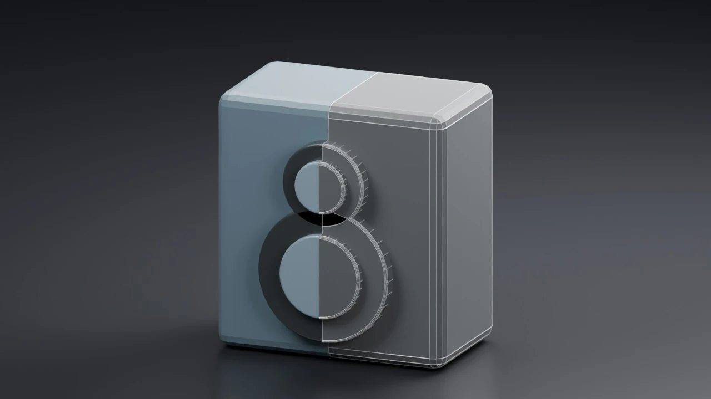

---

group: "blender-export-glb"
title: "Come esportare un GLB da Blender con le texture"
description: "Prepara materiali e texture in Blender, esporta un GLB e verificalo in una sessione di visualizzazione pulita."
date: 2026-12-04
updated: 2026-12-04
keyword: "esportare GLB Blender"
cta: "Controlla le diverse viste del tuo prodotto nell’anteprima gratuita."
---

Prepara i tuoi materiali con texture in immagine connesse a un shader supportato, poi esporta il GLB 2.0 in formato binario GLB di Blender. Sposta il risultato in una cartella nuova e apri il file nel viewer di destinazione. Verifica che il colore, le normali e la posizione delle texture siano state mantenute durante il trasferimento.

## Cosa prepari prima dell'esportazione?

Apri ogni materiale importante nell'Editor dei Shader. Usa un Principled BSDF quando appropriato e verifica i nodi immagine. Baka effetti procedurali non supportati in mappe se necessario. Seleziona gli oggetti che devono essere inclusi nella consegna e controlla le loro trasformazioni e orientamento.

## Come esporti e verifichi?

Seleziona File, Esporta, glTF 2.0, poi glTF Binario. Usa un'esportazione selezionata per escludere gli helper della scena. Valida il file, caricalo in un viewer fresco e confronta il lato anteriore e quello posteriore con la tua scena.

## Cosa dovresti controllare prima della pubblicazione?

| Problema                                   | Verifica prima                                        |
| ------------------------------------------ | ----------------------------------------------------- |
| Texture assente                            | Connessioni immagini e risorse esportate              |
| La superficie appare con un aspetto errato | Canali delle mappe e spazio di colore                 |
| Il modello è rotto di lato                 | Trasformazione oggetto e orientamento di destinazione |

<!-- IMAGE PENDING: Photograph or capture the example described in the brief. -->

**Source** [Blender · glTF 2.0 import and export](https://docs.blender.org/manual/en/5.1/addons/import_export/scene_gltf2.html), [Khronos · glTF 2.0 specification](https://registry.khronos.org/glTF/specs/2.0/glTF-2.0.html), [Khronos · glTF Validator](https://github.com/KhronosGroup/glTF-Validator).

[Guida correlata](/learn/glb-file)

[Come creare un modello 3D](/it/guide/come-creare-un-modello-3d)

## Domande frequenti

### Esporta ogni materiale di Blender?

L'esportatore riconosce combinazioni di nodi supportate. Alcuni effetti procedurali devono essere baktati. Controlla il viewer di destinazione con un materiale semplice prima di configurare un asset complesso.

### Come posso verificare che sia autarchico?

Sposta solamente il GLB esportato in una cartella vuota e aprilo nel viewer di destinazione. Verifica il materiale sotto illuminazione neutra per assicurarti che le texture si caricano senza errori. Successivamente, controlla che il GLB contenga tutte le texture verificando le risorse integrate nell'asset attraverso il pannello delle metadati del viewer.

### Importa il file BLEND dopo l'esportazione?

Mantienilo come fonte modificabile. Aggiorna quel file per le revisioni e riprova l'esportazione, senza trattare il file distribuito come versione principale. Sposta solamente il GLB esportato in una cartella vuota e aprilo nel viewer di destinazione per verificare il caricamento delle texture.
