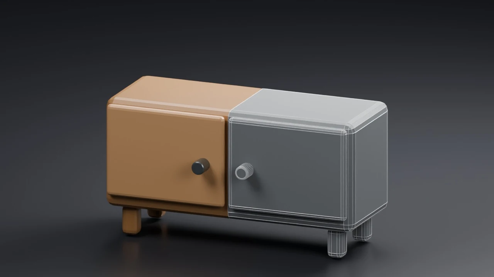

---

group: "furniture-photography"
title: "Come fotografare mobili da vendere online"
description: "Pianifica e fotografando una galleria di mobili che mostri la forma, i materiali e la costruzione che i clienti devono vedere."
date: 2026-11-19
updated: 2026-11-19
keyword: "fotografare mobili per ecommerce"
cta: "Controlla le diverse viste del tuo prodotto nell’anteprima gratuita."
---

Inizia con una foto a tre quarti che mostri il fronte e la profondità del mobile. Aggiungi una vista frontale, una vista laterale o posteriore e zoom su finitura e accessori. Usa lo stesso setup per tutte le varianti in modo che i clienti possano capire quando il legno, la stoffa o la costruzione cambiano realmente.

## Come illuminare un grande mobile?

Posiziona una finestra o una luce diffusa ampia da un lato, leggermente davanti al mobile. Spegni le luci della stanza se il colore è diverso. Usa un pannello bianco sul lato opposto alla luce per levare le aree scure senza appiattire la venatura.

Posiziona la tua macchina a distanza sufficiente per vedere l’intero mobile, poi regola l’altezza fino a che i bordi verticali sembrano retti. Segna la posizione del treppiede e del mobile sul pavimento. Usa quei punti di riferimento per ogni colore o tessuto.

## Quali foto devi fare prima di spostare l’impostazione?

Usa l’immagine principale per mostrare la silhouette. Una vista frontale spiega il fronte, mentre una vista laterale mostra la profondità e la forma delle bracciature o delle gambe. Fai foto con le porte e i cassetti aperti quando cambia l’uso per il cliente.

Fai le foto dei dettagli e dei materiali dopo le viste complete. Fai foto di un giunto o di un’incisione, nonché della stoffa o del grano. Inserisci le dimensioni misurate in un disegno etichettato o nelle specifiche.

## Cosa devi verificare prima di pubblicare?

| Problema                                   | Soluzione                                             |
| ------------------------------------------ | ----------------------------------------------------- |
| Il mobile sembra più largo dal basso       | Sposta la macchina indietro e mantienila orizzontale  |
| Oak sembra giallo nella foto laterale      | Disattiva la luce mista e blocca il bianconero        |
| Il retro appare solo in una foto di stanza | Aggiungi una vista posteriore completa e non ostruita |

<!-- IMAGE PENDING: Photograph or capture the example described in the brief. -->

**Fonte** [Shopify · fotografazione prodotto](https://help.shopify.com/en/manual/products/product-media/product-photography), [Google Merchant Center · collegamento immagine](https://support.google.com/merchants/answer/6324350), [GS1 · specifiche immagine prodotto](https://www.gs1.org/standards/gs1-product-image-specification-standard/current-standard).

[Guida correlata](/it/guide/fotografia-prodotto-ecommerce)

[Come creare il modello 3D](/it/guide/come-creare-un-modello-3d)

## Domande frequenti

### Posso fotografare mobili con un telefono?

Sì, puoi fotografare mobili con un telefono usando l'obiettivo principale in luce buona e appoggiare il telefono per ripetere l'angolo. Prevedi un backup prima di passare all'obiettivo ultra-ampliato, poi verifica l'immagine iniziale ingrandita per difetti di angoli allungati e texture sfocate. Usa un tripode o una superficie stabile per mantenere la coerenza.

### Devo mostrare la stanza intorno al mobile?

Usa una foto di stanza per mostrare un possibile contesto. Mantieni una foto separata del prodotto in cui l'outline, la base e il finish sono chiari. La tabella delle specifiche deve contenere le dimensioni.

### Tutte le varianti necessitano della stessa galleria?

Ripetere l'angolo principale quando cambia il finish o la costruzione. Ripropri le immagini dettagliate solo quando la parte fotografata è veramente identica. Etichetta il colore o l'assemblaggio che l'immagine mostra.
