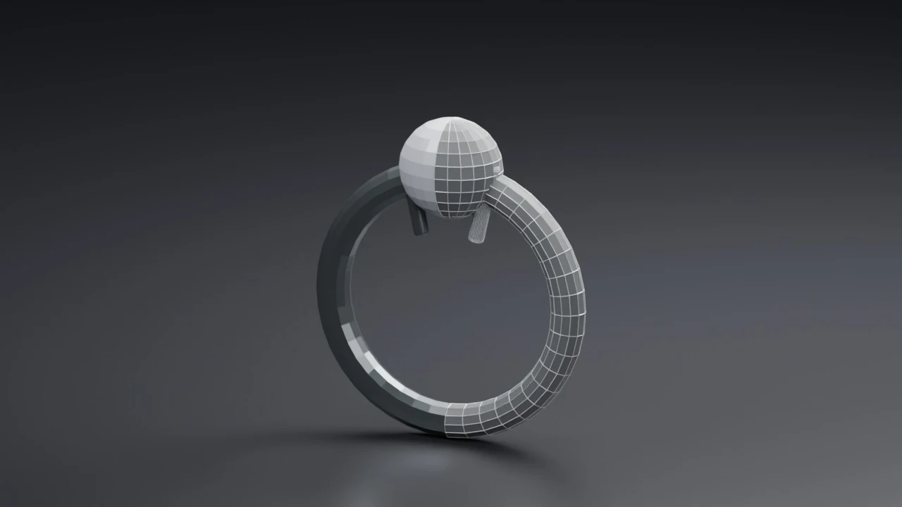

---

group: "jewelry-photography"
title: "Come fotografare gioielli e controllare i riflessi"
description: "Fotografa gioielli con bordi leggibili, riflessi metallici controllati e una ripetizione dettagliata."
date: 2026-12-07
updated: 2026-12-07
keyword: "fotografia gioielli"
cta: "Controlla le diverse viste del tuo prodotto nell’anteprima gratuita."
---

Quando fotografate gioielli poliriti, definisci come il metallo riflette. Posiziona una diffusione tra la luce e l'oggetto per un'illuminazione ampia, e usa una piccola carta scura per definire il bordo. Controlla pietre, prong e incisioni in formato completo prima di passare al successivo pezzo.

## Come ottenere un riflesso uniforme?

Inizia su una superficie neutra. Aumenta l'area della fonte luminosa rispetto al pezzo usando un diffusore, poi spostala fino a che il riflesso delimita il metallo. Usa una piccola carta scura dove due bordi poliriti si incontrano.

Imposta il tripode e verifica il focus sulla pietra più vicina o sul sistema di fissaggio. Se modifichi l'apertura per il profilo, controlla nuovamente le incisioni sottili prima di fotografare tutte le versioni.

## Quali dettagli dovresti riservare a un quadro?

Mantieni una vista principale, una vista del fissaggio e un ingrandimento del supporto o del marchio. Fissa colore e cornice per le varianti e confronta i file l'uno con l'altro.

## Cosa devi verificare prima di pubblicare?

| Sintomo                                 | Regolazione                                                 |
| --------------------------------------- | ----------------------------------------------------------- |
| Il riflesso bianco nasconde l'incisione | Sposta il diffusore o riduci leggermente l'esposizione      |
| L'argento appare come una forma bianca  | Aggiungi un riflesso di bordo scuro                         |
| Il supporto è sfuocato                  | Regola il piano di focus o usa un profilo di campo adeguato |

<!-- IMAGE PENDING: Photograph or capture the example described in the brief. -->

**Fonte** [GIA · gem and jewelry photography](https://www.gia.edu/gem-photography), [Shopify · product photography](https://help.shopify.com/en/manual/products/product-media/product-photography), [GS1 · product image specification](https://www.gs1.org/standards/gs1-product-image-specification-standard/current-standard).

[Guida correlata](/it/guide/fotografia-prodotto-ecommerce)

[Come creare il modello 3D](/it/guide/come-creare-un-modello-3d)

## Domande frequenti

### Dovrei usare un light tent?

Può semplificare i riflessi. Aggiungi una carta scura o sposta parte della diffusione quando il tenda lascia il pezzo senza un bordo leggibile. Aggiungi una carta scura per evitare che il bordo del gioiello sia illeggibile sotto riflessi di luce.

### Come devo verificare il colore del gemma?

Mantieni luce e bilancio bianco stabili e confronta con l'oggetto reale. Differenti display possono comunque mostrare variazioni.

### Qual è l'angolo hero ideale?

Scegli la vista che mostra la forma e la pietra o il caratteristico elemento principale. Aggiungi una seconda foto per il chiusura o il retro. Usa una carta scura per nascondere i riflessi e garantire che i bordi del gioiello siano leggibili nella foto.
