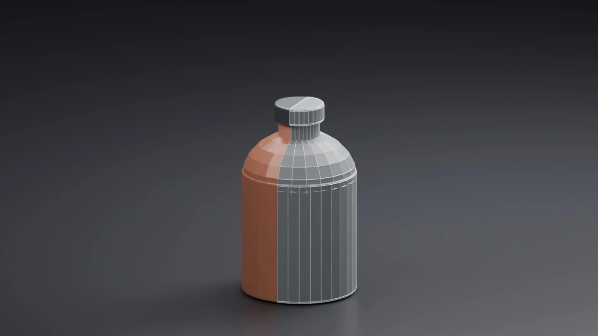

---

group: "ai-product-photography"
title: "Foto di prodotto con IA: cosa creare e controllare"
description: "Usa l'IA per l'immagine del prodotto adeguata e controlla forma, colore, etichetta e variante prima della pubblicazione."
date: 2026-12-11
updated: 2026-12-11
keyword: "fotografia prodotto IA"
cta: "Controlla le diverse viste del tuo prodotto nell’anteprima gratuita."
---

Usa la fotografia dei prodotti con IA per modifiche verificabili, come lo sfondo o la presentazione. Mantieni una foto reale del prodotto per la sua forma, etichetta, finitura e colore. Confronta ogni candidato con quel riferimento prima di pubblicare, soprattutto quando mostra un lato non fotografato o suggerisce un elemento specifico.

## Quali modifiche sono praticabili da verificare?

Parti da una sola foto di prodotto pulita e da un singolo cambiamento, ad esempio uno sfondo neutro. Confronta l'originale e il candidato allo stesso dimensionamento. Verifica l'etichetta a risoluzione completa e il siluetto a dimensione ridotta.

Se generi un'altra vista, confronta i dettagli visibili con una foto reale quando ne hai una. Mantiene il risultato fuori dal gallery fact se non riesci a verificare un elemento critico.

## Come gestisci le varianti?

Usa un'immagine di origine separata per ogni finitura, se cambia il colore o la costruzione. Aggiungi il numero SKU di origine e la revisione della generazione. Controlla il tutto accanto alle foto reali in un foglio di contatto e verifica le regole attuali del canale.

## Cosa verificare prima della pubblicazione?

| Cambiamento                    | Controllo di accettazione                       |
| ------------------------------ | ----------------------------------------------- |
| Nuovo sfondo                   | Contorno pulito e etichetta integra             |
| Nuovo angolo apparente         | Elementi visibili coincidono con il riferimento |
| Colore o trattamento materiale | Varianta e finitura corrette                    |

<!-- IMAGE PENDING: Photograph or capture the example described in the brief. -->

**Fonte** [Google Merchant Center · Product Studio](https://support.google.com/merchants/answer/13708167), [Google Merchant Center · image link](https://support.google.com/merchants/answer/6324350), [Shopify · product photography](https://help.shopify.com/en/manual/products/product-media/product-photography).

[Guida correlata](/it/guide/fotografia-prodotto-ecommerce)

[Come creare il modello 3D](/it/guide/come-creare-un-modello-3d)

## Domande frequenti

### Posso conservare l'immagine originale come record?

Sì. Conserva l'immagine originale accanto alla versione pubblicata e segna il relativo SKU. Ciò rende più semplice effettuare revisioni e correggerle in seguito.

### Devo usare etichette generate?

Mantieni informazioni factuali leggibili e basate sul prodotto reale. Confronta il testo ingrandito e sostituisci l'immagine se l'etichetta contiene informazioni errate.

### Posso valutare soltanto in dimensione piena?

Devi valutare in dimensione piena per i dettagli e verificare la dimensione del thumbnail per l'identificazione. Verifica sempre che l'immagine si adatti bene in una griglia di prodotti e prova l'immagine a dimensione piena contro l'assetto della griglia per assicurarti che i dettagli del prodotto rimangano leggibili. Assicurati che testi e caratteristiche principali siano visibili sia in dimensione piena che ridotta.
