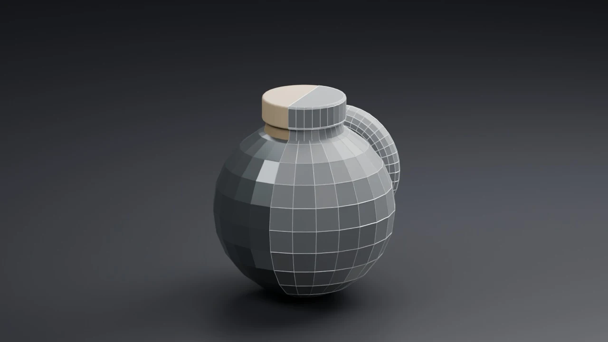

---

group: "product-photography-lighting"
title: "Tre schemi di illuminazione per le foto di prodotto"
description: "Usa tre configurazioni ripetibili di illuminazione per prodotti opachi, superfici riflettenti e dettagli testurizzati."
date: 2026-11-30
updated: 2026-11-30
keyword: "illuminazione fotografia prodotto"
cta: "Controlla le diverse viste del tuo prodotto nell’anteprima gratuita."
---

Scegli la luce in base alla superficie: usa la luce del finestrino con un riflettore bianco per prodotti mati, amplia la fonte per elementi lucidi, e applica luce di sfioro per evidenziare rilievi, pieghe e tessuti. Mantieni posizione della telecamera e esposizione costante quando confronti i setup.

## Come posizionare le fonti?

Posiziona il finestrino o il softbox davanti e da un lato per il baseline. Aggiungi una carta bianca opposta e verificare se l’ombra mantiene ancora profondità. Muovila indietro se la forma sembra piana.

Per superfici lucide, posiziona la diffusione vicino per mostrare una riflessione continua ampia. Per texture, abbassa la luce fino a farla sfiorare la superficie. In entrambi i casi, analizza un punto di luce e un punto di ombra a dimensione naturale.

## Come ripetere il risultato?

Segna posizione della telecamera, luce e oggetto. Scrivi il bilancio di colore e esposizione. Salva un frame con una carta neutra se il colore conta. Confronta l’immagine con l’oggetto reale sotto luce neutra.

## Cosa verificare prima di pubblicare?

| Superficie        | Impostazione                   | Cerca                               |
| ----------------- | ------------------------------ | ----------------------------------- |
| Matto             | Luce laterale e riflettore     | Ombra leggibile                     |
| Lucido            | Diffusione ampia e scudi scuri | Riflessione liscia con bordo chiaro |
| Rilievo o tessuto | Luce laterale bassa            | Texture con highlight intatti       |

<!-- IMAGE PENDING: Photograph or capture the example described in the brief. -->

**Fonte** [Shopify · product photography](https://help.shopify.com/en/manual/products/product-media/product-photography), [GIA · gem and jewelry photography](https://www.gia.edu/gem-photography), [GS1 · product image specification](https://www.gs1.org/standards/gs1-product-image-specification-standard/current-standard).

[Guida correlata](/it/guide/fotografia-prodotto-ecommerce)

[Come creare un modello 3D](/it/guide/come-creare-un-modello-3d)

## Domande frequenti

### Quanti lumi necessiti?

Usa una sola fonte di luce per iniziare il setup. Aggiungi un riflettore solo se l’ombra è leggibile e il bordo è chiaro. Verifica che la luce sia posizionata da un lato e che il punto di ombra sia naturale e non piana.

### Perché i miei prodotti cambiano colore?

L'uso di lumi misti e il white balance automatico possono alterare il risultato. Disattiva le fonti non necessarie, registrati un riferimento e mantieni le impostazioni stabili. Usa una sola fonte di luce per iniziare e verifica che il punto di ombra sia naturale e non piana prima di modificare l’impostazione.

### Cosa devo fotografare per una nota di setup?

Fai una ripresa a campo ampio con l’oggetto e le fonti per il setup. Posiziona il softbox davanti e da un lato con carta bianca opposta. Verifica che l’ombra sia profonda e che la riflessione sia liscia per evitare un effetto piana.
