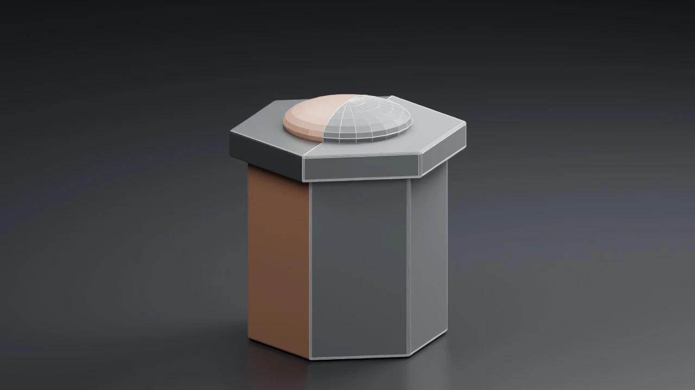
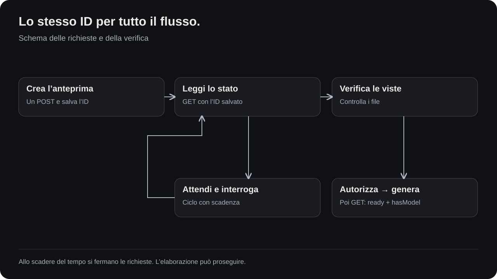

---

group: "n8n-image-to-3d-workflow"
title: "Da immagine a 3D in un flusso n8n"
description: "Connetti n8n a un'API immagine-a-3D. Crea un anteprima, salva l'ID del lavoro, approva la costruzione e scarica il GLB con polling limitato e…"
date: 2026-11-26
updated: 2026-11-26
keyword: "immagine in 3D n8n"
cta: "Controlla le diverse viste del tuo prodotto nell’anteprima gratuita."
---

Per integrare la generazione immagine-a-3D all'interno di n8n, crea un anteprima tramite un nodo HTTP Request, salva l'ID del lavoro e controlla lo stesso job. Dopo l'approvazione, autorizza la versione a pagamento e scarica il file GLB finale. Separare la creazione, l'attesa, l'approvazione e la consegna in modo che un timeout non riavvii il lavoro o sprechi crediti due volte.

> **Salva l'ID prima di aggiungere l'automazione.** Se conosci quale lavoro è collegato all'immagine, puoi riprendere il processo. Se l'unico record è una cella vuota, un riavvio può generare lavoro inutile.

## Qual è il metodo di connessione da scegliere?

Usa REST quando la sequenza è fissa. Usa un agente quando è necessario interpretare una richiesta o scegliere tra strumenti. Un nodo della comunità può semplificare l'installazione, ma non deve determinare se è possibile implementare il flusso completo.

| Metodo                            | Soluzione più adatta                                | Verifica prima di scegliere                                          |
| --------------------------------- | --------------------------------------------------- | -------------------------------------------------------------------- |
| Richiesta HTTP integrata          | Sequenza esplicita con input e output visibili      | Credenziali, forma del corpo e rami di stato                         |
| Nodo della comunità               | Operazioni supportate con setup più semplice        | Disponibilità di installazione e copertura operativa                 |
| Cliente MCP collegato a un agente | Richieste che necessitano di selezione di strumenti | Supporto di trasporto, strumenti disponibili e controlli sul consumo |

Questa guida usa il [nodo HTTP Request](https://docs.n8n.io/integrations/builtin/core-nodes/n8n-nodes-base.httprequest/) e il [contratto REST di easyrender](/image-to-3d-api). Puoi seguire il flusso con i nodi integrati. Per scegliere le azioni in una conversazione, consulta la [guida all’agente n8n e MCP](/it/guide/client-mcp-n8n).

## Cosa hai bisogno prima di aggiungere il primo nodo?

Scegli una foto chiara di un ventilatore da tavolo. L'API accetta JPEG, PNG o WebP fino a 4 MiB. Per un'immagine pubblica HTTPS, usa `image_url`. Per un file locale o privato, caricalo tramite l'endpoint dei file autenticati e utilizza il suo `upload_id` invece.

Crea una chiave API in Connectors. Un workflow in anteprima necessita di `write` per crearla e di `read` per esaminarla. Aggiungi `spend` soltanto alla credenziale utilizzata per un'operazione pagata approvata. Salva la chiave come credenziale di autenticazione del header n8n: `Authorization` è il nome del header e `Bearer YOUR_API_KEY` il suo valore.

| Valore da salvare      | Esempio                        | Da dove proviene                           |
| ---------------------- | ------------------------------ | ------------------------------------------ |
| Record di origine      | `FAN-DESK-01`                  | Il tuo catalogo                            |
| Revisione della foto   | `front-v1`                     | La tua gestione delle fonti                |
| Chiave di creazione    | `FAN-DESK-01-front-v1`         | Chiave stabile per l'input esatto previsto |
| `render_id`            | `id` effettivamente restituito | Risposta di anteprima                      |
| Limite di approvazione | Un intero approvato            | Prezzo attuale più la tua decisione        |

L'URL della foto deve continuare a puntare ai medesimi byte durante un retry. Se la fonte cambia, crea deliberatamente una nuova revisione. Prima di testare il collegamento, usa il [guida alla preparazione della foto](/it/guide/creare-un-modello-3d-da-foto) per eliminare problemi di input evitabili.

## Passo 1: come creare un'anteprima?

Aggiungi un Trigger Manuale e un nodo Edit Fields per il tuo record di origine. Poi configura il primo HTTP Request come segue. Mappa l'URL della tua foto accessibile nel campo immagine.

| Impostazioni del HTTP Request | Valore                                                |
| ----------------------------- | ----------------------------------------------------- |
| Metodo                        | `POST`                                                |
| URL                           | `https://easyrender.ai/api/renders`                   |
| Autenticazione                | Il tuo credenziale di Header Auth                     |
| Header                        | `Idempotency-Key` con la chiave di creazione salvata  |
| Tipo di contenuto del corpo   | JSON                                                  |
| Campo del corpo               | `image_url` mappato dal record di origine             |
| Campo del corpo               | `name` mappato dal nome del prodotto                  |
| Campo del corpo               | `isPublic` impostato a booleano `false`               |
| Formato di risposta           | JSON. Solo il corpo per i percorsi dei campi indicati |

Salva il valore ritornato `id` prima di procedere. Con i header e lo stato della risposta disabilitati, è il valore del corpo della risposta `id`. Se si abilita l'opzione risposta completa, aggiorna le mappature a `body.id`. Non mescolare le due forme di risposta nei nodi.

La chiave di creazione è 1–128 caratteri ASCII stampabili senza spazi. L'utilizzo ripetuto con input identico riproduce lo stesso risultato. Un input diverso genera un conflitto. Questo contratto di idempotenza si applica alla creazione in anteprima, non a ogni POST nel servizio. Mantienila stabile anche in caso di risposta persa.

## Passo 2: come aspettare senza riavviare?

Aggiungi un nodo [Wait](https://docs.n8n.io/integrations/builtin/core-nodes/n8n-nodes-base.wait/) con un intervallo di tempo, seguito da `GET https://easyrender.ai/api/renders/{saved_render_id}`. Un intervallo di 15 secondi e un limite di workflow di 20 minuti sono impostazioni ragionevoli per il test, non garantiscono tempi di generazione. Registrare il limite prima di entrare nel ciclo.

| Stato restituito                            | Branch del flusso di lavoro                            |
| ------------------------------------------- | ------------------------------------------------------ |
| `drafting`                                  | Aspetta, poi effettua una GET sull'ID esistente        |
| `preview_ready`                             | Ferma il ciclo di anteprima e richiedi la revisione    |
| `rendering`                                 | Continua il polling limitato sul costrutto autorizzato |
| `ready` e `hasModel=true`                   | Scarica il modello                                     |
| `failed`                                    | Salva l'errore e ferma questo tentativo                |
| Scaduto il tempo massimo o stato imprevisto | Salva l'ID e lo stato per la riconciliazione           |

Controlla il singolo render, non solo l'endpoint di elenco. Il [contratto API](https://github.com/easyrenderai/easyrender.ai/blob/main/docs/api.md) spiega che l'elenco non avanza i lavori. Un URL presente in una risposta non dimostra che l'artifact corrispondente sia pronto.

## Passo 3: cosa esattamente deve approvare il revisore?

Apri il viewer dell'utente a `https://easyrender.ai/r/{saved_render_id}`. Verifica `hasSheet` prima di etichettare un'immagine come foglio di vista: l'asset di anteprima potrebbe ancora essere la foto di partenza. Se richiedi un foglio a pagamento o una revisione, autorizza separatamente e mantieni il costo nel medesimo record del prodotto.

Aggiorna il render e `GET /api/credits`. Associa la decisione all'ID del render, alla revisione di origine e ai crediti concessi. Il debito residuo è `max(0, renderCredits - credits)`, piuttosto che un prezzo fisso assunto e copiato nel flusso.

Dopo l'approvazione, invia `POST https://easyrender.ai/api/renders/{saved_render_id}/render` con il campo JSON `maxCredits` impostato all'intero autorizzato. Un termine raggiunto o un'approvazione rifiutata deve andare in un ramo di stop. Non collegare né condizione a un'azione a pagamento come continuazione predefinita.

<!-- IMAGE PENDING: unique screenshot of HTTP Request settings and a credential-free status output from a real n8n run. -->

## Passo 4: come scaricare il GLB?

Dopo `ready` e `hasModel=true`, richiedi `/api/renders/{saved_render_id}/model?download=1` con le credenziali dell'utente proprietario. Seleziona una risposta file e un campo di output come `model`. Invia quel binario output al tuo passo di archiviazione o caricamento commerciale.

La [riferimento del formato Khronos](https://www.khronos.org/gltf/) spiega perché GLB è adatto per la distribuzione di un modello. Mantieni tre destinazioni distinte: la pagina del viewer proprietario, l'endpoint di download autenticato e il file caricato nel tuo store. Non sono collegamenti intercambiabili.

I collegamenti ai modelli privati richiedono autenticazione. Per Shopify, usa la sequenza di caricamento e elaborazione [media upload and processing sequence](https://shopify.dev/docs/apps/build/product-merchandising/products-and-collections/manage-media) dopo aver scaricato il file. Mai mettere una chiave API in un URL per rendere accessibile quel collegamento all'interno del negozio.

## Quali errori devi gestire esplicitamente?

| Sintomo                       | Causa da verificare                        | Recupero                                                                   |
| ----------------------------- | ------------------------------------------ | -------------------------------------------------------------------------- |
| HTTP 401                      | Chiave errata, scaduta o revocata          | Correggi la credenziale. Mantieni l'ID del job                             |
| HTTP 403                      | Scopo mancante o limite di chiave esaurito | Controlla il codice errore e i limiti delle chiavi autorizzate             |
| HTTP 402                      | Crediti dell'account insufficienti         | Ferma il consumo e richiedi una decisione sul budget                       |
| HTTP 409 durante la creazione | Chiave riutilizzata con input diverso      | Recupera la richiesta precedente o versiona deliberatamente la nuova fonte |
| HTTP 429                      | Limite di velocità/concorrenza             | Leggi `Retry-After` e ritarda la prossima richiesta                        |
| POST pagato scade             | Risultato sconosciuto                      | Controlla il job salvato. Non ripetere l'azione in modo esclusivo          |
| Il file contiene JSON         | Risposta con errore salvata come modello   | Verifica lo stato e il tipo di contenuto prima della conservazione         |

Per il pacing, [n8n documenta il trattamento del rate-limit](https://docs.n8n.io/integrations/builtin/handle-rate-limits.md). Evita Retry On Fail generico sui nodi pagati. Letture sicure e mutazioni incerte richiedono percorsi di recupero diversi, anche quando entrambi mostrano un marker rosso di esecuzione.

## Come si testa il flusso prima di utilizzare un catalogo?

Prova prima la lettura delle credenziali e la creazione di un preview con una sola foto. Verifica che il record contenga l'ID restituito e che il ripristino con la stessa chiave di creazione non generi un altro render. Ferma il processo al review fino a quando non hai un budget esplicito per la costruzione.

Prova poi i rami utilizzando fixture di risposta rappresentativi: `drafting`, `preview_ready`, `ready`, `failed` e un errore di rate-limit. I controlli sui fixture validano la routing, non il servizio di rendering in tempo reale. Una esecuzione autenticata finale è comunque necessaria per verificare il funzionamento completo del flusso n8n configurato.

Lo schema deployato è stato verificato per questo documento. Non è stato utilizzato un run pagato per affermare un tempo di completamento o un tasso di successo. Per le scelte metodologiche sottostanti, vedi [come creare un modello 3D](/it/guide/come-creare-un-modello-3d). Estendi a batch soltanto dopo che un modello accettato ha raggiunto la sua destinazione prevista.

## Domande frequenti

### La creazione di un render avvia anche il modello pagato?

Creare un render non avvia il modello pagato. La creazione del preview restituisce un ID render e avvia la fase di preview. Il build 3D pagato è un'azione separata con autorizzazione propria. Salva l'ID, verifica il risultato disponibile e controlla il costo prima di procedere a sospensare il flusso senza perdere progressi.

### Posso usare una foto che non è pubblicamente ospitata?

Sì. Invia il file all'endpoint di upload autenticato, poi usa l'ID di upload restituito come fonte del preview. L'identificativo è a livello di proprietario e scade dopo un'ora, quindi crea il render entro quel periodo e salva l'ID separato per successive query e recupero.

### Riceve n8n il modello completato immediatamente?

No. La creazione e il costrutto restituiscono informazioni sul job mentre il processo continua. Polla l'ID render salvato e richiedi sia lo stato pronto che la disponibilità del modello prima di scaricarlo. Se il tuo flusso raggiunge il termine, conserva il job per controlli successivi, piuttosto che considerare il termine come prova che la generazione è fallita.

### È possibile automatizzare il download di USDZ con lo stesso endpoint?

L'endpoint del modello in questa ricetta restituisce GLB. Il contratto REST non definisce un endpoint di conversione in USDZ, quindi aggiungere un'estensione al URL non creerà il file. Usa il flusso di esportazione supportato dal viewer o un passaggio di conversione verificato separatamente quando la destinazione richiede specificamente USDZ.
