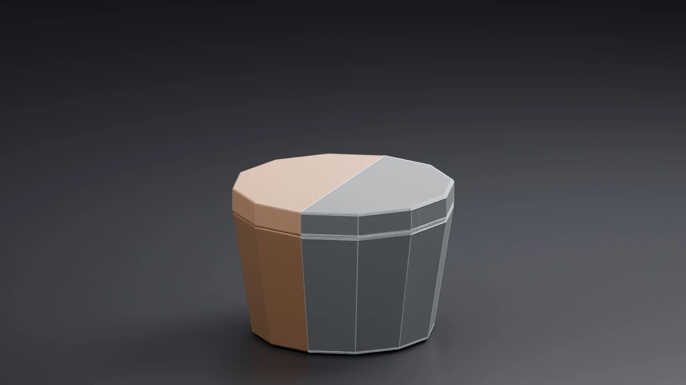

---

group: "low-poly-vs-high-poly"
title: "Low poly o high poly in un visualizzatore di prodotto"
description: "Scegli la dettagliate della mesh in base alla distanza della telecamera, al silueto e al dispositivo target, piuttosto che a un limite di triangoli."
date: 2026-12-16
updated: 2026-12-16
keyword: "low poly vs high poly"
cta: "Controlla le diverse viste del tuo prodotto nell’anteprima gratuita."
---

Scegli il dettaglio della mesh in base a ciò che il cliente deve vedere. Mantieni la geometria sugli outline, sulle curve e sui fori che contano quando il prodotto viene rotato. Usa i texture per i dettagli superficiali fini quando possibile. Confronta due versioni alla dimensione effettiva del gallery e al livello di ingrandimento più vicino consentito dal visitatore.

## Quali dettagli devono rimanere in geometria?

Mantieni i bordi delle gambe del tavolo, le aperture dei manici e il bordo di un contenitore se influiscono sulla silhouette o sulla parallasse. Disegna o applica il dettaglio superficiale fine dove non altera il contorno. Verifica anche i bordi delle ombre e i riflessi, insieme alla mesh.

## Come scegli il target?

Il nostro tavolo da caffè ha 16,228 triangoli e il nostro tavolo da letto ha 69,910.. Entrambi hanno un solo materiale. Si tratta di oggetti diversi, quindi nessun numero è un budget universale. Per una decisione, confronta due esportazioni dello stesso oggetto, con lo stesso cornice, materiale e dispositivo.

## Cosa verificare prima di pubblicare?

| Dove conta           | Mantenere o testare                                       |
| -------------------- | --------------------------------------------------------- |
| Silhouette esterna   | Verifica l'outline in vista frontale e profilo            |
| Accessori e aperture | Conserva le crepe reali e le intersezioni                 |
| Grana superficiale   | Testa il dettaglio della texture in ingrandimento elevato |

<!-- IMAGE PENDING: Photograph or capture the example described in the brief. -->

**Fonte** [Blender · Modificatore Decimate](https://docs.blender.org/manual/en/latest/modeling/modifiers/generate/decimate.html), [Khronos · specifica glTF 2.0](https://registry.khronos.org/glTF/specs/2.0/glTF-2.0.html), [model-viewer · documentazione](https://modelviewer.dev/docs/)

[Guida correlata](/learn/glb-file)

[Come creare un modello 3D](/it/guide/come-creare-un-modello-3d)

## Domande frequenti

### Esiste un limite standard per il low-poly?

Non esiste un limite standard per il low-poly: il numero dipende dall'oggetto e dal dispositivo. Imposta il numero di triangoli confrontando due esportazioni dello stesso oggetto. Verifica la silhouette e i dettagli superficiali in ingrandimento elevato per evitare perdite di dettaglio.

### Da cosa devo partire per la semplificazione?

Inizia dalle aree nascoste dalla vista o dalle superfici piane con geometria eccessiva. Semplifica una zona alla volta e confronta il risultato.

### Un mappaggio normale salva i dettagli del silueto?

Usa un mappaggio normale per i dettagli superficiali. Non salva i dettagli del silueto. Mantieni la geometria base dove la forma modifica l'outline o crea un'apertura visibile. Verifica che il silueto del modello low-poly rimanga netto e visibile nel visualizzatore 3D.
