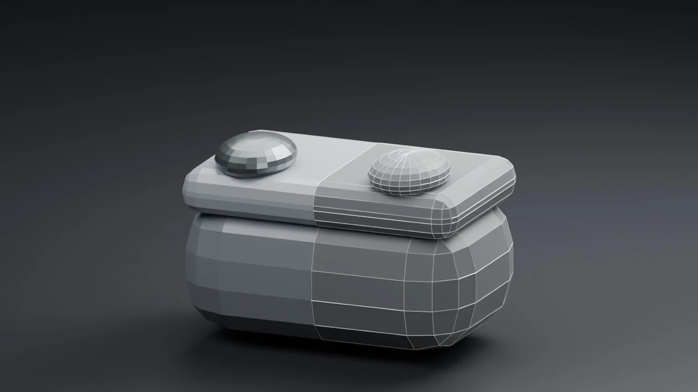
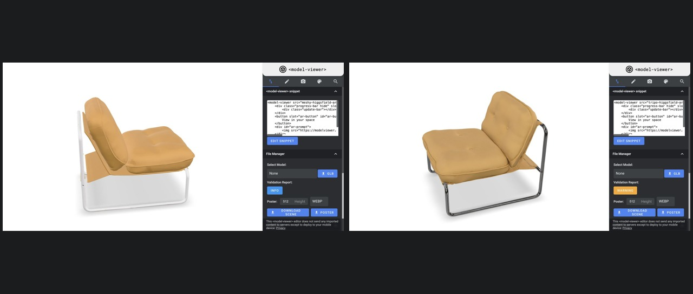

---

group: "meshy-vs-tripo"
title: "Meshy o Tripo per creare 3D da foto di prodotto"
description: "Confronta Meshy e Tripo su una stessa foto di prodotto. Verifica silhouette, dettagli, materiali e ciò che puoi esportare."
date: 2026-11-23
updated: 2026-11-23
keyword: "Meshy vs Tripo"
cta: "Controlla le diverse viste del tuo prodotto nell’anteprima gratuita."
publishAt: "2026-11-23"
---

Confronta Meshy e Tripo con la stessa foto del prodotto senza ritocchi, poi valuta il risultato nella vista che realmente necessiti. Per un modello da negozio, controlla la silhouette e il retro prima di valutare il finish. La scelta dipende dal file esportato se la tua prossima fase è Shopify, Blender o un altro visualizzatore.

## Quando conviene scegliere Meshy o Tripo?

- **Parti da Meshy** se vuoi confrontare una foto con più viste direttamente nell’app web. Metti prima la vista frontale e aggiungi fino a tre foto della stessa finitura. [Guida Meshy alle immagini di partenza](https://docs.meshy.ai/en/webapp/image-to-3d).
- **Parti da Tripo** se il tuo flusso identifica già fronte, retro e lati o se devi modificare una mesh a quadrilateri. L’API accetta viste con un nome e offre un modello con topologia nativa a quadrilateri. [API multivista di Tripo](https://developers.tripo3d.com/en/docs/generation-multiview-to-model/standard), [modello Tripo P2](https://developers.tripo3d.com/en/models/p2).

Se parti da una sola foto e devi consegnare un GLB, apri entrambi i file nello stesso visualizzatore prima di scegliere. Controlla innanzitutto il retro, le parti sottili e i materiali.

## Cosa renderebbe uno strumento la scelta migliore?

| Se il compito è…                        | Decidere utilizzando…                                        |
| --------------------------------------- | ------------------------------------------------------------ |
| Mostrare il prodotto da un altro angolo | Silhouette, aperture e piedi riconoscibili                   |
| Corrispondere al finish del catalogo    | Continuità della texture e dettagli visibili nella foto      |
| Delivare un modello a un'altra app      | Esportazione reale, dimensione del file e risultato riaperto |
| Mantenere i costi di produzione bassi   | Crediti e tempo di editing per ogni modello accettato        |

## Cosa abbiamo misurato dalla stessa foto?

Abbiamo inviato la stessa foto di un divano a entrambi i modelli su 15 nel mese di novembre e abbiamo aperto entrambi i file nello stesso visualizzatore esterno. Gli esecuzioni hanno utilizzato i crediti Higgsfield già disponibili sul conto. Le impostazioni registrate differivano per il trattamento PBR e della texture.

| File salvato in GLB |      Byte | Triangoli | PBR abilitato |
| ------------------- | --------: | --------: | ------------- |
| Meshy 7             | 2,824,116 |    27,415 | No            |
| Tripo H3.1          | 3,846,052 |    27,067 | Sì            |

Tratta la tabella come un elenco di quei due file. Per una decisione d'acquisto basata sulla mesh, sulla fedeltà materiale o sulla velocità, esegui entrambi con impostazioni equivalenti e utilizza la stessa telecamera. [Apri il record di misurazione](/benchmarks/2026-11-15/measurements.json)

## Come si riproduce il confronto?

Usa una foto con un riferimento di fondo o lato esposto per la revisione. Segna la data, il modo, la revisione e il numero di immagini d'input per entrambi gli strumenti. Cattura gli stessi angoli frontale, posteriore e laterale.

Marcia ogni criterio come confermato, incerto o errato. Se è disponibile un'export, apri il file in un visualizzatore separato e nota le impostazioni del visualizzatore. Tratta l'accesso al file come un criterio autonomo.

## Cosa dovresti verificare prima di pubblicare?

| Guarda                         | Registrati                                            |
| ------------------------------ | ----------------------------------------------------- |
| Silhouette frontale e laterale | Dove l'outline si discosta                            |
| Retro e lato inferiore         | Quali strutture visibili potrebbero essere confermate |
| Esporta                        | Se il file aperto con texture                         |

**Fonte** [Meshy · immagine a 3D](https://docs.meshy.ai/en/webapp/image-to-3d), [Tripo · immagine a 3D](https://developers.tripo3d.com/en/docs/generation-image-to-model/standard), [Khronos · specifica glTF 2.0](https://registry.khronos.org/glTF/specs/2.0/glTF-2.0.html)

[Guida correlata](/it/confronti/meshy)

[Come creare un modello 3D](/it/guide/come-creare-un-modello-3d)

## Domande frequenti

### Quale strumento devo provare per primo?

Prova Meshy per la sua esportazione in GLB con bassi byte e triangoli. Inserisci la foto del prodotto e seleziona l'opzione "PBR disabilitato" nel modulo di input. Il errore comune è abilitare PBR per perdere dettagli di texture, come dimostrato nei dati di novembre.

### Posso confrontare un screenshot con un modello esportato?

Usa i screenshot per ciò che è visibile in ciascun servizio. Riserva giudizi sulla struttura della mesh, sui mappaggi materiali e sulla compatibilità downstream per file che puoi esaminare separatamente. Cattura gli stessi angoli frontale, posteriore e laterale per un confronto accurato tra i due modelli.

### Cosa costituisce un'immagine d'input equa?

Fai partire entrambi i tool con la stessa immagine e la stessa dimensione. Salva una vista di riferimento per valutare il retro quando la hai disponibile. Effettua un trial separato se desideri anche confrontare l'input multi-view.
