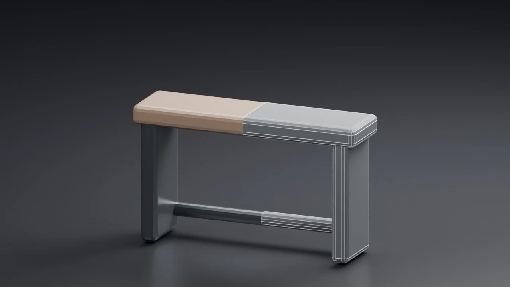
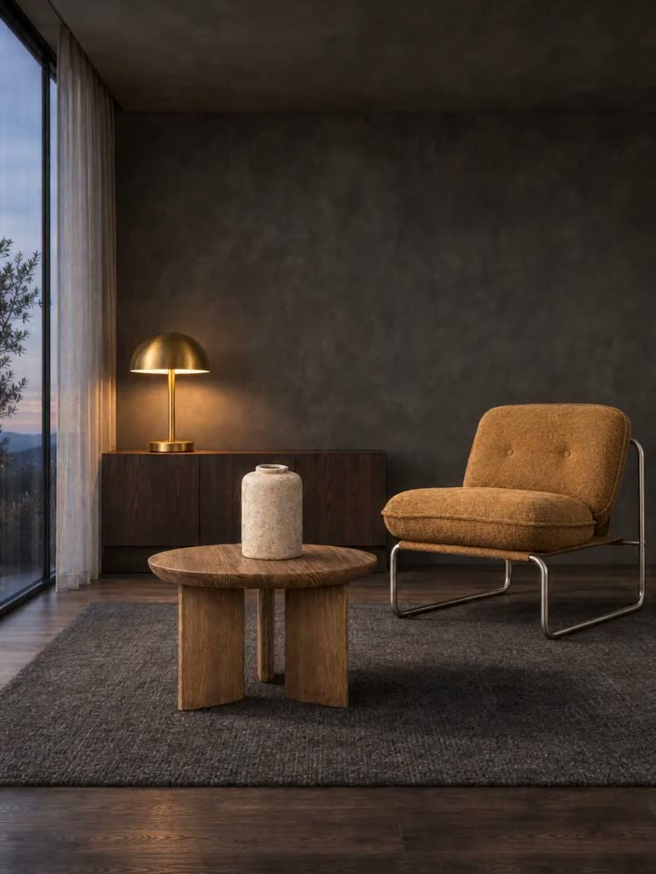

---

group: "3d-furniture-models-home-staging"
title: "Come usare mobili 3D in una scena di home staging"
description: "Posiziona un modello esistente di mobili in una scena di stanza, poi verifica la proporzionalità, il contatto con il pavimento e l'illuminazione."
date: 2026-12-08
updated: 2026-12-08
keyword: "modelli 3D mobili home staging"
cta: "Controlla le diverse viste del tuo prodotto nell’anteprima gratuita."
---

Aggiungi un modello di mobili 3D a una scena esistente controllando prima l'orientamento e il punto di pivot. Usa dimensioni verificate indipendentemente per posizionarlo nell'editor. Adatta la luce, posiziona l'oggetto sul pavimento e verifica la scena dal punto di vista finale e da una vista secondaria.

## Come prepari l'oggetto?

Apri una copia nell'editor della scena. Verifica la direzione avanti e se il pivot rende la posizione prevedibile. Imposta le unità secondo il briefing del progetto e usa le specifiche misurate del prodotto quando l'accuratezza dimensionale è fondamentale.

## Come rendi la posizione credibile?

Posiziona il mobile con un oggetto neutro o di riferimento per valutare la proporzionalità. Adatta la direzione della luce e verifica il contatto dal punto di vista. Ruota la vista per assicurarti che non intersechi muri o mobili vicini. Salva l'oggetto isolato come asset per varianti.

## Cosa verificare prima di pubblicare?

| Problema                     | Soluzione                                                               |
| ---------------------------- | ----------------------------------------------------------------------- |
| L'oggetto appare sospeso     | Verifica il lato inferiore e l'ombra di contatto                        |
| Il mobile sovrappone un muro | Controlla la posizione da sopra                                         |
| La scena sembra un negozio   | Usa oggetti da posizionare che supportino il layout senza coprire prove |

<!-- IMAGE PENDING: Photograph or capture the example described in the brief. -->

**Fonte** [Blender · Asset Browser](https://docs.blender.org/manual/en/latest/editors/asset_browser.html), [Blender · units](https://docs.blender.org/manual/en/latest/scene_layout/scene/properties.html#units), [Khronos · glTF 2.0 specification](https://registry.khronos.org/glTF/specs/2.0/glTF-2.0.html).

[Biblioteca dei modelli (EN)](/models)

[Come creare un modello 3D](/it/guide/come-creare-un-modello-3d)

## Domande frequenti

### Posso usare un modello da una libreria?

Sì, puoi utilizzare un modello da una libreria, a patto che abbia diritti adeguati e sia in un formato compatibile. Verifica il modello per dettaglio, orientamento e distanza finale di visione. Successivamente, controlla il formato del file e assicurati che corrisponda ai requisiti di importazione del tuo software di staging.

### Hai bisogno di misure esatte di origine?

Non è necessario avere misure esatte di origine se il mobili viene utilizzato esclusivamente per l'aspetto. Per una precisione dimensionale, usa misure verificate e controlla il foglio con le dimensioni ufficiali del prodotto per confermare che la scala del modello 3D corrisponda al catalogo. Verifica la scala del modello contro il catalogo prima di effettuare il staging.

### Come mostro le opzioni al cliente?

Mostra al cliente diversi modelli 3D di mobili nello stesso ambiente con una stessa posizione della telecamera e illuminazione coerente. Seleziona un modello alla volta, modificando solamente il mobile per confrontare le disposizioni. Successivamente, assicurati che tutti i modelli 3D siano correttamente scalati e allineati alle dimensioni della stanza prima di condividere.
