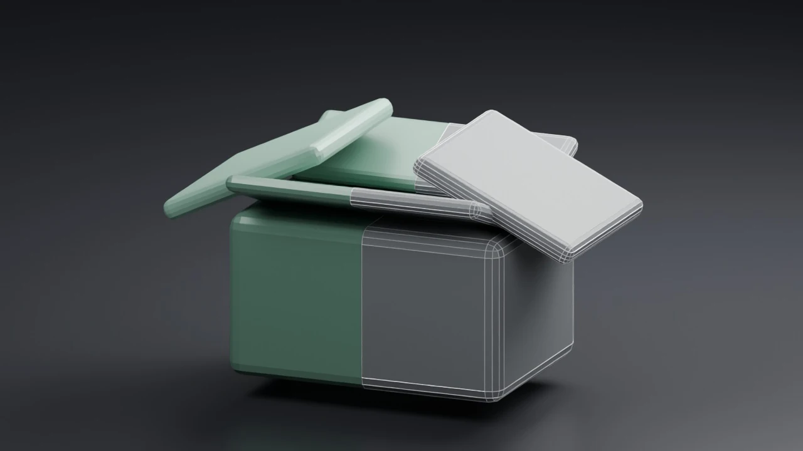

---

group: "shopify-3d-models"
title: "Come aggiungere modelli 3D ai prodotti su Shopify"
description: "Carica un modello di prodotto su Shopify, verifica il tuo tema e prova come i clienti lo vedono sia in web che su mobile."
date: 2026-11-20
updated: 2026-11-20
keyword: "modelli 3D Shopify"
cta: "Controlla le diverse viste del tuo prodotto nell’anteprima gratuita."
---

Aggiungi un GLB o USDZ alla galleria multimediali di un prodotto su Shopify e visualizzalo con il tema del negozio. Verifica il risultato sia su telefono che su desktop. Mantieni una foto del prodotto come primo elemento multimediale in modo che l'elenco funzioni anche mentre il modello si carica.

## Cosa dovresti verificare prima dell'upload?

Seleziona un prodotto esistente con fotografie chiare. Apri il modello in un viewer standalone per controllare l'orientamento, le superfici e la texture. Registrati la dimensione del file e scegli un thumbnail che mostri cosa aggiunge il modello.

Verifica i formati supportati e i limiti di caricamento nell’elenco multimediali di Shopify. Il tema deve supportare il tipo di media 3D o essere adattato per visualizzarlo. Conferma questo su un prodotto in bozza o su un tema di sviluppo prima.

## Come trovare un viewer mancante?

Apri il prodotto nell'admin di Shopify e aggiungi il file nella sezione Media. Aspetta che il processo di elaborazione termini e salva il prodotto. Apri il preview del negozio, seleziona il modello e gira il prodotto verso il retro e verso il basso.

Se il modello funziona nell'admin ma non appare nel storefront, controlla prima la sezione prodotto-media del tema. Verifica la visualizzazione su mobile e su una sessione nuova. Dove è abilitato l'AR, apri l'esperienza su un dispositivo compatibile e torna nel negozio.

## Cosa dovresti verificare prima di pubblicare?

| Cosa accade                                         | Dove cercare                                    |
| --------------------------------------------------- | ----------------------------------------------- |
| Caricamento rifiutato                               | Formato e limiti di file                        |
| Preview nell'admin funziona ma il viewer non appare | Supporto per multimediali nei prodotti nel tema |
| Il viewer funziona ma l'AR non si apre              | Dispositivo, browser e file AR                  |

<!-- IMAGE PENDING: Photograph or capture the example described in the brief. -->

**Fonte** [Shopify · media prodotto](https://help.shopify.com/en/manual/products/product-media), [Shopify · tipi di media](https://help.shopify.com/en/manual/products/product-media/product-media-types), [Shopify · gestione media prodotto](https://shopify.dev/docs/apps/build/product-merchandising/products-and-collections/manage-media), [Apple · Quick Look](https://developer.apple.com/quick-look-gallery/).

[Guida correlata](/learn/3d-models-for-ecommerce)

[Come creare un modello 3D](/it/guide/come-creare-un-modello-3d)

## Domande frequenti

### Ogni tema Shopify mostra il modello 3D?

Shopify elenca temi con supporto a media prodotto. Verifica la versione in produzione e il template del prodotto dove apparirà il modello. Un tema personalizzato potrebbe richiedere modifiche.

### Qual è il file da caricare?

Carica un file in formato glb o usd o in formato 3D supportato da Shopify. Apri il modello in un viewer standalone per verificare l'orientamento e la texture. Il modello può non visualizzarsi nel storefront se il tema non lo supporta o se il file è troppo grande.

### Devo sostituire la foto hero con il modello?

Sostituisci la foto hero con il modello solo se il tema lo supporta. Aggiungi il file nel media di Shopify e aspetta il processo di elaborazione. Verifica che il modello si mostri nel preview e non sia bloccato dal tema o dal dispositivo.
