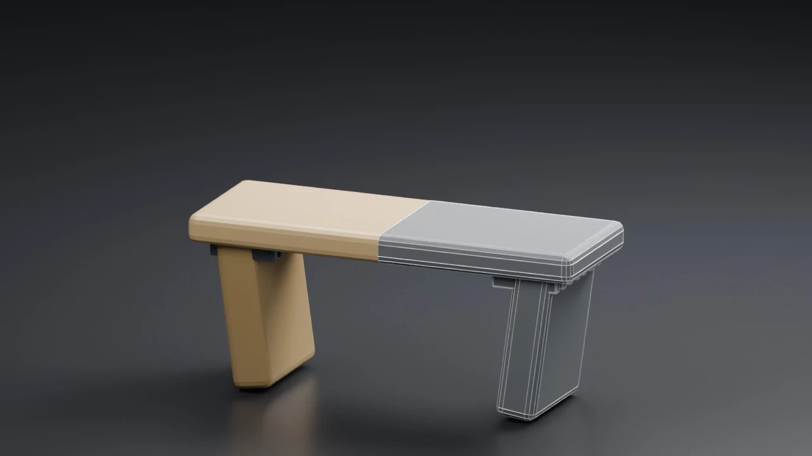
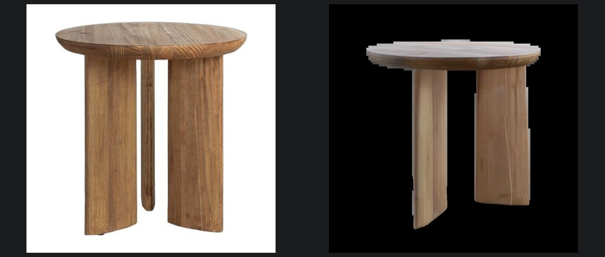

---

group: "furniture-model-from-photo"
title: "Come creare un modello 3D di un mobile da una foto"
description: "Prepara una foto del mobile, verifica gli angoli generati e controlla il modello prima di usarlo in un catalogo."
date: 2026-11-27
updated: 2026-11-27
keyword: "modello 3D mobile da foto"
cta: "Controlla le diverse viste del tuo prodotto nell’anteprima gratuita."
---

Inizia con una foto nitida che mostri il lato anteriore, il lato laterale e i piedi del mobile. Verifica gli angoli generati per le parti caratteristiche prima di costruire il modello. Dopo l'esportazione, apri il GLB effettivo separatamente e controlla la silhouette, le superfici e i dettagli alla dimensione che i clienti vedranno.

## Da quale immagine devi partire?

Usa un'immagine a tre quarti con il mobile isolato. Lascia spazio sotto i piedi e evita oggetti che coprono l'outline. Fissa l'esposizione in modo che un tavolo luminoso mantenga i dettagli e gli elementi in metallo scuri rimangano visibili. Conserva fotografie reali delle altre superfici per il controllo.

## Come accetti il modello?

Confronta il preview con la fonte e le tue viste di riferimento. Conta i piedi, i manici e le aperture. Apri il modello generato, gira il mobile e controlla i giunti e il lato inferiore. Il nostro GLB pubblico per tavolo da caffè ha triangoli 16,228 e richiede 322,876 bytes. Confronta il tuo file con il budget del destinatario.

## Cosa devi verificare prima di pubblicare?

| Verifica                | Accetta quando                                    |
| ----------------------- | ------------------------------------------------- |
| Il numero di componenti | Le parti visibili corrispondono al riferimento    |
| Finishing               | Il prodotto è ancora riconoscibile in luce neutra |
| Esporta                 | Si apre nel visualizzatore previsto               |

**Fonte** [Khronos · specifica glTF 2.0](https://registry.khronos.org/glTF/specs/2.0/glTF-2.0.html), [Khronos · Validator glTF](https://github.com/KhronosGroup/glTF-Validator), [Shopify · creazione modelli 3D](https://help.shopify.com/en/partners/manage-clients-stores/creating-media/3d-models/creating-3d-models).

[Guida correlata](/it/guide/creare-un-modello-3d-da-foto)

[Come creare un modello 3D](/it/guide/come-creare-un-modello-3d)

## Domande frequenti

### Devo fotografare il retro separatamente?

Conservalo come riferimento se il retro contiene elementi significativi. Un angolo generato è una previsione. Usa fotografie fisiche per dettagli che devono essere confermati.

### Cosa fare se un piede sottile si fonde con lo sfondo?

Se un piede sottile si fonde con lo sfondo, regola lo sfondo o l'illuminazione per definire il suo bordo. Mantieni una distanza di fotocamera adeguata per catturare l'intero oggetto quando i piedi si allargano. Successivamente, verificare che il bordo del piede sia chiaramente visibile nella foto prima di procedere al modello.

### Qual è il file da inviare alla bottega?

Inizia con il formato accettato dal destinatario. Prova il file trasmesso stesso e conserva le foto di riferimento e la versione modificabile originale. Manda il file in formato glTF con l'immagine del mobile da tre quarti e i dettagli dei piedi e dei manici visibili.
