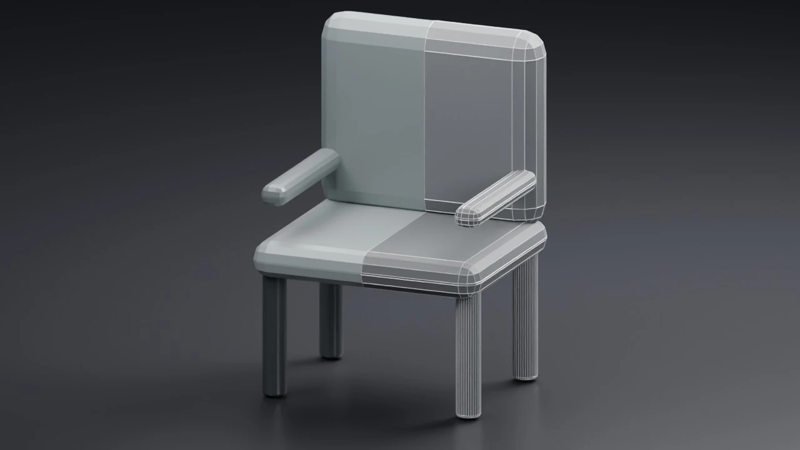

---

group: "augmented-reality-furniture"
title: "Come controllare un mobile in realtà aumentata"
description: "Verifica il posizionamento, l'aspetto e il percorso sul telefono per tornare alla pagina del prodotto arredamento."
date: 2026-12-01
updated: 2026-12-01
keyword: "realtà aumentata mobili"
cta: "Controlla le diverse viste del tuo prodotto nell’anteprima gratuita."
---

Verifica un modello di arredamento in realtà aumentata su un telefono compatibile prima di collegarlo dalla pagina del prodotto. Prova l'entry point, l'orientamento, la posizione sul pavimento e il ritorno al browser. Mantieni le dimensioni verificate nelle specifiche del prodotto e usa la sessione AR per valutare la presentazione visiva.

## Qual è il percorso da testare?

Apri la pagina visibile al cliente sul telefono di destinazione e fai clic sullo stesso controllo che l'utente utilizzerà. Su dispositivi Apple, verifica che l'asset si apra in Quick Look, quando supportato. Per altri percorsi controlla il modo AR e le richieste di dispositivo indicati nel viewer.

## Cosa dovresti registrare?

Usa un pavimento pulito e buona illuminazione. Posiziona il modello, cammina intorno a esso e verifica se è orientato nella direzione prevista e se appare in posizione corretta sul pavimento. Torna alla pagina del prodotto e conferma che la variante attiva sia ancora corretta.

## Cosa devi verificare prima di pubblicare?

| Problema                | Diagnosi                                                  |
| ----------------------- | --------------------------------------------------------- |
| L'oggetto appare rotato | Verifica l'orientamento esportato e la posizione iniziale |
| L'azione AR manca       | Dispositivo, browser e modalità viewer                    |
| Apre il pezzo sbagliato | Verifica l'URL di origine della variante attiva           |

<!-- IMAGE PENDING: Photograph or capture the example described in the brief. -->

**Fonte** [Apple · Quick Look](https://developer.apple.com/quick-look-gallery/), [model-viewer · documentazione](https://modelviewer.dev/docs/), [Apple · Preparazione del contenuto 3D per RealityKit](https://developer.apple.com/documentation/arkit/previewing-a-model-with-ar-quick-look).

[Guida correlata](/it/guide/file-usdz)

[Come creare un modello 3D](/it/guide/come-creare-un-modello-3d)

## Domande frequenti

### I clienti hanno ancora bisogno delle dimensioni del prodotto?

Sì. Fornisci le dimensioni verificate dal produttore e verifica che appartengano alla versione selezionata. Usa l'AR per il contesto visivo.

### Cosa deve vedere un telefono non supportato?

Mantieni le foto del prodotto e, quando possibile, l'interfaccia web accessibile. Verifica che la pagina continui a fornire informazioni sul prodotto e i controlli di acquisto. Posiziona il modello in un ambiente aperto con illuminazione uniforme e verifica che sia visibile e orientato correttamente dal punto di vista dell’utente.

### Posso testare solo su un desktop?

Puoi testare il modello di arredamento in realtà aumentata su un desktop per verifiche iniziali del file. Esegui il percorso effettivo su un telefono supportato prima di pubblicare un punto d'ingresso in realtà aumentata. Verifica il posizionamento, l'aspetto e il percorso sul telefono per garantire l'accuratezza.
