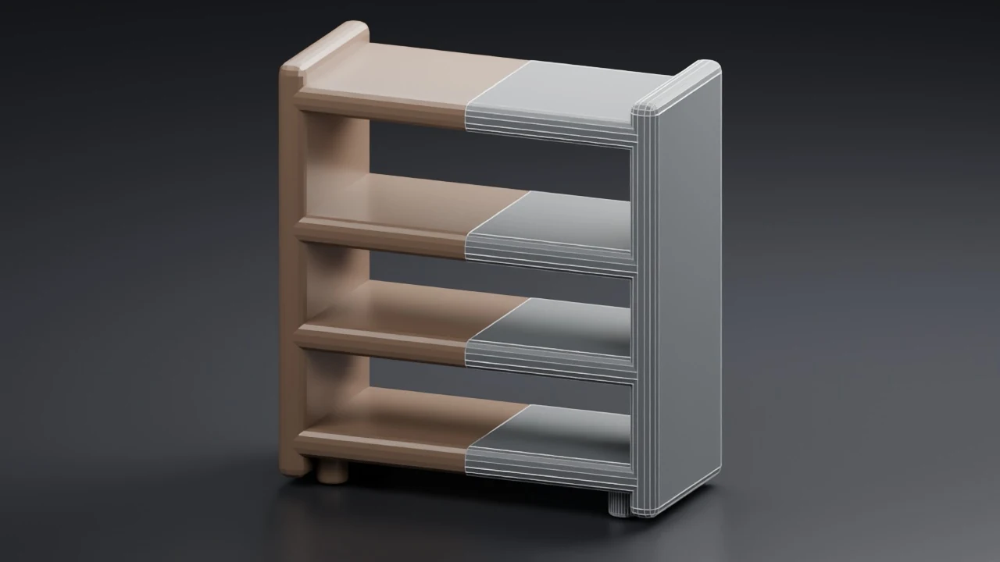

---

group: "furniture-product-page-best-practices"
title: "Cosa inserire in una scheda prodotto di arredamento"
description: "Crea una pagina di prodotto per arredamento con dimensioni verificate, varianti chiare, dettagli di consegna e una gallery utile."
date: 2026-12-05
updated: 2026-12-05
keyword: "scheda prodotto arredamento"
cta: "Controlla le diverse viste del tuo prodotto nell’anteprima gratuita."
---

Fornisci ai clienti le informazioni necessarie per scegliere e ricevere l'arredamento. Posiziona il modello scelto, il prezzo, le dimensioni e il tempo di consegna vicino ai bottoni di acquisto. Usa la galleria per mostrare il materiale e la costruzione. Aggiungi una vista 3D in cui un elemento difficile da vedere viene reso più comprensibile.

## Cosa deve vedere il cliente prima di aggiungere all'carrello?

Mostra il nome, il finish scelto, la disponibilità e la stima di consegna in un blocco unificato. Inserisci la larghezza, la profondità e l'altezza complessiva in un blocco facilmente accessibile. Include misure pratiche, come l'altezza del sedile o l'area di posa con i cassetti aperti, quando sono state verificate.

## Come si verifica una variante?

Scegli il finish sullo smartphone e verifica che l'immagine principale, il prezzo, la disponibilità, la consegna e il modello riferiscano allo stesso SKU. Testa una variante out-of-stock e una che viene spedita in modo diverso. Mantieni informazioni sull’assemblaggio e sul trasporto facilmente accessibili.

## Cosa verificare prima di pubblicare?

| Domanda                              | Inserisci la risposta                           |
| ------------------------------------ | ----------------------------------------------- |
| Cosa esattamente sto acquistando?    | Selettore di variante e foto attuale            |
| Quali sono le dimensioni verificate? | Blocco delle specifiche e disegno etichettato   |
| Come arriverà il prodotto?           | Note sulla consegna, imballaggio e assemblaggio |

<!-- IMAGE PENDING: Photograph or capture the example described in the brief. -->

**Fonte** [Shopify · product media](https://help.shopify.com/en/manual/products/product-media), [Google Merchant Center · product data](https://support.google.com/merchants/answer/7052112), [GS1 · product image specification](https://www.gs1.org/standards/gs1-product-image-specification-standard/current-standard).

[Guida correlata](/learn/3d-models-for-ecommerce)

[Come creare un modello 3D](/it/guide/come-creare-un-modello-3d)

## Domande frequenti

### Ogni prodotto deve avere un modello 3D?

Parti dai pezzi in cui la rotazione spiega un lato nascosto o la costruzione. Mantieni le foto e le specifiche disponibili indipendentemente dal supporto del visitatore. Verifica che le dimensioni del pacchetto siano distinte dalle dimensioni del pezzo assemblato nel blocco delle misure.

### Devo includere le dimensioni dell'imballaggio?

Inseriscili quando ci sono variazioni sull'accesso, sulla consegna o sull'assemblaggio. Distingui le dimensioni del pacchetto dalle dimensioni verificate del pezzo assemblato.

### Qual è la pagina che devo testare per prima?

Scegli un prodotto con diversi finiture e un'eccezione di consegna. Si evidenzeranno problemi di varianti e di esecuzione che un prodotto a un singolo SKU potrebbe nascondere. Controlla che le dimensioni del pacchetto siano distinte dalle dimensioni verificate del pezzo assemblato nella scheda prodotto.
