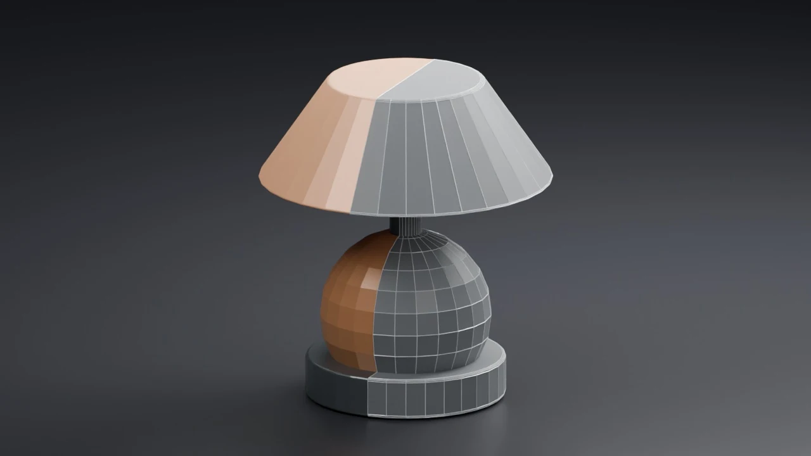
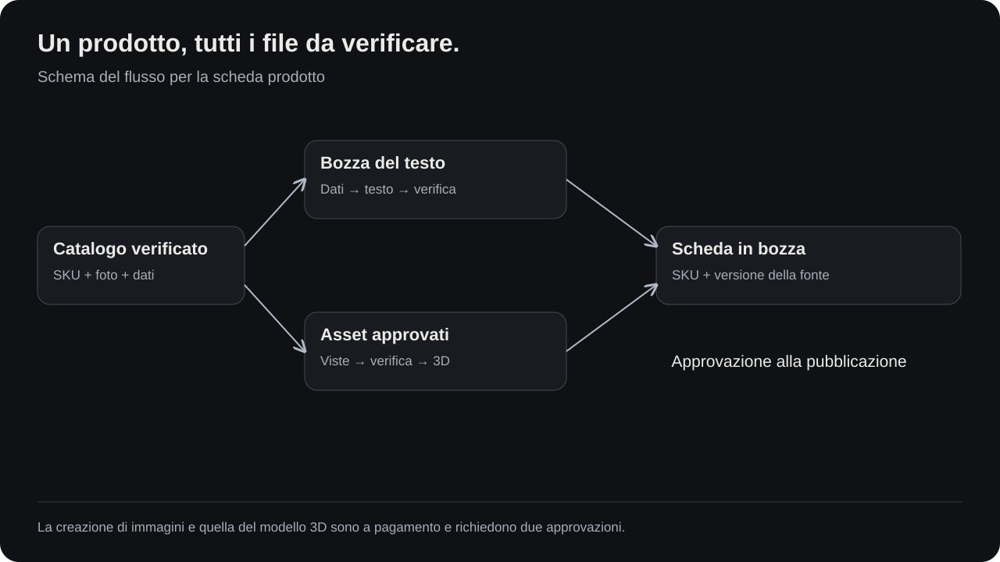
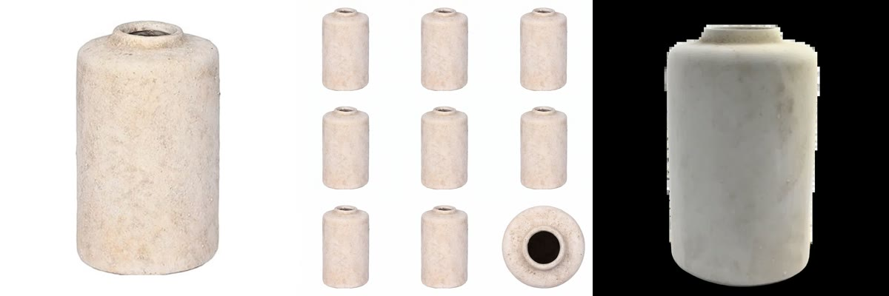

---

group: "n8n-product-pages-images-3d"
title: "Schede prodotto con n8n: testi, immagini e 3D"
description: "Crea schede prodotto con n8n a partire dai dati del catalogo. Prepara testi, immagini e modello 3D e salva una bozza nel CMS dopo aver approvato i costi."
date: 2026-11-18
updated: 2026-11-19
keyword: "schede prodotto n8n"
cta: "Controlla le diverse viste del tuo prodotto nell’anteprima gratuita."
---

Per creare una scheda prodotto con n8n, parti dai dati verificati e prepara testo, immagini e modello 3D in rami distinti. Riunisci i risultati usando lo SKU e la versione della fonte, poi salva la scheda in bozza e registra separatamente l’approvazione della spesa e della pubblicazione.

> **Un listing finale richiede di più di una descrizione.** Mantieni i dati del prodotto, i file delle immagini, il modello 3D e lo stato di pubblicazione insieme. Un'ottima generazione è un passo avanti verso una pagina di prodotto approvata.

## Cosa deve fornire questo flusso?

Per una lampada da tavolo in ceramica, l'output è un pacchetto da valutare: copy accurato, viste selezionate del prodotto, un file GLB e l'identificativo di una bozza nel CMS. GLB è un contenitore binario per un modello 3D, descritto nella [documentazione Khronos glTF](https://www.khronos.org/gltf/). Un video rotante è un altro tipo di deliverable.

| Deliverable                | Fonte di verità                           | Controllo di accettazione                                 |
| -------------------------- | ----------------------------------------- | --------------------------------------------------------- |
| Titolo e descrizione       | Fatti del fornitore più regole editoriali | Nessun materiale, dimensioni o certificazione inventato   |
| Immagini del prodotto      | Set visivo accettato                      | Lo stesso prodotto, finitura e varianti in tutto          |
| File interattivo 3D        | Costruzione approvata                     | Il file si apre, si gira e corrisponde al pezzo accettato |
| Bozza nel CMS              | Mappatura SKU-prodotto                    | Prodotto e varianti corretti, ancora non pubblicati       |
| Registrazione del processo | ID salvati e approvazione                 | Un'altra esecuzione può riprendere il lavoro              |

Il [modello n8n per Shopify](https://n8n.io/workflows/11695-generate-product-descriptions-from-images-and-publish-to-shopify-using-ai/) mostra come generare le descrizioni a partire dalle immagini. Aggiungere 3D richiede uno stato specifico, una revisione e la consegna del file. Questa ricetta descrive quell'architettura. Non è un rapporto su un'implementazione del negozio eseguita.

## Come dovrebbe apparire il pacchetto di listing?

Parti da un oggetto noto per poter verificare il tipo di file da ciascun passaggio. Questo vaso dalla gallery di easyrender mostra l'immagine originale, il foglio generato e il modello esportato. Usa questi file come riferimento quando imposti il flusso.

| Campo da revisione        | Esempio di input                                     |
| ------------------------- | ---------------------------------------------------- |
| Identificatore di esempio | `VASE-DEMO-01`                                       |
| Immagine di riferimento   | [Apri l'immagine di origine](/showcase/vase.jpg)     |
| Viste da revisionare      | [Apri il foglio generato](/showcase/vase-angles.jpg) |
| Modello per la galleria   | [Apri il file di esempio GLB](/showcase/vase.glb)    |
| Stato del listing         | Esempio di bozza                                     |

**Verifica che tutti e tre gli asset siano assegnati allo stesso SKU.** Apri il modello separatamente e mantieni disponibile l'immagine di origine quando si verifichino forma e finitura. Questo esempio utilizza asset esistenti per mostrare cosa deve ricevere il revisore.

## Che cosa abbiamo verificato in n8n?

In n8n 2.48.5 abbiamo cambiato di proposito l’ordine dei file di tre SKU di esempio. Il flusso ha unito i dati per SKU e versione di origine, ha scaricato i due GLB pubblici approvati e ne ha verificato le intestazioni binarie e le lunghezze dichiarate. La poltrona è rimasta in revisione perché il modello apparteneva a una versione precedente.

| SKU           | Versione di origine | Risultato                     |
| ------------- | ------------------- | ----------------------------- |
| VASE-DEMO-01  | v2                  | Bozza con GLB da 400.792 byte |
| TABLE-DEMO-01 | v3                  | Bozza con GLB da 326.872 byte |
| CHAIR-DEMO-01 | v3 con modello v2   | In attesa di revisione        |

La prova copre l’unione e la validazione di file esistenti. La generazione delle immagini, la creazione 3D a pagamento e la pubblicazione nel negozio richiedono una prova a parte. [Importa il flusso di esempio](../evidence/n8n-local-draft-workflow.json), [vedi il risultato dell’esecuzione](../evidence/n8n-local-draft-result.json).

## Quali informazioni devono provenire dal tuo catalogo?

Crea un record di partenza con lo SKU, la versione dei dati originali e le informazioni verificate. Lascia vuoti i campi sconosciuti. Prevedi tre approvazioni separate per le immagini, il costo del modello 3D e la pubblicazione. Usa questi campi: `sku`, `source_version`, `name`, `material`, `dimensions`, `image_url` e `locale`.

| Campo                | Valore esempio                    | Perché conta                                         |
| -------------------- | --------------------------------- | ---------------------------------------------------- |
| `sku`                | `LAMP-CERAMIC-01`                 | Unisce testo, immagini e modelli 3D                  |
| `source_version`     | `photo-v2`                        | Distingue una foto nuova da un retry                 |
| `material`           | Ceramica confermata dal fornitore | Evita che supposizioni visive diventino affermazioni |
| `dimensions`         | Record del fornitore verificato   | Mantiene le misure indipendenti dal modello generato |
| `publication_status` | `draft`                           | Separata la creazione del file dal lancio live       |

Per la ramificazione testo, chiedi al tuo modello selezionato di restituire titolo, descrizione, punti, testo alternativo per l'immagine e `missing_facts`. Instruiscilo a utilizzare solamente i campi fattuali forniti per le specifiche. Invia ogni dato mancante obbligatorio al review invece che lasciarlo compilare dal modello.

### Cosa deve contenere il prompt e l'output del testo?

Passa il record verificato al nodo di generazione del testo selezionato, seguendo l'istruzione qui sotto. Mantieni la credenziale API separata da quella del servizio visivo. Se l'output non può essere analizzato o non corrisponde ai campi richiesti, invialo a un passaggio di editing prima che raggiunga il CMS.

> Scrivi una bozza di scheda prodotto nella lingua richiesta usando solo i dati forniti. Restituisci title, description, bullets, alt_text e missing_facts. Non dedurre dalla foto il materiale, le misure, le compatibilità o le certificazioni. Ometti dal testo i dati sconosciuti ed elencali in missing_facts. Non pubblicare nulla.

| Campo di output | Tipo                      | Esempio dal record della lampada                                   |
| --------------- | ------------------------- | ------------------------------------------------------------------ |
| `title`         | Testo                     | Lampada da tavolo in ceramica                                      |
| `description`   | Testo                     | Lampada da tavolo in ceramica per un tavolo o un tavolino da lato. |
| `bullets`       | Elenco di testo           | Corpo in ceramica, solo quando confermato dal fornitore            |
| `alt_text`      | Testo                     | Vista anteriore della lampada da tavolo in ceramica                |
| `missing_facts` | Elenco dei nomi dei campi | `dimensions`, `bulb_compatibility` in caso di assenza              |

Verifica che la risposta contenga tutti e cinque i campi e che lo SKU sia rimasto invariato. Per questo input illustrativo, la compatibilità con lampadine sconosciute non è inclusa. Richiedi tutti e cinque i campi, array per le due liste e un SKU di origine invariato prima di unire il ramo testo con i risultati visivi.

## Come generi immagini e 3D da lo stesso prodotto?

Usa il nodo [Richiesta HTTP](https://docs.n8n.io/integrations/builtin/core-nodes/n8n-nodes-base.httprequest/) integrato di n8n per le chiamate API. Salva la chiave in un credenziale con nome di intestazione `Authorization` e valore `Bearer YOUR_API_KEY`. Il placeholder viene sostituito all'interno della credenziale, mai all'interno di un'export condiviso o del record del prodotto.

1. Leggi `GET https://easyrender.ai/api/credits`. Mostra il costo attuale dell'insieme immagini, il saldo conto e il prodotto richiesto prima dell'approvazione. La creazione dell'insieme immagini è a pagamento. È separata dalla visualizzazione gratuita.
2. Dopo l'approvazione, chiama `POST /api/product-views` con JSON contenente `image_url`, `name` e un'eventuale `prompt`. Salva il valore restituito `id` come `view_set_id` immediatamente.
3. Effettua un polling su `GET /api/product-views/{id}` utilizzando l'identificativo salvato. Una configurazione iniziale è un attesa di 15 secondi con scadenza fissa. Rispetta le risposte relative al limite di velocità. Ferma l'operazione su `failed`, e analizza le viste individuali prima di accettare l'insieme.
4. Scarica le immagini accettate da `GET /api/product-views/{id}/views/{view}`, utilizzando ciascun identificativo della vista restituita. Usa la stessa credenziale API e salva le risposte come file.
5. Chiama `POST /api/product-views/{id}/render` soltanto dopo che l'insieme è pronto e accettato. Salva il suo `renderId`. Questo crea o riutilizza una bozza. Non avvia la costruzione a pagamento 3D.
6. Verifica quanti crediti restano da addebitare per il modello e approva l’importo, calcolato con `max(0, renderCredits - credits)`. Invia `POST /api/renders/{id}/render` con l’importo intero autorizzato in `maxCredits`.
7. Polla fino a che `status` è `ready` e `hasModel` è `true`, poi scarica `GET /api/renders/{id}/model?download=1` come file.

I percorsi e i campi sono descritti nello [schema dell’API](https://easyrender.ai/api/openapi.json). La richiesta REST per creare una serie di immagini non ha il campo `maxCredits`. Verifica l’autorizzazione alla spesa nel flusso e usa una chiave dedicata con un limite di crediti.

Per provare un prodotto senza pagare una serie di viste, usa l’[API di anteprima gratuita](https://easyrender.ai/api/openapi.json). Il flusso chiama `POST /api/renders`, si ferma per la revisione e tiene separata la generazione 3D.

<!-- IMAGE PENDING: unique real screenshot of product-view review and generated files, captured without credentials or customer data. -->

## Come mantieni allineate le versioni testo e visive?

Porta lo stesso `sku` e `source_version` nei due rami. Salva `view_set_id`, `render_id` e la revisione testuale insieme a loro. Unisci i risultati per SKU e versione: anche se una richiesta impiega più tempo, il modello resterà associato al prodotto giusto.

| Stato della copia                | Stato visivo                 | Azione successiva                                |
| -------------------------------- | ---------------------------- | ------------------------------------------------ |
| Pronto                           | In elaborazione              | Salva la copia e aspetta il lavoro esistente     |
| Manca informazione del fornitore | Pronto                       | Richiedi le informazioni. Conserva i file        |
| Approvato                        | Approvato                    | Crea una bozza per il CMS                        |
| Approvato                        | Rifiutato                    | Mantieni il testo. Modifica solo la parte visiva |
| Versione precedente della fonte  | Versione attuale della fonte | Verifica il disallineamento prima di combinare   |

Non descrivi le visualizzazioni generate come fotografie aggiuntive della lampada fisica. Mantieni disponibili le fotografie originali per il revisore e scrivi didascalie adeguate per ogni asset. Per preparare la fonte stessa, segui la [guida foto-a-3D](/it/guide/creare-un-modello-3d-da-foto).

## Come i file raggiungono Shopify o un altro CMS?

Un endpoint privato del modello non è un URL multimediale pubblico. Scarica il file tramite n8n autenticato, poi caricalo attraverso il flusso multimediale supportato dalla piattaforma destinataria. Mantieni le credenziali easyRender in richieste separate. Non appartengono al negozio, al nome del file o alla richiesta Shopify.

La [guida multimedia di Shopify](https://shopify.dev/docs/apps/build/product-merchandising/products-and-collections/manage-media) separa l'upload, il processing e l'aggiunta al prodotto. Seguila nell'ordine indicato per la versione API utilizzata dal tuo negozio. Salva l'identificativo del file e del prodotto restituito e conferma il completamento del processing prima di considerare il pacchetto consegnato.

Inizia con un prodotto in bozza o con una modifica non pubblicata. Verifica le immagini, il caricamento del modello e la mappatura delle varianti all'interno del tema effettivo. Un sistema che accetta un file non dimostra che la pagina del prodotto lo mostri correttamente. La [guida e-commerce 3D](/learn/3d-models-for-ecommerce) copre tale verifica sul negozio.

## Cosa solitamente rompe questa automazione?

| Sintomo                                        | Causa probabile                                                        | Soluzione                                                     |
| ---------------------------------------------- | ---------------------------------------------------------------------- | ------------------------------------------------------------- |
| Il testo crea un materiale                     | L'output visivo viene trattato come dato del fornitore                 | Limita le specifiche ai campi verificati                      |
| L'insieme delle immagini viene ripetuto        | POST pagato ripetuto dopo risposta persa                               | Salva l'output come incerto e riconcilia prima di reinviare   |
| Modello errato su un prodotto                  | Rami uniti per posizione nella lista                                   | Unisci per SKU e versione della fonte                         |
| Shopify non riesce a recuperare il modello     | Punto finale privato fornito come media pubblica                       | Scarica con autenticazione, poi carica il file                |
| L'esecuzione non avvia mai                     | Il draft visualizzato viene confuso con un build completato            | Approva e avvia l'operazione separata per il build            |
| Il polling si interrompe ma il lavoro continua | Il termine del workflow viene mal interpretato come fallimento del job | Salva l'ID e riprendi i controlli in seguito                  |
| L'immagine precedente sopravvive a un rilancio | Nessun sistema di tracciamento delle revisioni delle medie             | Salva l'ID della media di destinazione e la versione sorgente |

## Come sai che il workflow merita di essere esteso?

Prova il flusso con una lampada da tavolo e confronta la bozza con i dati di partenza. Registrare il tempo trascorso nel revisione, il numero di correzioni manuali e i crediti netti utilizzati. Poi elabora un piccolo insieme di prodotti distinti prima di lasciare il workflow al feed programmato senza intervento umano.

La nostra implementazione separa l'ID del view-set, l'ID del render e la disponibilità del modello finale. Questo fornisce a questa ricetta tre punti di controllo invece che un singolo segnale di successo generico. Il numero di pacchetti di prodotti esaminati e consegnati è l'output. Un nodo HTTP verde rappresenta soltanto un segnale intermedio.

Per un metodo di produzione più ampio, usa la [guida alla creazione 3D](/it/guide/come-creare-un-modello-3d). Per un catalogo più ampio, salva gli ID e gli importi approvati per ogni SKU, così puoi riprendere il lavoro senza ripetere la spesa.

## Domande frequenti

### Può n8n creare una pagina di prodotto completa a partire da una sola foto?

Può coordinare il lavoro, ma la foto non è sufficiente per verificare le specifiche dei prodotti. Fornisci dati certificati dal catalogo, scegli i servizi di testo e visuali, verifica gli output e crea una bozza per il CMS. Mantieni misure, materiali e approvazione di pubblicazione separati da quanto inferito da un modello visivo.

### Le immagini e il modello 3D sono gratuiti?

L’anteprima è gratuita. La serie di viste del prodotto consuma crediti e la generazione successiva del modello 3D ha un costo separato. Controlla quanto verrà addebitato al tuo account prima di approvare ogni operazione. Considera anche i costi del modello linguistico e dell’hosting di n8n.

### Ho bisogno di un nodo nativo EasyRender in n8n?

No, non hai bisogno di un nodo EasyRender nativo in n8n. Il nodo Richiesta HTTP utilizza funzionalità integrate e il contratto REST pubblicato. Parti dal nodo integrato, poi valuta un nodo dedicato EasyRender per le tue operazioni esatte e disponibilità attuale nell'installazione.

### Il workflow pubblicherà automaticamente i prodotti?

Solo se aggiungi e autorizzi quel passaggio. Questa ricetta termina con una bozza verificata nel CMS e gli ID dei file multimediali. Mantenendo la pubblicazione separata, puoi verificare insieme varianti, testi e file prima di modificare un listing in vivo, e riprovare il delivery senza rigenerare il lavoro visivo.
