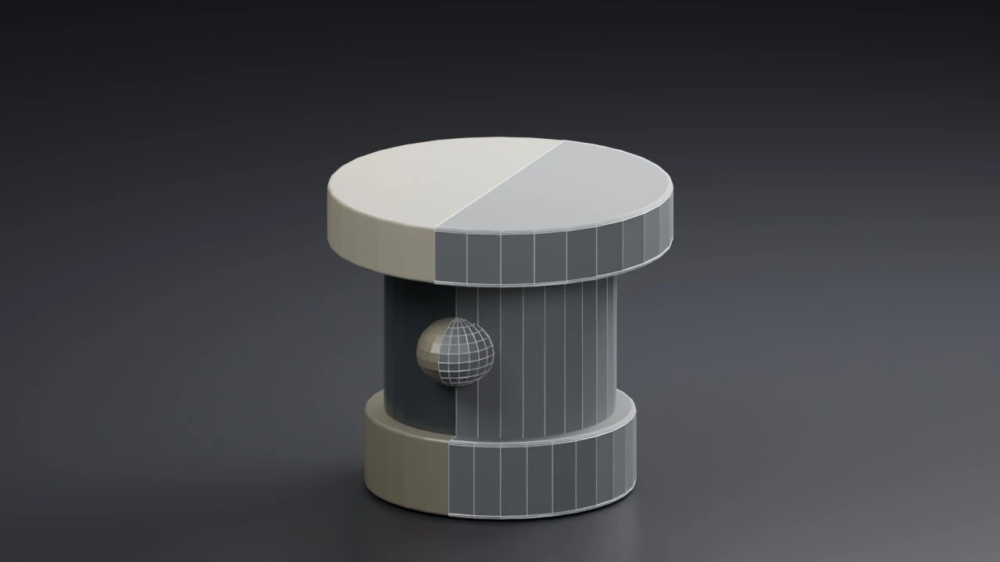

---

group: "woocommerce-3d-models"
title: "Come aggiungere un visualizzatore 3D a WooCommerce"
description: "Configura un visualizzatore 3D su WooCommerce, con un GLB e una foto alternativa. Verifica la scheda su un dispositivo mobile."
date: 2026-11-29
updated: 2026-11-29
keyword: "visualizzatore 3D WooCommerce"
cta: "Controlla le diverse viste del tuo prodotto nell’anteprima gratuita."
---

Aggiungi un visualizzatore 3D a un prodotto WooCommerce su un sito di prova. Usa un'estensione se necessiti di un flusso di lavoro per l'amministratore, oppure aggiungi un visualizzatore web se gestisci il template. Mantieni disponibile una foto del prodotto e prova la galleria sul tema e sui dispositivi che i tuoi clienti utilizzano.

## Come scegliere l'integrazione?

Verifica che l'estensione supporti il tuo file e il suo posizionamento prima di acquistarlo o installarlo. Un template personalizzato può utilizzare un componente come model-viewer, ospitato con il tuo GLB e poster. Verifica che la selezione delle varianti e i controlli di acquisto funzionino ancora.

## Cosa testi con un singolo prodotto?

Carica un modello piccolo per prima. Apri il prodotto in una sessione incognito, verifica il poster, interagisci con il visualizzatore e aggiungi la variante corretta al carrello. In una connessione mobile lenta, conferma che la foto e i dettagli del prodotto rimangano utilizzabili.

## Cosa verificare prima di pubblicare?

| Fallimento                                      | Verifica                                                              |
| ----------------------------------------------- | --------------------------------------------------------------------- |
| Il modello restituisce 403                      | URL pubblico o permessi di hosting                                    |
| Il visualizzatore sostituisce l'intera galleria | Posizionamento dell'estensione e del tema                             |
| Il sito salta quando si carica                  | Assegna un rapporto di aspetto definito al poster e al visualizzatore |

<!-- IMAGE PENDING: Photograph or capture the example described in the brief. -->

**Fonte** [WooCommerce · Arty 3D Viewer](https://woocommerce.com/document/arty-3dmodelviewer/), [WooCommerce · aggiunta di prodotti](https://woocommerce.com/document/managing-products/add-product/), [model-viewer · documentazione](https://modelviewer.dev/docs/).

[Guida correlata](/learn/3d-models-for-ecommerce)

[Come creare un modello 3D](/it/guide/come-creare-un-modello-3d)

## Domande frequenti

### Ho bisogno di un plugin?

Usa un plugin per una galleria gestita dall'amministratore, oppure scegli un componente quando puoi gestire il template e l'hosting. Testa anche il mantenimento e il primo caricamento. Prima di caricare il modello, prova su un dispositivo mobile lento per verificare che il poster e i dettagli siano leggibili e funzionanti.

### È sufficiente un GLB per tutti i modi AR?

Verifica i modi previsti dal visualizzatore selezionato e il supporto ai dispositivi. Testa un dispositivo rappresentativo prima di mostrare azioni AR ai clienti. Carica un modello piccolo prima di testare il visualizzatore 3D per evitare problemi di caricamento su dispositivi con connessione debole.

### Dove deve apparire il 3D?

Posizionalo in un luogo chiaro accanto alle foto. Priorizza foto e controlli di acquisto su schermi stretti e rendi la rotazione opzionale.
