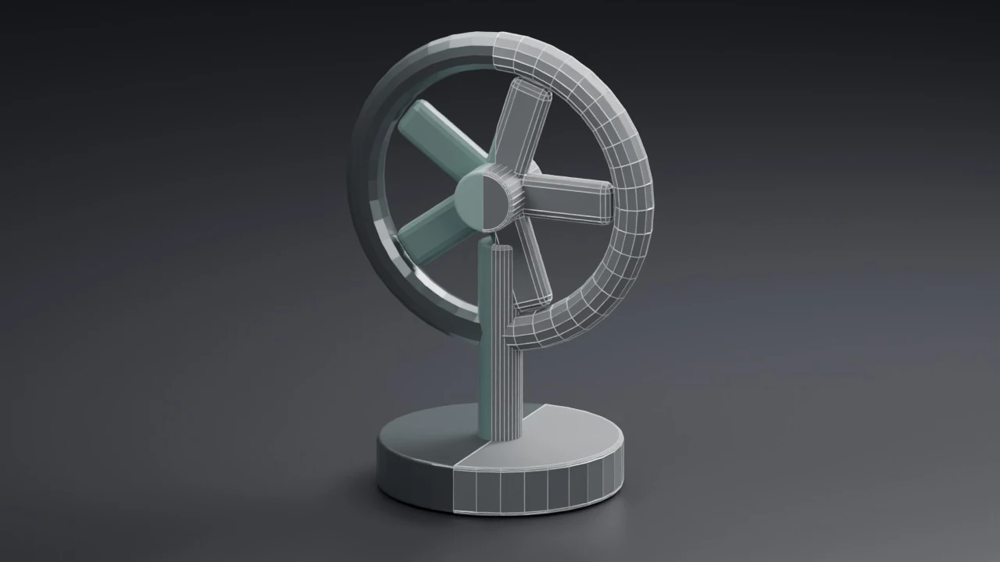

---

group: "sketchfab"
title: "Alternativas ao Sketchfab para publicar modelos 3D"
description: "Escolher uma página de modelo hospedada ou um visualizador GLB auto-hospedado com base em acesso, integração e manutenção."
date: 2026-12-06
updated: 2026-12-06
keyword: "alternativas ao Sketchfab"
cta: "Reveja os ângulos do seu produto numa pré-visualização gratuita."
publishAt: "2026-12-06"
---

Escolha Vectary para apresentar cenários com controles personalizados de partilha. Carregue o GLB em Vectary e teste a incorporação na página alvo com navegador anónimo. O erro comum é ignorar o acesso anónimo, o que impede a verificação do comportamento real do modelo.

## Qual opção se adapta a cada tarefa de publicação?

| Tarefa                                                 | Ponto de partida | Verificar                                       |
| ------------------------------------------------------ | ---------------- | ----------------------------------------------- |
| Compartilhar uma página com modelo em hospedagem       | p3d.in           | Acesso anónimo e permissões                     |
| Apresentar uma cena com controles próprios de partilha | Vectary          | Acesso, configurações de incorporação e limites |
| Possuir a página e hospedar o ficheiro                 | model-viewer     | Hospedagem de ativos, fallback e manutenção     |

## Como comparar os resultados com o mesmo modelo?

Carregar um único GLB com textura conhecida e abrir cada ligação num navegador sem login. Verificar rotação, desempenho em dispositivos móveis e se o original está acessível. Testar a incorporação real numa versão preliminar da página alvo, incluindo as definições de consentimento do visitante.

## O que deve verificar antes da publicação?

| Pergunta                                                | Teste                                                                |
| ------------------------------------------------------- | -------------------------------------------------------------------- |
| Pode o revisor aceder ao modelo?                        | Navegador anónimo e um segundo dispositivo                           |
| Pode o visualizador integrar-se numa página de produto? | Inserção prática em uma página em rascunho                           |
| É possível afastar-se posteriormente?                   | Manter a fonte local e documentar opções de exportação ou publicação |

<!-- IMAGE PENDING: Photograph or capture the example described in the brief. -->

**Fonte** [Sketchfab · viewer API](https://sketchfab.com/developers/viewer), [Vectary · sharing](https://help.vectary.com/documentation/sharing-exporting-embedding/sharing), [p3d.in · account FAQ](https://p3d.in/faq/account), [model-viewer · documentation](https://modelviewer.dev/docs/).

[Biblioteca de modelos (EN)](/models)

[Como criar um modelo 3D](/pt/guias/como-criar-um-modelo-3d)

## Perguntas frequentes

### Em que momento um visualizador embutido é excessivo?

Utilizar um visualizador embutido apenas quando os utilizadores necessitam rotacionar ou examinar o modelo 3D no contexto. Verificar se o público exige interação além da visualização e assegurar que o embed mantenha desempenho consistente. Próxima etapa: testar o embed com um grupo reduzido de utilizadors antes da divulgação completa.

### É possível utilizar o mesmo GLB em todos os locais?

Pode utilizar o mesmo GLB em todos os locais, desde que o destino o suporte e o ficheiro permaneça dentro dos limites de tamanho. Verificar os tratamentos de textura e os limites de tamanho de ficheiro de cada plataforma antes da publicação. Testar com um único GLB no período de triagem para confirmar a compatibilidade.

### Como decidir entre solução hospedada e auto-hospedada?

A escolha entre solução hospedada e auto-hospedada depende da necessidade de controlo sobre o ficheiro e os direitos de acesso. Carregar o modelo no ecrã de teste usando o link do ficheiro e verificar a exibição em navegador anónimo. O erro comum é assumir que o modelo carrega-se corretamente sem testar o fallback em dispositivos móveis.
