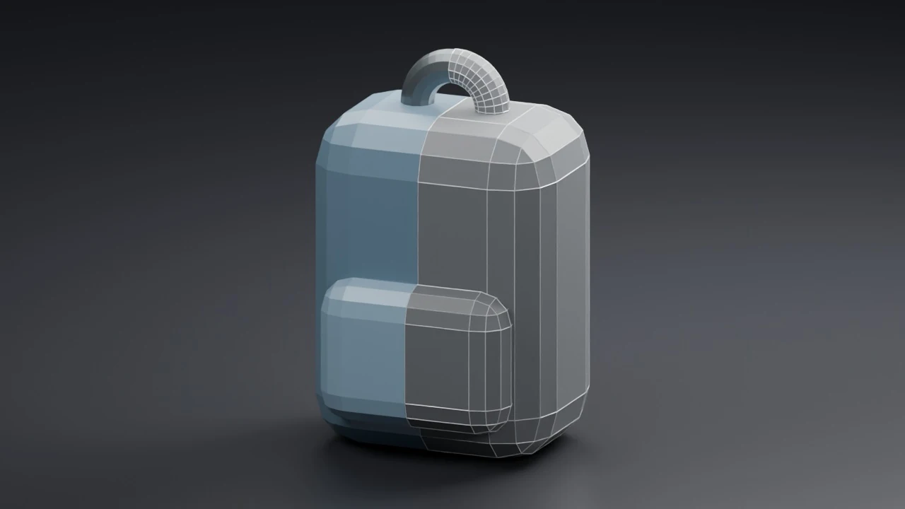

---

group: "product-photography-angles"
title: "Que ângulos mostrar nas fotografias de produto"
description: "Escolha uma vista principal e vistas secundárias que respondam a perguntas sobre ajuste, construção e utilização."
date: 2026-11-21
updated: 2026-11-21
keyword: "ângulos de fotografia de produto"
cta: "Reveja os ângulos do seu produto numa pré-visualização gratuita."
---

Escolha cada fotografia do produto para responder a uma pergunta. Comece por uma vista que explique a forma, seguida por outros ângulos que mostrem como o produto se integra ou funciona. Uma vista de trás, um close-up ou uma imagem com o produto aberto costuma responder a mais do que um ângulo frontal semelhante.

## Qual o ângulo que deve vir primeiro?

Comece por três quartos quando a profundidade do objeto importa, como numa bolsa ou numa cadeira. Utilize a vista frontal quando a face, a forma ou a informação impressa identifica o item de forma mais rápida. Verifique o corte na versão de miniatura.

Deixe espaço suficiente ao redor do produto para o corte do site. Mantenha a composição principal e o quadro coerentes entre as variantes, e adicione imagens de detalhe quando os materiais ou os elementos de fixação variam.

## Quais os espaços que as próximas fotografias devem preencher?

Formule três perguntas que um comprador poderia fazer sem segurar o produto. A cada pergunta, associe uma vista. Para uma bolsa, mostre a parte de trás, a abertura e a fixação da alça. Para um calçado, acrescente a sola. Para móveis, mostre a parte de trás ou a face inferior, caso a construção seja relevante.

Coloque as respostas em ordem de importância. Um close-up é mais útil quando uma vista mais ampla indica onde o detalhe se encontra.

## O que deve ser verificado antes da publicação?

| Vista                         | Pergunta que ela responde                                |
| ----------------------------- | -------------------------------------------------------- |
| Frontal ou em três quartos    | Qual é o item e qual é a sua forma?                      |
| Traseira, lateral ou inferior | Como é construído o elemento que não é visível?          |
| Aberta ou em uso              | O que posso fazer com ele?                               |
| Detalhe                       | Qual é o aspecto do material ou do mecanismo em detalhe? |

<!-- IMAGE PENDING: Photograph or capture the example described in the brief. -->

**Fonte** [Shopify · fotografia de produto](https://help.shopify.com/en/manual/products/product-media/product-photography), [Google Merchant Center · ligação de imagem](https://support.google.com/merchants/answer/6324350), [GS1 · especificação de imagem de produto](https://www.gs1.org/standards/gs1-product-image-specification-standard/current-standard).

[Guia relacionado](/pt/guias/fotografia-de-produto-para-ecommerce)

[Como criar o modelo 3D](/pt/guias/como-criar-um-modelo-3d)

## Perguntas frequentes

### Quantas fotografias devo utilizar?

Comece com uma vista principal mais todas as respostas úteis que a galeria ainda necessita. Remova duplicatas próximas. Verifique os requisitos dos destinos onde publicar o mesmo item.

### Em que situação uma vista frontal reta é mais adequada?

Uma vista frontal reta é mais adequada quando a face ou a informação impressa identifica o item rapidamente. Verifique o corte na versão de miniatura antes do carregamento. O erro comum é ignorar a legibilidade da etiqueta, resultando em perda de detalhes visíveis.

### Pode o modelo 3D substituir a fotografia da parte de trás?

O modelo 3D não pode substituir a fotografia da parte de trás se esta conter características que o comprador precisa verificar. Utilize ambos quando a fotografia real confirma detalhes e o modelo oferece contexto. Assegure-se de que a fotografia da parte de trás mostre todas as características essenciais de forma clara e que seja tirada sob iluminação coerente.
