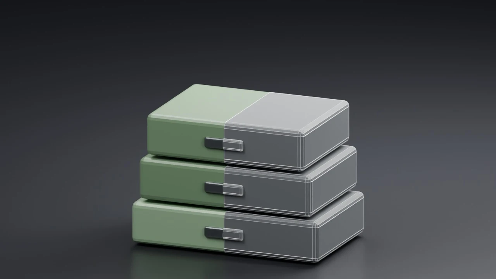
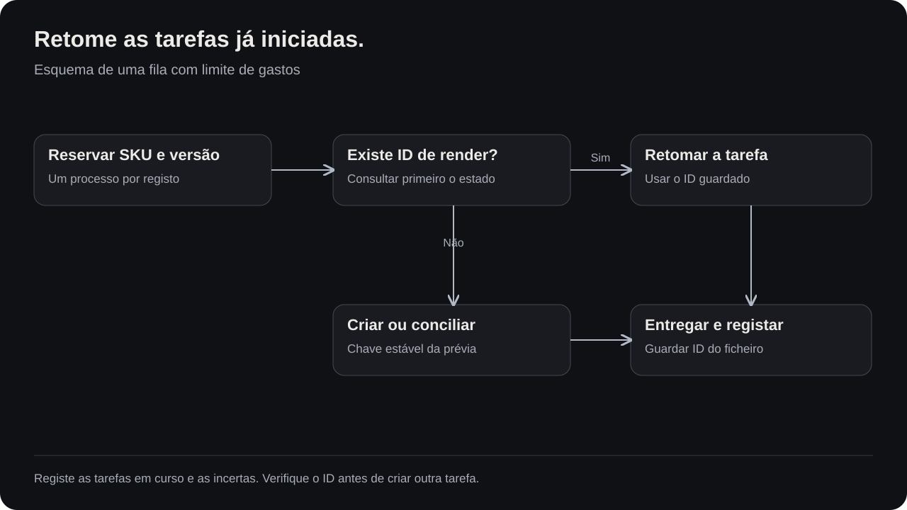

---

group: "n8n-batch-3d-catalog"
title: "Como automatizar um catálogo 3D com n8n"
description: "Transforme as linhas do catálogo em modelos 3D revistos com n8n. Registre versões de SKU, reabra tarefas, limite de gastos e entregue ficheiros sem…"
date: 2026-12-09
updated: 2026-12-09
keyword: "automatizar catálogo de produtos n8n"
cta: "Reveja os ângulos do seu produto numa pré-visualização gratuita."
---

O catálogo 3D deve ser automatizado com processamento por SKU para revisão individual. Carregue o SKU, a revisão da foto, a chave de criação e o ID de renderização no ecrã. Um resultado vazio não significa que nada tenha começado a tarefa pode estar em espera.

> **Um resultado vazio não significa que nada tenha começado.** A tarefa pode estar ainda em execução, em espera por revisão ou estar faltando a sua última resposta. Recupere esse estado antes de efectuar outra solicitação paga.

## Deverá utilizar um ciclo de planilha ou o ponto final do catálogo?

Utilize processamento por produto quando cada modelo exige uma decisão individual de prévia. Utilize o ponto final do catálogo quando o proprietário tenha aprovado um lote definido, o seu gasto total e o compartilhamento necessário para os meios da loja. Essas escolhas criam fronteiras diferentes em revisão e privacidade.

| Route                                | Escolha quando                                            | Aprovação para retenção                                                |
| ------------------------------------ | --------------------------------------------------------- | ---------------------------------------------------------------------- |
| Prévia e construção por SKU          | Uma pessoa revisa cada produto primeiro                   | Revisão da versão de origem, ID de renderização e limite de construção |
| Submissão via ponto final do catálio | Um lote definido pode ser executado após aprovação prévia | Lista exata de itens, loja, limite total e compartilhamento            |
| Entrega de modelos já existentes     | Modelos já existem e apenas necessitam de transferência   | Decisão de destino e publicação                                        |

O [guia do produto único no n8n](/pt/guias/imagem-para-3d-n8n) é o ponto de partida para a primeira rota. O [contrato do ponto final do catálogo](https://github.com/easyrenderai/easyrender.ai/blob/main/docs/api.md) documenta a segunda. Não invoque o ponto final de lote e exija que ele pause no mesmo ponto de prévia manual.

## Que informação deve conter cada linha de origem?

Para uma série de vasos cerâmicos, mantenha a identidade do produto separada do estado da automação. Uma nova foto de um vaso existente constitui uma nova revisão de fonte, não necessariamente um novo produto. Preserve o ID de renderização antigo até que se decida substituir a media aprovada.

| Campo                  | Função                                  | Exemplo ou regra                                            |
| ---------------------- | --------------------------------------- | ----------------------------------------------------------- |
| `sku`                  | Identidade do produto                   | `VASE-ROUND-01`                                             |
| `source_version`       | Entrada intencionalmente definida       | `photo-v3`                                                  |
| `image_url`            | Fonte estável                           | Imagem pública via HTTPS, quando se utiliza entrada por URL |
| `creation_key`         | Identidade de pré-visualização          | Estável por SKU e revisão de fonte                          |
| `render_id`            | Tarefa de serviço                       | Persiste imediatamente após a criação                       |
| `workflow_state`       | Estado da sua fila                      | Novo, em revisão, submetido, incerto, entregue              |
| `approved_credits`     | Limite de construção autorizado         | Recuperação de entrega                                      |
| `destination_media_id` | Guardado após a loja aceitar o ficheiro | Guardado após o estabelecimento aceitar o ficheiro          |

Estes campos de fila pertencem ao seu sistema. Não são campos adicionais a enviar para `/api/renders`. O estado do serviço deve ser mantido separadamente, pois o `preview_ready` e o estado da sua empresa descrevem situações distintas.

## Como processar linhas sem iniciar duplicatas?

1. Selecione registos de origem compatíveis, depois solicite um SKU/revisão antes de criar a tarefa. Uma regra de unicidade em base de dados é preferível quando múltiplos trabalhadores podem operar. Uma célula de estado em planilha não constitui um bloqueio atómico.
2. Se `render_id` existir, leia o render e continue a partir do seu estado. Não o recrie porque `destination_media_id` está vazio.
3. Se não existir ID mas a criação foi tentada, repita a criação do preview com o mesmo `Idempotency-Key` guardado e entrada inalterada. Preserve o ID devolvido antes de prosseguir.
4. Aguarde o preview e armazene a decisão de revisão. Apenas a rama aprovada pode iniciar a construção paga, utilizando o `maxCredits` autorizado.
5. Monitore o mesmo trabalho até à conclusão, falha ou ao limite de tempo do workflow. Um limite de tempo salva o registo para reconciliação. Não cria automaticamente uma nova tentativa.
6. Descarregue e entregue o modelo. Guarde o identificador média de destino antes de marcar a linha de origem como entregue.

Na primeira implantação, utilize um único trabalhador e processe um item de cada vez. O [Loop Over Items](https://docs.n8n.io/integrations/builtin/core-nodes/n8n-nodes-base.splitinbatches/) do n8n suporta batching explícito. Mantenha os schedules sem sobreposição, depois aumente a concorrência apenas após medir os limites do serviço e o comportamento de recuperação próprio.

## Como deve controlar o gasto em lote?

Um limite por chamada aprovado não impõe, por si só, um orçamento total em várias operações. Mantenha uma reserva atómica para cada operação paga em andamento e inclua submissões não resolvidas no valor já comprometido. Caso contrário, dois trabalhadores podem ver o mesmo limite restante.

| Componente de orçamento | Contar quando                         | Liberar ou reconciliar quando                              |
| ----------------------- | ------------------------------------- | ---------------------------------------------------------- |
| Total aprovado          | O proprietário aprova o lote          | O escopo ou orçamento é alterado explicitamente            |
| Créditos reservados     | O trabalhador afirma uma ação paga    | O resultado definitivo é reconciliado                      |
| Gasto confirmado        | O serviço registar a débito           | Um reembolso verificado é registado separadamente          |
| Resultado desconhecido  | A resposta é perdida após a submissão | Um trabalho existente ou evidência de apoio resolve o caso |

Leia o valor atualizado e o saldo restante do render antes de iniciar a construção. Pare em caso de fundos insuficientes ou limite excedido do chave. Um reembolso de carteira e um limite de débito bruto de vida de chave comportam-se de forma distinta. Não redefina as premissas sobre o orçamento da chave apenas porque o saldo aumentou.

Utilize a orientação de [limites de taxa do n8n](https://docs.n8n.io/integrations/builtin/handle-rate-limits.md) para regularizações seguras de leitura. Para um 429,, respeite o valor do `Retry-After` indicado na resposta. Para uma mutação paga com timeout, reconcilie o recurso antes de tentar novamente. Um backoff sozinho não torna uma submissão duplicada segura.

## Quais as alterações ao utilizar a API do catálogo?

Solicite `GET /api/catalog/quote?items=N` com o número exato de itens propostos. Mostre ao utilizador a lista de itens, o valor do orçamento, a loja de destino e as implicações de partilha. A submissão exige `write`, `spend` e `share`, em vez apenas dos escopos de leitura/escrita usados no trabalho de prévia.

| Campo de submissão | Valor obrigatório                                   |
| ------------------ | --------------------------------------------------- |
| `platform`         | `shopify`, `woocommerce`, `prestashop` ou `other`   |
| `store`            | Identificador estável para a loja de destino        |
| `maxCredits`       | Limite total aprovado para esta submissão           |
| `items`            | No máximo 100 itens por requisição no esquema atual |
| Cada item          | `externalId`, `title`, `imageUrl`. Opcional `note`  |

Submeta uma vez para `POST /api/catalog`, depois utilize `GET /api/catalog?platform=...&store=...` para inspecionar e avançar a fila já autorizada. Trate explicitamente `needs_credits`, `needs_info` e `failed`. Mantenha os valores da plataforma e da loja idênticos ao recuperar o mesmo lote.

A submissão do catálogo partilha ligações do modelo para uso da loja. Escolha a rota por produto se essa não estiver autorizada. Distinga também a geração dos modelos do catálogo da escrita das páginas de produto para um CMS do vendedor: o conectador da loja ainda necessita de um passo de entrega testado.

<!-- IMAGE PENDING: unique real screenshot of catalog rows with saved job IDs and a recovered execution. Use synthetic SKUs and no customer data. -->

## Como saber que um produto foi entregue corretamente?

É necessário que a revisão de origem, o ID de renderização, o ID do produto de destino e o ID de mídia estejam em sintonia. Descarregue o GLB privado com as credenciais de API, seguidamente carregue-o através do fluxo compatível com a loja. A disponibilidade de um modelo no gerador não corresponde à sua disponibilidade na página do produto.

Para Shopify, siga a documentação sobre [processamento de mídia e anexação](https://shopify.dev/docs/apps/build/product-merchandising/products-and-collections/manage-media). Verifique o storefront final após o processamento. Caso apenas a entrega falhe, repita esse passo com o ficheiro existente, em vez de gerar um novo modelo.

O GLB entregue deve abrir num visualizador compatível; [a Khronos descreve o formato](https://www.khronos.org/gltf/). Registe o tamanho do ficheiro e o estado de destino para os outputs aceitos internamente. Não se possa inferir vantagem de velocidade ou conversão a partir do número de tarefas concluídas.

## Quais os falhas de lote que necessitam de um caminho de recuperação específico?

| Sintoma                                       | Causa provável                                                       | Solução                                                   |
| --------------------------------------------- | -------------------------------------------------------------------- | --------------------------------------------------------- |
| O mesmo SKU é executado duas vezes            | Horários sobrepostos ou ausência de declaração                       | Serializar o trabalho ou utilizar uma reserva atómica     |
| O preview existente foi substituído           | A célula final em branco foi usada como única regra de elegibilidade | Verifique o ID guardado e o estado do fluxo antes         |
| O produto errado foi atualizado               | A ordem das linhas foi alterada                                      | Verifique IDs externos estáveis                           |
| O gasto total excede as expectativas          | Reservas concorrentes foram ignoradas                                | Registe o gasto comprometido e desconhecido conjuntamente |
| Cada tentativa de atualização reativa um erro | O estado operativo foi tratado como transitório                      | Pare e resolva créditos, entrada ou permissão             |
| Modelo pronto mas a página está vazia         | Falha no processamento ou entrega de media                           | Reiniciar o carregamento/anexo, manter a renderização     |
| Nova fonte reutiliza a aprovação anterior     | A revisão não faz parte da decisão                                   | É necessário aprovação para a versão atual da fonte       |

## Que teste de aceitação inicial deveria abranger?

Utilizar uma amostra reduzida: um produto válido, uma imagem intencionalmente inválida e um registo com ID de renderização existente. Verificar que a linha inválida seja interrompida, o trabalho existente seja retomado e o registo válido entre na revisão. Este teste verifica o comportamento da fila antes de autorizar um lote pago.

Em seguida, simular uma resposta de criação perdida e uma interrupção na entrega com fixtures. Posteriormente, realizar uma execução final end-to-end autorizada antes de ativar o agendamento não monitorizado. O esquema público e o contrato do repositório foram verificados para este guia. Não são afirmados resultados de lote vivo nem economia de custos.

Medir modelos revisados entregues por SKU/versão única, intervenções manuais, trabalhos não resolvidos e créditos líquidos por modelo aprovado. Para o fluxo de ativo, utilizar [como criar um modelo 3D](/pt/guias/como-criar-um-modelo-3d) e o guia [do pacote de página de produto](/pt/guias/fichas-de-produto-com-n8n).

## Perguntas frequentes

### Um campo vazio no link do modelo é suficiente para selecionar nova atividade?

Um campo vazio no link do modelo não é suficiente para iniciar uma nova atividade. Verifique o estado do trabalho recuperando o ID de trabalho e o estado atual do fluxo. O erro comum é assumir que a ausência de dados significa conclusão, quando a tarefa pode estar em execução ou em espera por revisão.

### É possível processar todo o catálogo em paralelo?

Comece com concorrência limitada e orçamento aprovado. Trabalhadores paralelos necessitam de reivindicações atômicas e reservas de crédito compartilhadas, incluindo submissões incertas cujo resultado ainda não é conhecido. Aumentar o número de trabalhadores sem esses controles pode duplicar tarefas ou exceder o total pretendido, mesmo quando cada pedido individual possui o seu limite próprio.

### O API do catálogo exige partilha pública?

Exige o escopo de partilha porque o fluxo de catálogo torna os links de modelo acessíveis para uso em lojas. Isso exige autorização explícita, juntamente com a lista de itens e o limite de gastos. Utilize prévias privadas por produto quando desejar revisão individual antes de decidir quais ativos podem ser construídos, entregues ou partilhados.

### Devo regenerar um modelo após falha no carregamento para loja?

Normalmente o passo de geração já está concluído. Mantenha o ID de renderização e recupere a descarga ou o carregamento para destino em seguida. Guarde o identificador de mídia retornado pela loja e o estado de processamento para distinguir uma transferência falhou, um anexo pendente e um modelo ausente, sem ter de pagar novamente pela geração.
