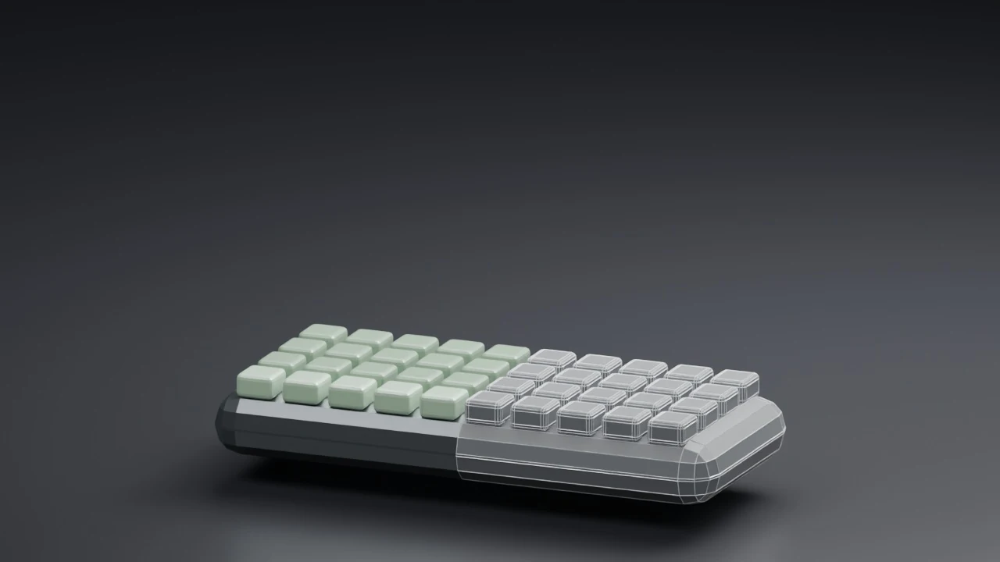

---

group: "compress-glb"
title: "Como comprimir um GLB e preservar o detalhe"
description: "Identifique o que torna o seu GLB grande, reduza geometria ou texturas e compare o resultado no mesmo visualizador."
date: 2026-11-28
updated: 2026-11-28
keyword: "comprimir GLB"
cta: "Reveja os ângulos do seu produto numa pré-visualização gratuita."
---

Para comprimir um GLB e preservar detalhe útil, reduza o tamanho das texturas se imagens dominarem ou simplifique a geometria se a malha dominar. Exporte uma cópia e compare as duas num mesmo visualizador. Aceite o ficheiro reduzido apenas após verificar ângulos, arestas e detalhes superficiais que o público verá.

## O que mudou ao simplificar um modelo?

Importámos a mesa de café no Blender 5.2.3 e exportámos duas versões com as mesmas configurações GLB. Aplicando uma razão de Decimate de 0.5 reduziu-se de 16,228 para 8,114. triângulos. As duas exportações mudaram de 1,687,180 para 863,068 bytes, cerca de 49% menos.

São estas as dimensões das duas exportações no Blender. O GLB original do site utiliza uma codificação preparada separadamente, por isso constitui um baseline diferente.

## Como escolher a próxima otimização?

Para um modelo com predominância de geometria, experimente uma alteração geométrica e verifique cantos e intersecções. Para um modelo com predominância de texturas, tente um mapa menor e inspeccione marcas finas. Teste extensões de texturas comprimidas no visualizador de destino antes de comprometer a catalogação.

## O que deve verificar antes de publicar?

| Sintoma                        | Ação seguinte                                                 |
| ------------------------------ | ------------------------------------------------------------- |
| Rótulos ficam difusos          | Restaure a resolução da textura antes de alterar a geometria  |
| Arestas mudam perto das pernas | Reduza a intensidade da decimação                             |
| O ficheiro novo não abre       | Verifique as extensões necessárias e o resultado do validador |

<!-- IMAGE PENDING: Photograph or capture the example described in the brief. -->

**Fonte** [Khronos · especificação glTF 2.0](https://registry.khronos.org/glTF/specs/2.0/glTF-2.0.html), [Khronos · KHR_texture_basisu](https://github.com/KhronosGroup/glTF/tree/main/extensions/2.0/Khronos/KHR_texture_basisu), [Blender · modificador Decimate](https://docs.blender.org/manual/en/latest/modeling/modifiers/generate/decimate.html), [Khronos · Validador glTF](https://github.com/KhronosGroup/glTF-Validator).

[Guia relacionado](/learn/glb-file)

[Como criar um modelo 3D](/pt/guias/como-criar-um-modelo-3d)

## Perguntas frequentes

### Qual a dimensão mínima que um GLB deve ter?

Reduza o GLB ao menor tamanho possível sem perder detalhe visível ou desempenho. Teste no dispositivo e na página real, verificando os bytes transferidos, tempo de carregamento e clareza das características essenciais. Posteriormente, verifique o tamanho do ficheiro e o desempenho do visualizador antes da implementação.

### Têm menos triângulos sempre menos bytes?

Menos triângulos não implicam necessariamente menos bytes, uma vez que texturas, codificação de buffer e atributos influenciam o tamanho do ficheiro. Optimize a geometria em primeiro lugar, depois verifique o tamanho do ficheiro GLB e o número de triângulos num visualizador. Compare exportações completas com as mesmas configurações para confirmar a eficiência da compressão.

### Devo sobrescrever a fonte?

Mantenha a fonte e um registo das configurações de exportação. Teste um ficheiro de entrega separado para que possa restaurar detalhes sem repetir o trabalho de modelação inicial. O utilizador deve verificar a exibição do GLB no visualizador de destino antes de aplicar compressões de textura.
