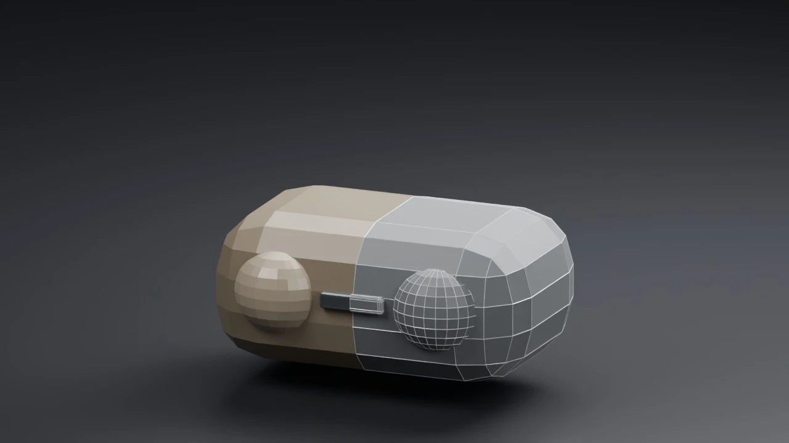

---

group: "3d-modeling-cost"
title: "Quanto custa criar um modelo 3D de produto?"
description: "Qual a estimativa do custo por modelo 3D aprovado, incluindo tentativas, captura, revisões e a exportação final?"
date: 2026-12-03
updated: 2026-12-03
keyword: "custo modelo 3D de produto"
cta: "Reveja os ângulos do seu produto numa pré-visualização gratuita."
---

Estime o custo de um modelo 3D de produto 3D a partir do entregável que necessita. Contabilize captura, modelação ou geração, correções e exportação que realmente utilizará. Compare as opções por custo por modelo aprovado. Um baixo custo por tentativa pode tornar-se dispendioso quando várias tentativas falham na mesma verificação de aceitação.

## O que incluir na proposta?

Indique a aplicação alvo, formato, materiais, número de variantes e se é necessário animação ou fonte editável. Forneça ao modelador um conjunto suficiente de fotografias e uma referência clara para cada característica que será verificada. Pergunte quais as revisões e licenças abrangidas pela proposta.

## Como comparar custos entre métodos?

Divida o total gasto num pequeno piloto pelo número de modelos que pode utilizar. Se um piloto hipotético de quatro itens custar $120 para ser produzido e $40 para revisão e correção, e três modelos forem aprovados, o custo será aproximadamente $53.33 por ativo aprovado. Este cálculo é um exemplo, não uma taxa.

## O que verificar antes da publicação?

| Método                         | Itens principais                                 |
| ------------------------------ | ------------------------------------------------ |
| Geração baseada em fotografias | Tentativas, revisão e correções                  |
| Modelação contratada           | Breve, horas ou cotação fixa, rodadas de revisão |
| Ativo de fornecedor existente  | Licença, limpeza e re-exportação                 |

<!-- IMAGE PENDING: Photograph or capture the example described in the brief. -->

**Fonte** [Upwork · taxas de modelador 3D](https://www.upwork.com/hire/3d-modelers/cost/), [Shopify · criação de modelos 3D](https://help.shopify.com/en/partners/manage-clients-stores/creating-media/3d-models/creating-3d-models), [Khronos · especificação glTF 2.0](https://registry.khronos.org/glTF/specs/2.0/glTF-2.0.html).

[Guia relacionado](/pt/comparacoes/modelador-3d-ou-ia)

[Como criar um modelo 3D](/pt/guias/como-criar-um-modelo-3d)

## Perguntas frequentes

### Devo reservar para revisões?

Deve reservar para revisões conforme o número de rodadas definidas no piloto. Adicione ao ficheiro de proposta um detalhamento do número de rodadas e tempo de revisão. O erro comum é esquecer a revisão, o que pode gerar atrasos no carregamento do ecrã.

### É possível utilizar uma cotação para todo o catálogo?

É possível utilizar uma cotação para todo o catálogo após validar o número de ativos e revisões necessárias. Adote um piloto com quatro itens para calcular o custo médio por ativo. O erro comum é aplicar a cotação sem testar o número de revisões e variantes.

### E se já possuímos CAD?

Se já dispõe de CAD, verifique os direitos de reutilização e confirme quais detalhes são necessários. Prepare o CAD para visualização web mediante simplificação da geometria, atribuição de materiais e exportação separada. Verifique que o formato e as configurações de exportação do ficheiro de CAD correspondem às exigências do visualizador web.
