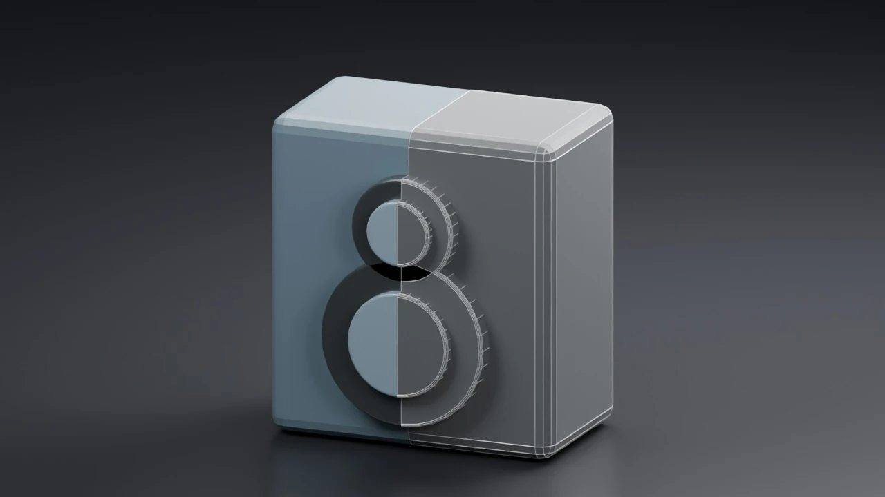

---

group: "blender-export-glb"
title: "Como exportar um GLB do Blender com texturas"
description: "Prepare os materiais e texturas no Blender, exporte um GLB e verifique-o numa sessão de visualização limpa."
date: 2026-12-04
updated: 2026-12-04
keyword: "exportar GLB Blender"
cta: "Reveja os ângulos do seu produto numa pré-visualização gratuita."
---

Prepare os materiais com texturas de imagem conectadas a um shader suportado, em seguida exporte o GLB 2.0 no formato binário do Blender. Mova o resultado para uma pasta nova e abra-o no visualizador de destino. Verifique que a cor, as normais e a colocação das texturas sobrevivem ao movimento.

## O que se prepara antes da exportação?

Abra cada material importante no Editor de Shader. Utilize um Principled BSDF quando apropriado e verifique os nós de imagem. Bake aparições procedurais não suportadas para mapas, se necessário. Selecione os objetos que pertencem à entrega e verifique as suas transformações e orientação.

## Como se realiza a exportação e a verificação?

Escolha Arquivo, Exportar, glTF 2.0, seguido de glTF Binário. Utilize a exportação de objetos selecionados quando se deseja excluir auxiliares da cena. Valide o ficheiro, carregue-o num visualizador fresco e compare a frente e a parte de trás com a cena original.

## O que se deve verificar antes da publicação?

| Problema                                 | Verifique primeiro                        |
| ---------------------------------------- | ----------------------------------------- |
| Textura ausente                          | Conexões de imagem e recursos exportados  |
| A textura de superfície parece incorreta | Canais de mapa e espaço de cor            |
| O modelo está de lado                    | Transformação do objeto e orientação alvo |

<!-- IMAGE PENDING: Photograph or capture the example described in the brief. -->

**Fonte** [Blender · glTF 2.0 import e export](https://docs.blender.org/manual/en/5.1/addons/import_export/scene_gltf2.html), [Khronos · glTF 2.0 specification](https://registry.khronos.org/glTF/specs/2.0/glTF-2.0.html), [Khronos · glTF Validator](https://github.com/KhronosGroup/glTF-Validator).

[Guia relacionado](/learn/glb-file)

[Como criar um modelo 3D](/pt/guias/como-criar-um-modelo-3d)

## Perguntas frequentes

### Exporta-se todo o material do Blender?

O exportador reconhece combinações de nós suportadas. Alguns efeitos procedurais necessitam de ser bakes. Verifique o visualizador de destino com um material simples antes de configurar um ativo complexo.

### Como confirmar que é autocontido?

Mova apenas o GLB exportado para uma pasta vazia e abra-o no visualizador alvo. Verifique o material sob iluminação neutra para assegurar que as texturas carreguem sem erros. Em seguida, verifique se o GLB contém todas as texturas ao analisar os recursos embutidos no painel de metadados do visualizador.

### O ficheiro BLEND importa após a exportação?

Mantenha-o como fonte editável. Atualize esse ficheiro para revisões e repita a exportação, evitando tratar o ficheiro distribuído como master. Mova o GLB exportado para uma pasta vazia e abra-o no visualizador alvo para verificar se todas as texturas estão corretamente carregadas e visíveis sob iluminação neutra.
