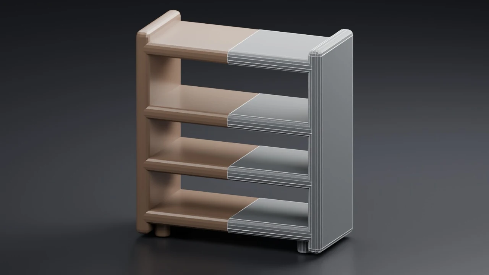

---

group: "furniture-product-page-best-practices"
title: "O que incluir numa ficha de produto de móveis"
description: "Crie uma página de produto de móveis com dimensões verificadas, variantes claras, detalhes de entrega e uma galeria útil."
date: 2026-12-05
updated: 2026-12-05
keyword: "ficha de produto de móveis"
cta: "Reveja os ângulos do seu produto numa pré-visualização gratuita."
---

Forneça aos compradores as informações necessárias para escolher e receber o mobiliário. Coloque a variante selecionada, preço, dimensões e entrega próximas aos controles de compra. Utilize a galeria para demonstrar o material e a construção. Adicione um modelo 3D onde uma característica difícil de perceber se torne mais compreensível.

## O que deve ser visível antes de ser adicionado ao carrinho?

Mostre o nome, acabamento escolhido, disponibilidade e estimativa de entrega juntamente. Coloque a largura, profundidade e altura totais num bloco acessível. Inclua medidas práticas, como a altura da poltrona ou o pé de trabalho com os compartimentos abertos, quando verificadas.

## Como verificar uma variante?

Escolha o acabamento no dispositivo móvel e verifique a imagem principal, preço, disponibilidade, entrega e modelo para que todos se referem ao mesmo SKU. Teste uma variante fora de estoque e outra que envie de forma diferente. Mantenha as informações sobre montagem e transporte facilmente acessíveis.

## O que deve ser verificado antes de publicar?

| Pergunta                           | Coloque a resposta                          |
| ---------------------------------- | ------------------------------------------- |
| O que exatamente estou a adquirir? | Seletor de variante e foto atual            |
| Quais as dimensões verificadas?    | Bloco de especificações e diagrama rotulado |
| Como chegará o produto?            | Notas sobre entrega, embalagem e montagem   |

<!-- IMAGE PENDING: Photograph or capture the example described in the brief. -->

**Fonte** [Shopify · produto de mídia](https://help.shopify.com/en/manual/products/product-media), [Google Merchant Center · dados do produto](https://support.google.com/merchants/answer/7052112), [GS1 · especificação de imagem do produto](https://www.gs1.org/standards/gs1-product-image-specification-standard/current-standard).

[Guia relacionado](/pt/guias/modelos-3d-para-ecommerce)

[Como criar um modelo 3D](/pt/guias/como-criar-um-modelo-3d)

## Perguntas frequentes

### Deveria todo produto ter um modelo 3D?

Não, todo produto não precisa ter um modelo 3D. Adicione um modelo 3D apenas se for possível visualizar um lado oculto ou construção. Verifique se a foto principal e as dimensões coincidem com a variante selecionada, pois muitos utilizadores confundem as medidas apresentadas no ecrã.

### Devo incluir as dimensões do pacote?

Inclui-se quando ocorrem alterações no acesso, entrega ou montagem. Distingue as dimensões dos pacotes das dimensões verificadas do elemento montado. Verifique que as dimensões do pacote indicadas no ecrã coincidem com as apresentadas na ficha de produto para evitar mal-entendidos durante a entrega.

### A que página devo testar em primeiro lugar?

Teste a página de detalhes do produto em dispositivos móveis para verificar a exibição das variantes. Selecione o acabamento e confirme que a imagem principal, preço e estimativa de entrega coincidem com o mesmo SKU. Um erro comum é que a entrega ou disponibilidade mude sem atualização no bloco de especificações.
