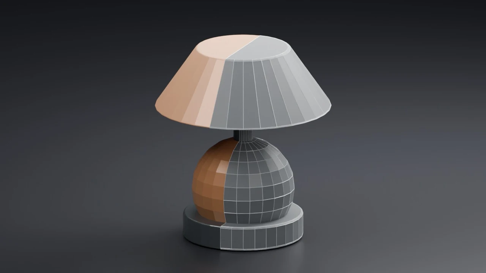
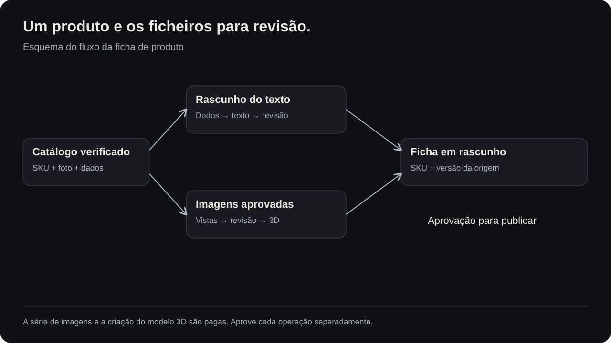
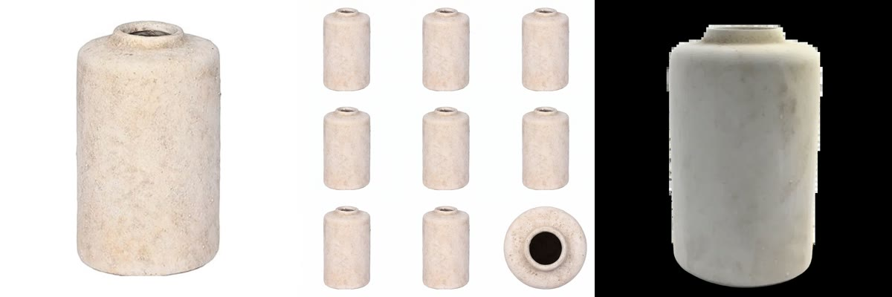

---

group: "n8n-product-pages-images-3d"
title: "Fichas de produto com n8n, imagens e 3D"
description: "Crie um fluxo de página de produto no n8n: fatos verificados, geração de imagem, modelo 3D revisado e rascunho do CMS, com aprovação antes de gastar."
date: 2026-11-18
updated: 2026-11-18
keyword: "fichas de produto com n8n"
cta: "Reveja os ângulos do seu produto numa pré-visualização gratuita."
---

Para criar uma ficha de produto com n8n, comece com dados verificados e prepare o texto, as imagens e o modelo 3D em ramos distintos. Junte os ficheiros pelo SKU e pela versão da origem, guarde a ficha como rascunho e registe separadamente a autorização de despesa e a aprovação de publicação.

> **Uma lista final exige mais do que uma descrição.** Mantenha os dados do produto, ficheiros de imagem, modelo 3D e estado de publicação unificados. Um processo bem-sucedido representa um passo para uma página de produto aprovada.

## O que este fluxo deve entregar?

Para uma lâmpada de mesa em cerâmica, o resultado é um pacote revisável: cópia precisa, vistas selecionadas, ficheiro GLB e o identificador de um rascunho do CMS. O GLB é um contêiner binário para o modelo 3D, descrito na [documentação do Khronos glTF](https://www.khronos.org/gltf/). Um vídeo de rotação é um entregável diferente.

| Entregável               | Fonte de verdade                           | Verificação de aceitação                                  |
| ------------------------ | ------------------------------------------ | --------------------------------------------------------- |
| Título e descrição       | Fatos do fornecedor mais regras editoriais | Sem materiais inventados, dimensões ou certificação       |
| Imagens do produto       | Conjunto visual aprovado                   | O mesmo produto, acabamento e variante em todo o processo |
| Ficheiro interativo 3D   | Construção aprovada                        | O ficheiro abre, roda e corresponde ao elemento aprovado  |
| Rascunho do CMS          | Mapeamento SKU-product                     | Produto e variante corretos, ainda não publicados         |
| Registo de processamento | IDs guardados e aprovação documentada      | Outra execução pode reativar o trabalho                   |

O [modelo n8n imagem para Shopify](https://n8n.io/workflows/11695-generate-product-descriptions-from-images-and-publish-to-shopify-using-ai/) ilustra a parte de cópia. A adição de 3D exige um próprio estado de tarefa, revisão e entrega de ficheiro. A receita aqui descreve essa arquitetura. Não é um relatório de implantação de loja executada.

## Qual deveria ser a estrutura do pacote de lista?

Comece por um objeto conhecido para poder verificar o tipo de ficheiro que cada etapa deveria entregar. Este vaso da galeria do easyrender mostra a imagem original, o folheto gerado e o modelo exportado. Utilize estes ficheiros como referência ao configurar o fluxo.

| Campo para revisão       | Entrada de exemplo                                  |
| ------------------------ | --------------------------------------------------- |
| Identificador de exemplo | `VASE-DEMO-01`                                      |
| Imagem de referência     | [Abra a fotografia de origem](/showcase/vase.jpg)   |
| Vistas para revisão      | [Abra o folheto gerado](/showcase/vase-angles.jpg)  |
| Modelo para a galeria    | [Abra o exemplo no formato GLB](/showcase/vase.glb) |
| Estado da lista          | Rascunho de exemplo                                 |

**Verifique que todos os três ativos estejam atribuídos ao mesmo SKU.** Abra o modelo separadamente e mantenha a fotografia de origem disponível ao verificar forma e acabamento. Este exemplo utiliza ativos existentes para demonstrar o que deveria receber um revisor.

## O que verificámos no n8n?

No n8n 2.48.5, trocámos de propósito a ordem dos ficheiros de três SKU de exemplo. O fluxo associou os registos por SKU e versão de origem, descarregou os dois GLB públicos aprovados e verificou os cabeçalhos binários e os tamanhos declarados. O cadeirão ficou por rever porque o modelo era de uma versão anterior.

| SKU           | Versão de origem | Resultado                         |
| ------------- | ---------------- | --------------------------------- |
| VASE-DEMO-01  | v2               | Rascunho com GLB de 400 792 bytes |
| TABLE-DEMO-01 | v3               | Rascunho com GLB de 326 872 bytes |
| CHAIR-DEMO-01 | v3 com modelo v2 | Aguarda revisão                   |

O teste abrange a junção e validação de ficheiros existentes. A geração de imagens, a criação 3D paga e a publicação na loja precisam de um teste próprio. [Importa o fluxo de exemplo](../evidence/n8n-local-draft-workflow.json), [vê o resultado da execução](../evidence/n8n-local-draft-result.json).

## Quais informações devem vir do catálogo?

Crie um registo de entrada com `sku`, `source_version`, `name`, `material`, `dimensions`, `image_url` e `locale`. Mantenha fatos desconhecidos em branco. Adicione campos separados de aprovação para imagens, 3D e despesas, e publicação. Um único sinal `approved` é demasiado vago uma vez que várias ações podem ser executadas.

| Campo                | Valor de exemplo                    | Por que é relevante                                       |
| -------------------- | ----------------------------------- | --------------------------------------------------------- |
| `sku`                | `LAMP-CERAMIC-01`                   | Une cópia, imagens e modelo 3D                            |
| `source_version`     | `photo-v2`                          | Distingue uma nova foto de uma tentativa recorrente       |
| `material`           | Cerâmica confirmada pelo fornecedor | Evita que suposições visuais se transformem em afirmações |
| `dimensions`         | Registo verificado do fornecedor    | Mantém as medidas independentes do modelo gerado          |
| `publication_status` | `draft`                             | Separa a criação do ficheiro da publicação                |

Para a ramificação de texto, instrua o modelo linguístico escolhido a devolver título, descrição, bullets, texto alternativo da imagem e `missing_facts`. Deve utilizar apenas os campos factuais fornecidos para as especificações. Redirecione quaisquer fatos obrigatórios ausentes para revisão, em vez de os preencher automaticamente.

### O que deverá conter o prompt e a saída do texto?

Passe o registo validado para o nó de geração de texto escolhido, com a instrução abaixo. Mantenha a credencial de API separada da credencial do serviço visual. Se a saída não for analisável ou não corresponder aos campos exigidos, redirecione para uma etapa de edição antes de atingir o CMS.

> Crie um rascunho de página de produto na língua solicitada utilizando apenas os fatos fornecidos. Devolva título, descrição, bullets, texto alternativo e fatos ausentes. Não infere material, medidas, compatibilidade ou certificações a partir da fotografia. Deixe as especificações ausentes fora da cópia e indique-as na lista de fatos ausentes. Não publique nada.

| Campo de saída  | Tipo                     | Exemplo do registo da lâmpada                               |
| --------------- | ------------------------ | ----------------------------------------------------------- |
| `title`         | Texto                    | Lâmpada de cerâmica                                         |
| `description`   | Texto                    | Lâmpada de cerâmica para mesa ou pequeno banco.             |
| `bullets`       | Lista de texto           | Corpo em cerâmica, apenas quando confirmado pelo fornecedor |
| `alt_text`      | Texto                    | Vista frontal da lâmpada de mesa cerâmica                   |
| `missing_facts` | Lista de nomes de campos | `dimensions`, `bulb_compatibility` se ausentes              |

Trate isto como um esquema para validação, não como uma garantia de que o modelo se cumprirá sempre. Para esta entrada ilustrativa, a compatibilidade com lâmpadas desconhecidas permanece fora do rascunho. Exija todos os cinco campos, arrays para as duas listas e o SKU de origem inalterado antes de mesclar a rama de texto com os resultados visuais.

## Como gerar imagens e 3D a partir do mesmo produto?

Utilize o nó [HTTP Request](https://docs.n8n.io/integrations/builtin/core-nodes/n8n-nodes-base.httprequest/) integrado do n8n para as chamadas à API. Armazene a chave numa credencial com nome de cabeçalho `Authorization` e valor `Bearer YOUR_API_KEY`. O placeholder é substituído dentro da credencial, nunca dentro de um exportação compartilhada ou registo de produto.

1. Leia `GET https://easyrender.ai/api/credits`. Exiba o custo actual do conjunto de imagens, saldo da conta e produto solicitado antes da aprovação. A criação do conjunto de imagens é paga. Separa-se do percurso de prévia gratuito.
2. Após aprovação, chame `POST /api/product-views` com JSON contendo `image_url`, `name` e um `prompt` opcional. Guarde o valor retornado `id` como `view_set_id` imediatamente.
3. Realize uma consulta a `GET /api/product-views/{id}` utilizando o identificador guardado. Uma configuração inicial é um intervalo de 15 segundos com um prazo fixo. Respeite as respostas de limite de taxa. Pare em `failed` e verifique as vistas individuais antes de aceitar o conjunto.
4. Descarregue as imagens aprovadas a partir de `GET /api/product-views/{id}/views/{view}`, utilizando cada identificador de vista retornada. Utilize a mesma credencial de API e guarde as respostas como ficheiros.
5. Chame `POST /api/product-views/{id}/render` apenas após o conjunto estar pronto e aprovado. Guarde o seu `renderId`. Isso cria ou reutiliza um rascunho. Não inicia a construção pagadora de 3D.
6. Leia o render e valide o seu saldo restante, calculado como `max(0, renderCredits - credits)`. Submeta `POST /api/renders/{id}/render` junto do inteiro aprovado em `maxCredits`.
7. Aguarde até que `status` seja `ready` e `hasModel` seja `true`, depois transfira `GET /api/renders/{id}/model?download=1` como ficheiro.

Estes caminhos e campos encontram-se no [esquema da API implementado](https://easyrender.ai/api/openapi.json). A requisição actual do conjunto de imagens REST não expõe o campo `maxCredits` do ponto de encomenda. Impõe a autorização neste fluxo e utiliza uma chave dedicada com limite de crédito definido. Não se assume que um campo JSON adicional cria um limite no nível do servidor.

Para teste inicial sem conjunto de imagens pago, utilize o [fluxo n8n de pré-visualização](/pt/guias/imagem-para-3d-n8n). Inicia-se em `POST /api/renders`, pausa para revisão e mantém o build posterior separado. Escolha esta opção quando se deseja avaliar apenas um produto antes de definir o pacote completo de lançamento.

<!-- IMAGE PENDING: unique real screenshot of product-view review and generated files, captured without credentials or customer data. -->

## Como manter as ramificações de cópia e visual alinhadas?

Transmite o mesmo `sku` e `source_version` pelas duas ramificações. Guarda `view_set_id`, `render_id` e a revisão textual ao lado. Une as ramificações por esses identificadores, não por posição numa lista: uma requisição lenta de imagem não deve associar o modelo de uma lâmpada à descrição do próximo produto.

| Estado de cópia              | Estado visual          | Ação seguinte                                 |
| ---------------------------- | ---------------------- | --------------------------------------------- |
| Pronto                       | Ainda em processamento | Guarda a cópia e aguarda o trabalho existente |
| Fatos do fornecedor ausentes | Pronto                 | Solicita os fatos. Mantém os ficheiros        |
| Aprovado                     | Aprovado               | Cria um rascunho para o CMS                   |
| Aprovado                     | Rejeitado              | Mantém o texto. Revisa apenas a tarefa visual |
| Versão anterior da fonte     | Versão atual do fonte  | Revise o desalinhamento antes da combinação   |

Não descreva as vistas geradas como fotografias adicionais da lâmpada física. Mantenha a fotografia original disponível para a revisão e escreva legendas adequadas para cada ativo. Para a preparação do fonte, siga o guia [fotografia para 3D](/pt/guias/criar-um-modelo-3d-a-partir-de-fotografias).

## Como os ficheiros atingem o Shopify ou outro CMS?

Um ponto de extremidade privado não é uma URL de mídia pública. Descarregue o ficheiro através de n8n autenticado, em seguida, carregue-o através do fluxo de mídia suportado pela plataforma de destino. Mantenha a credencial easyrender em requisições separadas. Não pertence ao storefront, nome de ficheiro ou requisição do Shopify.

O [guia de conteúdos multimédia da Shopify](https://shopify.dev/docs/apps/build/product-merchandising/products-and-collections/manage-media) separa o carregamento, o processamento e a associação ao produto. Siga esta sequência na versão da API da sua loja. Guarde os identificadores do ficheiro e do produto e confirme que o processamento terminou antes de marcar o pacote como entregue.

Comece por um produto em rascunho ou por uma alteração não publicada. Verifique as imagens, carregamento do modelo e mapeamento de variantes no tema real. Uma plataforma que aceita um ficheiro não prova que a página do produto o apresente corretamente. O guia de e-commerce [3D](/pt/guias/modelos-3d-para-ecommerce) aborda essa verificação no storefront.

## O que geralmente rompe esta automação?

| Sintoma                                      | Causa provável                                                    | Solução                                                       |
| -------------------------------------------- | ----------------------------------------------------------------- | ------------------------------------------------------------- |
| A cópia inventa um material                  | A saída da visão tratada como dados do fornecedor                 | Restrição das especificações aos campos verificados           |
| O conjunto de imagens começa duas vezes      | POST pago reenviado após resposta perdida                         | Guarde o resultado como incerto e reconcilie antes da reenvio |
| Modelo incorreto em um produto               | Ramificações unidas pela posição na lista                         | União por SKU e versão do fonte                               |
| Shopify não consegue recuperar o modelo      | Ponteiro privado fornecido como mídia pública                     | Descarregar com autenticação, em seguida carregar o ficheiro  |
| Construção nunca inicia                      | Versão de visualização em rascunho confundida com build concluído | Aprovar e invocar a operação separada de construção           |
| Polling para parar mas o trabalho continua   | Prazo do workflow confundido com falha do job                     | Armazenar o ID e reanalisar o estado posteriormente           |
| Imagem antiga sobrevive a um reprocessamento | Sem rastreamento de revisão de mídia                              | Armazenar o ID da mídia de destino e a versão de origem       |

## Como saber que o workflow merece ser expandido?

Executar uma lâmpada por todas as ramificações e comparar o rascunho final com o registo de entrada. Registar o tempo dedicado à revisão, o número de correções manuais e os créditos líquidos utilizados. Em seguida processar um conjunto pequeno de produtos distintos antes de permitir que um feed programado alimente o workflow sem supervisão.

A nossa implementação separa o ID do view-set, o ID do render e a disponibilidade do modelo final. Isso proporciona este procedimento três pontos de verificação em vez de um sinal de sucesso genérico. O número de pacotes de produtos revisados e entregues constitui o resultado. Um nó HTTP verde é apenas um sinal intermediário.

Para um método de produção mais amplo, utilize o guia de criação [3D](/pt/guias/como-criar-um-modelo-3d). Para muitos SKUs, o fluxo de trabalho [batch catalog workflow](/pt/guias/automatizar-catalogo-de-produtos-n8n) adiciona recuperação e controlo orçamentário ao redor dos mesmos passos de produto individual.

## Perguntas frequentes

### Pode o n8n criar uma página de produto completa a partir de uma única foto?

Pode coordenar o trabalho, mas a imagem não é suficiente para verificar as especificações do produto. Forneça fatos do catálogo de confiança, escolha os serviços de texto e visual, revise as saídas e crie um rascunho do CMS. Mantenha as medidas, materiais e aprovação de publicação separadas do que um modelo visual infere sobre o objeto.

### As imagens e o modelo 3D são gratuitos?

As imagens e o modelo 3D não são gratuitos e exigem pagamento por uso. Carregue o ficheiro GLB no ecrã de verificação para confirmar a rotação e correspondência. O erro mais comum é usar um modelo 3D não aprovado que não roda ou não corresponde ao produto.

### É necessário um nó nativo EasyRender no n8n?

Não, não é necessário um nó nativo EasyRender no n8n. O nó de Solicitação HTTP utiliza funcionalidades integradas e o contrato REST publicado. Comece com o nó integrado, depois avalie um nó dedicado EasyRender para as operações exatas e disponibilidade atual na sua instalação.

### O fluxo publicará os produtos automaticamente?

Apenas se for adicionado e autorizado esse passo. Este receituário termina com um rascunho de CMS revisado e identificadores de mídia guardados. Manter a publicação separada permite verificar a variação do produto, o texto e os ficheiros juntos antes de alterar uma lista ativa, e permite reenviar a entrega sem gerar novamente o trabalho visual.
