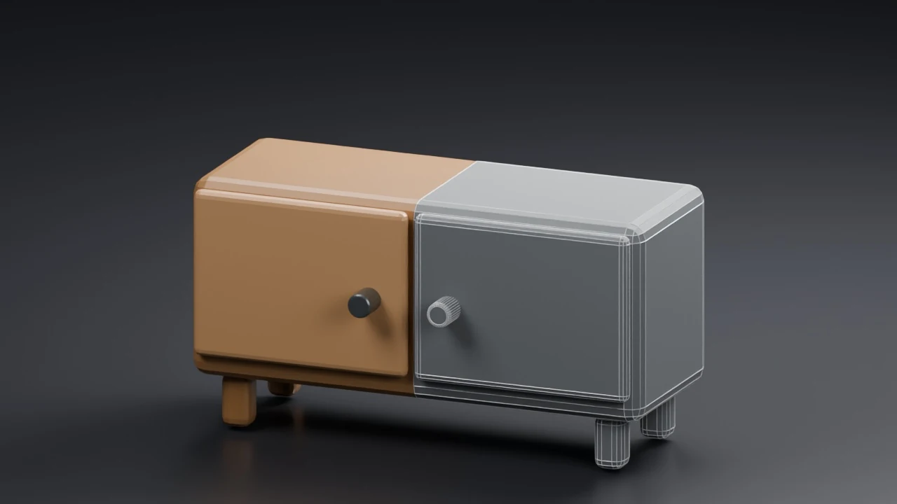

---

group: "furniture-photography"
title: "Como fotografar móveis para vender online"
description: "Planeie e fotografie uma galeria de móveis que mostre a forma, materiais e construção que os compradores precisam ver."
date: 2026-11-19
updated: 2026-11-19
keyword: "fotografar móveis para venda online"
cta: "Reveja os ângulos do seu produto numa pré-visualização gratuita."
---

Comece com uma fotografia de três quartos que mostre a frente e a profundidade do móvel. Adicione uma vista frontal reta, uma vista lateral ou de costas e detalhes de acabamento e hardware. Utilize o mesmo setup em todas as variações para que os compradores possam perceber quando há alterações no madeira, tecido ou construção.

## Como iluminar um grande móvel?

Coloque uma janela ou uma luz difusa ampla em um lado, um pouco adiantada em relação ao móvel. Desligue as luzes do ambiente caso a cor seja diferente. Utilize um quadro branco oposto à luz para elevar áreas escuras sem planificar a textura.

Posicione a câmera a uma distância suficiente para ver toda a peça, depois ajuste a altura até que as bordas verticais pareçam retas. Marque a posição do tripé e do móvel no chão. Utilize essas marcações para cada cor ou tecido.

## Quais fotografias devem ser tiradas antes de mover o setup?

Utilize a imagem principal para mostrar a silhueta. Uma vista frontal reta explica a frente, enquanto uma vista lateral revela a profundidade e a forma das pernas ou braços. Fotografe portas e gavetas abertas quando mudam o que o comprador pode utilizar.

Tire as fotografias de detalhes de hardware e materiais após as vistas completas. Fotografe uma junta ou encaixe assim como o tecido ou a textura. Inclua dimensões medidas em um diagrama rotulado ou nas especificações.

## O que deve ser verificado antes de publicar?

| Problema                                           | Solução                                              |
| -------------------------------------------------- | ---------------------------------------------------- |
| A imagem parece mais larga do que a base           | Mova a câmera para trás e mantenha-a nivelada        |
| O madeira parece amarelo na foto lateral           | Desligue a iluminação mista e fixe a balanço branco  |
| O lado traseiro só aparece numa fotografia de sala | Adicione uma vista traseira completa e não obstruída |

<!-- IMAGE PENDING: Photograph or capture the example described in the brief. -->

**Fonte** [Shopify · fotografia de produto](https://help.shopify.com/en/manual/products/product-media/product-photography), [Google Merchant Center · ligação de imagem](https://support.google.com/merchants/answer/6324350), [GS1 · especificação de imagem de produto](https://www.gs1.org/standards/gs1-product-image-specification-standard/current-standard).

[Guia relacionado](/pt/guias/fotografia-de-produto-para-ecommerce)

[Como construir o modelo 3D](/pt/guias/como-criar-um-modelo-3d)

## Perguntas frequentes

### É possível fotografar móveis com um telemóvel?

Sim, é possível fotografar móveis com um telemóvel utilizando a lente principal em luz boa e sustentar o aparelho para repetir o ângulo. Guarde uma cópia antes de passar para uma lente ultra-larga, depois verifique a primeira imagem ampliada para detectar cantos alongados e textura desfocada. Utilize um tripé ou superfície estável para manter a coerência.

### Devo mostrar a sala ao redor do móvel?

Não é necessário mostrar a sala ao redor do móvel. Fotografe a vista frontal e lateral com o móvel centrado no ecrã. Verifique se as dimensões estão rotuladas no ficheiro ou nas especificações, evitando o erro de omitir as medidas.

### Todos os variantes precisam da mesma galeria?

Repita o ângulo principal quando a acabamento ou construção mudar. Reuse as imagens de detalhe apenas quando a parte fotografada seja realmente idêntica. Indique a cor ou montagem que a imagem representa.
