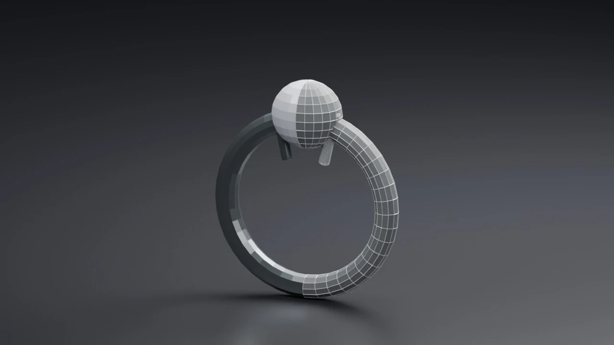

---

group: "jewelry-photography"
title: "Como fotografar joias e controlar os reflexos"
description: "Fotografe joias com bordas legíveis, reflexos de metal controlados e uma imagem detalhada repetível."
date: 2026-12-07
updated: 2026-12-07
keyword: "fotografia de joias"
cta: "Reveja os ângulos do seu produto numa pré-visualização gratuita."
---

Quando se fotografa joias polidas, defina o que o metal reflecte. Introduza difusão entre a luz e o objeto para um destaque amplo, e utilize uma pequena cartolina escura para definir o contorno. Revise as pedras, pronges e gravuras em tamanho inteiro antes de prosseguir para a próxima peça.

## Como obter um reflexo homogéneo?

Comece numa superfície neutra. Aumente o tamanho da fonte luminosa em relação ao objeto com um difusor, depois mova-a até o reflexo delineie o metal. Utilize uma pequena cartolina escura onde dois bordos polidos se unem.

Fixe o tripé e verifique o foco na pedra mais próxima ou no elemento de fixação. Se alterar a abertura para profundidade, verifique novamente as gravuras finas antes de fotografar todas as versões.

## Quais detalhes devem ser reservados para um quadro?

Mantenha uma vista principal, uma vista do elemento de fixação e um zoom sobre o montante ou a marcação. Fixe cor e composição para as variantes e compare os ficheiros um ao lado do outro.

## O que deve ser verificado antes da publicação?

| Sintoma                         | Ajuste                                                              |
| ------------------------------- | ------------------------------------------------------------------- |
| O brilho branco oculta gravuras | Mova o difusor ou reduza ligeiramente a exposição                   |
| O prata parece uma forma branca | Adicione reflexo de borda escura                                    |
| O montante está vago            | Ajuste o plano de foco ou utilize um campo de profundidade adequado |

<!-- IMAGE PENDING: Photograph or capture the example described in the brief. -->

**Fonte** [GIA · fotografia de gemas e joias](https://www.gia.edu/gem-photography), [Shopify · fotografia de produtos](https://help.shopify.com/en/manual/products/product-media/product-photography), [GS1 · especificação de imagem de produto](https://www.gs1.org/standards/gs1-product-image-specification-standard/current-standard).

[Guia relacionado](/pt/guias/fotografia-de-produto-para-ecommerce)

[Como construir o modelo 3D](/pt/guias/como-criar-um-modelo-3d)

## Perguntas frequentes

### Devo utilizar um tent de luz?

Pode simplificar reflexos. Adicione uma cartolina escura ou desloque parte da difusão quando o telhado deixa a peça sem borda legível. O utilizador deve comparar os ficheiros dos diferentes ângulos para verificar a clareza dos detalhes nas bordas polidas do metal.

### Como devo verificar a cor do gemstone?

Verifique a cor do gemstone comparando o ficheiro com o artigo real. Adicione um difusor e ajuste a exposição para evitar variações de brilho branco. O erro comum é ignorar a luz neutra, o que pode ocultar detalhes finos do montante.

### Qual é o melhor ângulo de destaque?

O melhor ângulo de destaque é o que mostra a pedra ou característica principal. Adicione uma imagem da fechadura ou parte de trás para complementar o ficheiro. Verifique se o reflexo é homogéneo e não oculta gravuras com o difusor ajustado.
