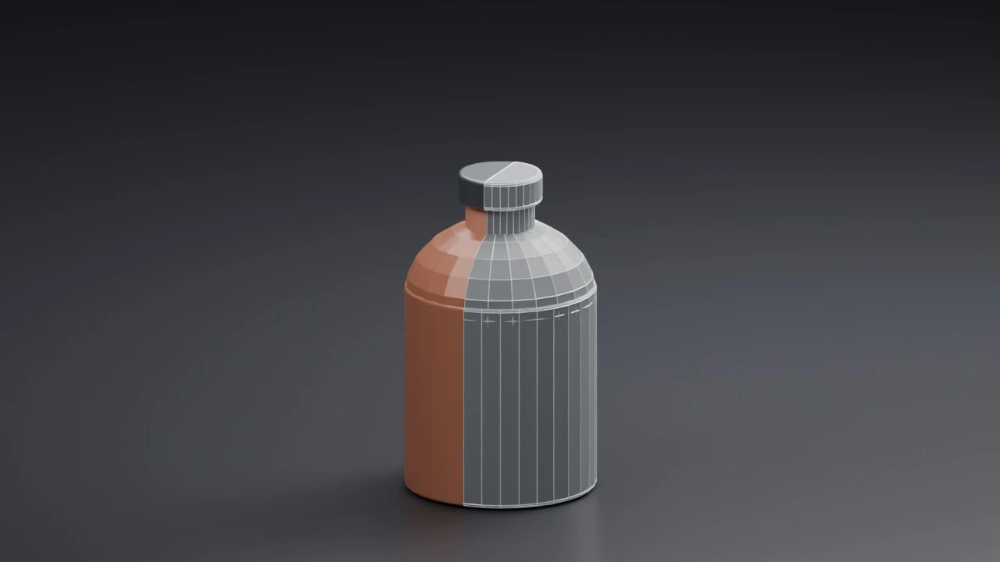

---

group: "ai-product-photography"
title: "Fotos de produto com IA: o que criar e rever"
description: "Utilize a IA para imagens de produto adequadas e verifique a forma, cor, etiqueta e variante antes da publicação."
date: 2026-12-11
updated: 2026-12-11
keyword: "fotografia de produto com IA"
cta: "Reveja os ângulos do seu produto numa pré-visualização gratuita."
---

Utiliza fotografias de produto com IA para alterações verificáveis, como um fundo ou apresentação. Mantém uma referência real para a forma, etiqueta, acabamento e cor do produto. Compara cada candidato com essa referência antes de publicar, especialmente quando mostra um lado não fotografado ou sugere uma característica.

## Quais edições são práticas de revisar?

Começa com uma única fotografia de produto limpa e uma alteração específica, como um fundo neutro. Compara o original e o candidato ao mesmo tamanho. Verifica a etiqueta em resolução completa e a silhueta em tamanho reduzido.

Se gerar uma nova vista, compara os detalhes visíveis com uma fotografia real quando a tens. Retira o resultado da galeria factual se não for possível verificar uma característica crítica.

## Como lidar com variantes?

Utiliza uma imagem de origem separada para cada acabamento, caso haja alteração de cor ou construção. Identifica o SKU de origem e a revisão de geração. Revisa ao lado de fotografias reais em um folheto de contato e verifica as regras atuais do canal.

## O que deve ser verificado antes da publicação?

| Alteração                     | Verificação de aceitação                            |
| ----------------------------- | --------------------------------------------------- |
| Fundo novo                    | Borda limpa e etiqueta intacta                      |
| Novo ângulo aparente          | Características visíveis coincidem com a referência |
| Cor ou tratamento de material | Variante e acabamento corretos                      |

<!-- IMAGE PENDING: Photograph or capture the example described in the brief. -->

**Fonte** [Google Merchant Center · Product Studio](https://support.google.com/merchants/answer/13708167), [Google Merchant Center · image link](https://support.google.com/merchants/answer/6324350), [Shopify · product photography](https://help.shopify.com/en/manual/products/product-media/product-photography).

[Guia relacionado](/pt/guias/fotografia-de-produto-para-ecommerce)

[Como criar um modelo 3D](/pt/guias/como-criar-um-modelo-3d)

## Perguntas frequentes

### É possível manter a imagem original como registo?

Sim. Armazene a versão original ao lado da versão publicada e registe o SKU a que pertence. Isto facilita posteriormente revisões e correções.

### Devo utilizar etiquetas geradas?

Mantenha informações factuais legíveis baseadas no produto real. Compare a tipografia ampliada e substitua a imagem se a etiqueta introduz informações incorretas. Armazene a versão original do ficheiro ao lado da versão publicada e registe o SKU correspondente para facilitar a revisão futura.

### É possível avaliar apenas em tamanho completo?

É obrigatório avaliar em tamanho completo para detalhes e verificar o tamanho do miniatura para reconhecimento. Verifique sempre que o corte da imagem se adapta bem a uma grade de produtos e teste a versão em tamanho completo contra o layout da grade para garantir que os detalhes do produto permaneçam legíveis. Assegure-se de que texto e características principais são visíveis em ambos os tamanhos.
