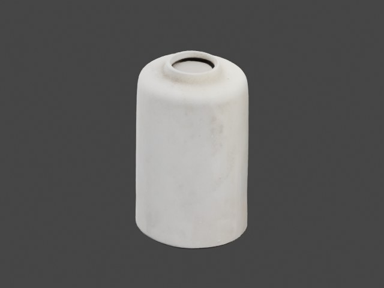

---

group: "glb-vs-gltf"
title: "GLB ou glTF: que ficheiro escolher"
description: "Compare o mesmo modelo como GLB e como ficheiros separados de glTF, incluindo a embalagem, texturas externas e implantação."
date: 2026-11-25
updated: 2026-11-25
keyword: "GLB vs glTF"
cta: "Reveja os ângulos do seu produto numa pré-visualização gratuita."
---

Utiliza um GLB se desejas entregar o modelo como um único ficheiro. Utiliza o formato separado glTF quando precisas de inspecionar ou gerir recursos individuais. Ambos podem descrever a mesma cena. A diferença prática reside na forma como se entrega a cena JSON, os buffers de geometria e as texturas de imagem.

## O que mudou ao exportar o mesmo vaso?

Exportámos o mesmo vaso duas vezes no Blender 5.2.3. O GLB foi 1,732,772 bytes. O pacote separado contém um ficheiro JSON de 2,124 bytes, um buffer de 1,702,680 bytes e uma imagem WebP de 28,466 bytes.

O total foi quase idêntico para estas configurações. O JSON próprio, embora pequeno, não representava todo o modelo. Outras configurações do exportador ou formatos de textura podem alterar os valores.

Retirámos um ficheiro de cada vez de cópias da exportação separada. Sem o WebP, o Blender abriu a geometria, mas a imagem ficou sem dados de píxeis. Sem o BIN, a importação falhou. Teste ambos os casos numa pasta isolada antes da entrega.

## Como testar a entrega?

Para entrega em único ficheiro, copia apenas o GLB para uma nova pasta e abre-o. Para o formato separado glTF, move toda a pasta de exportação. Se uma textura falhar, compara o seu URI no JSON com o nome de ficheiro e caminho em execução.

## O que deve verificar antes de publicar?

| Destino                                          | Escolha do pacote                                     |
| ------------------------------------------------ | ----------------------------------------------------- |
| Sistema de e-mail ou CMS de catálogo             | GLB autocontido, verificado por si só                 |
| Diagnóstico de um recurso de material            | Pacote separado glTF com a imagem e o buffer mantidos |
| Servidor web com necessidades de cache distintas | Testar ativos distintos e requisições necessárias     |

<!-- IMAGE PENDING: Photograph or capture the example described in the brief. -->

**Fonte** [Khronos · especificação glTF 2.0](https://registry.khronos.org/glTF/specs/2.0/glTF-2.0.html), [Khronos · validador glTF](https://github.com/KhronosGroup/glTF-Validator), [Blender · importação e exportação glTF 2.0](https://docs.blender.org/manual/en/5.1/addons/import_export/scene_gltf2.html).

[Guia relacionado](/learn/glb-file)

[Como criar um modelo 3D](/pt/guias/como-criar-um-modelo-3d)

## Perguntas frequentes

### O formato é sempre mais pequeno?

O formato não é sempre mais pequeno, pois o GLB e o glTF podem ter pesos semelhantes. Copia apenas o ficheiro GLB para uma nova pasta e abre-o no ecrã. O erro comum é esquecer o buffer ou a textura, levando à falha no carregamento.

### Pode um GLB referir-se a ficheiros externos?

Pode. Verifique que o exportado abra num diretório vazio quando o workflow exige um ficheiro autocontido. Antes da entrega, teste o carregamento do GLB isolado em uma pasta separada para garantir que a geometria e a textura se abram corretamente sem dependências externas.

### Por que o mesmo modelo parece diferente em dois visualizadores?

O mesmo modelo parece diferente porque o glTF separa texturas e geometria em ficheiros distintos. Copie apenas o ficheiro GLB para uma nova pasta e abra-o no visualizador de destino. O erro comum é esquecer o ficheiro WebP ou o buffer BIN, que são necessários para a exibição correta.
