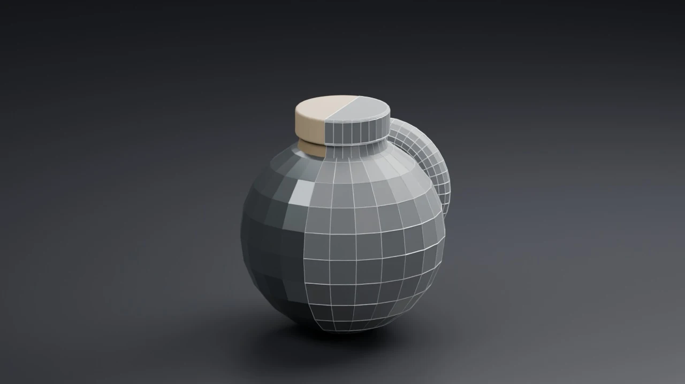

---

group: "product-photography-lighting"
title: "Três esquemas de iluminação para fotos de produto"
description: "Utilize três configurações de iluminação reutilizáveis para produtos matos, superfícies reflectoras e detalhes texturizados."
date: 2026-11-30
updated: 2026-11-30
keyword: "iluminação fotografia de produto"
cta: "Reveja os ângulos do seu produto numa pré-visualização gratuita."
---

Escolha a iluminação com base na superfície: utiliza luz de janela com reflector branco para produtos matos, amplia a fonte para itens gloss, e aplica luz de escorregamento para realce, costuras e tecidos. Mantenha a posição da câmera e a exposição constantes ao comparar os setups.

## Como posicionar as fontes?

Coloque a fonte de janela ou softbox à frente e a um lado para a configuração base. Adicione um cartão branco oposto e verifique se a sombra ainda descreve profundidade. Mova-o para trás se a forma parecer plana.

Para superfícies gloss, coloque a difusão perto o suficiente para mostrar uma reflexão contínua ampla. Para textura, reduza a intensidade da luz para que ela escorregue sobre a superfície. Em ambos os casos, verifique um destaque e uma sombra em tamanho inteiro.

## Como repetir o resultado?

Marque a posição da câmera, da luz e do objeto. Registe a temperatura de branco e a exposição. Guarde um quadro com um cartão neutro se a cor for relevante. Compare a imagem com o objeto real sob luz neutra.

## O que deve ser verificado antes da publicação?

| Superfície       | Configuração                      | Verifique                         |
| ---------------- | --------------------------------- | --------------------------------- |
| Matos            | Luz lateral e reflector           | Sombra legível                    |
| Gloss            | Difusão ampla e bandeiras escuras | Reflexão suave com borda definida |
| Realce ou tecido | Luz lateral reduzida              | Textura com destaque preservado   |

<!-- IMAGE PENDING: Photograph or capture the example described in the brief. -->

**Fonte** [Shopify · fotografia de produtos](https://help.shopify.com/en/manual/products/product-media/product-photography), [GIA · fotografia de joias e gemas](https://www.gia.edu/gem-photography), [GS1 · especificação de imagem de produto](https://www.gs1.org/standards/gs1-product-image-specification-standard/current-standard).

[Guia relacionado](/pt/guias/fotografia-de-produto-para-ecommerce)

[Como criar o modelo 3D](/pt/guias/como-criar-um-modelo-3d)

## Perguntas frequentes

### Quantas lâmpadas preciso?

Utilize uma única lâmpada inicial para testar a iluminação básica. Adicione uma segunda lâmpada apenas se a sombra for inadequada ou a superfície apresentar reflexão desbalanceada. Verifique se a sombra é legível e se a reflexão é suave, evitando o erro de usar difusão excessiva em superfícies gloss.

### Por que os produtos mudam de cor?

Os produtos mudam de cor devido à influência do equilíbrio branco automático e configurações de iluminação. Grave um quadro com cartão branco neutro antes do carregamento para comparação. O erro comum é usar luz lateral sem verificação de sombra e reflexão em superfícies gloss.

### O que devo fotografar para um anotativo de setup?

Deve fotografar a câmera, lâmpadas e um cartão branco neutro com a luz posicionada à frente e a um lado. Carregue o ficheiro com a temperatura de branco e a exposição no ecrã para reprodução exata. O erro comum é omitir o cartão neutro, resultando em desvios de cor na reprodução.
