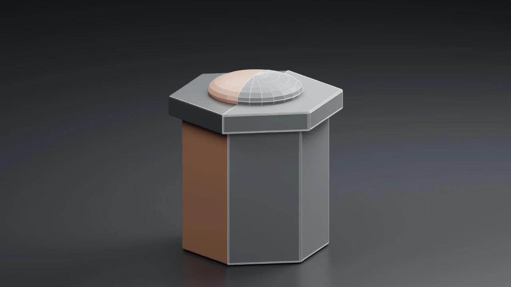
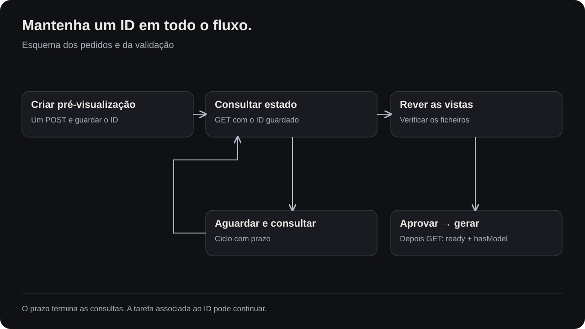

---

group: "n8n-image-to-3d-workflow"
title: "Como integrar imagem para 3D num fluxo n8n"
description: "Conecta o n8n a uma API de imagem para 3D. Cria um pré-visualização, armazena o ID da tarefa, aprova a construção e recupera o GLB com polling…"
date: 2026-11-26
updated: 2026-11-26
keyword: "imagem para 3D n8n"
cta: "Reveja os ângulos do seu produto numa pré-visualização gratuita."
---

Para criar um modelo 3D a partir de uma imagem no n8n, inicie a pré-visualização com o nó HTTP Request e guarde o identificador da tarefa. Reveja as vistas antes de aprovar a geração paga e descarregar o GLB. Se o prazo terminar, retome a tarefa guardada.

> **Persista o ID antes de adicionar automação.** Se sabes qual trabalho pertence à imagem, podes reativá-lo. Se o único registo for uma célula em branco, uma repetição pode gerar trabalho desnecessário.

## Qual método de ligação deve ser escolhido?

Utilize REST quando a sequência é fixa. Utilize um agente quando alguém precisa interpretar uma solicitação ou escolher entre ferramentas. Um nó da comunidade pode simplificar a configuração, mas não deve determinar se é possível implementar o fluxo completo.

| Método                         | Melhor adaptação                                      | Verifique antes de decidir                                          |
| ------------------------------ | ----------------------------------------------------- | ------------------------------------------------------------------- |
| Solicitação HTTP integrada     | Sequência explícita com entradas e saídas visíveis    | Credenciais, forma do corpo e ramificações de estado                |
| Nó da comunidade               | Operações suportadas com configuração mais simples    | Disponibilidade de instalação e cobertura operacional               |
| Cliente MCP ligado a um agente | Solicitações que necessitam de seleção de ferramentas | Suporte ao transporte, ferramentas permitidas e controlos de gastos |

Este guia utiliza o [nó de Solicitação HTTP](https://docs.n8n.io/integrations/builtin/core-nodes/n8n-nodes-base.httprequest/) e o contrato [REST do easyrender](/image-to-3d-api). Não exige lista no mercado. Para seleção conversacional, utilize o guia separado sobre [agente n8n e MCP](/pt/guias/cliente-mcp-n8n).

## O que é necessário antes de adicionar o primeiro nó?

Escolha uma foto clara de um ventilador de mesa. A API aceita JPEG, PNG ou WebP com até 4 MiB. Para uma imagem pública via HTTPS, utilize `image_url`. Para um ficheiro local ou privado, carregue-o através do ponto final autenticado de ficheiros e utilize o seu `upload_id` em seguida.

Crie uma chave API no Connectors. Um fluxo de pré-visualização exige `write` para criação e `read` para inspeção. Adicione apenas `spend` à credencial utilizada numa operação paga aprovada. Armazene a chave como credencial de autenticação de cabeçalho no n8n: `Authorization` é o nome do cabeçalho e `Bearer YOUR_API_KEY` é o seu valor.

| Valor a salvar      | Exemplo                  | De onde provém                                |
| ------------------- | ------------------------ | --------------------------------------------- |
| Registo de origem   | `FAN-DESK-01`            | O seu catálogo                                |
| Revisão da foto     | `front-v1`               | O seu sistema de gestão de origem             |
| Chave de criação    | `FAN-DESK-01-front-v1`   | Chave estável para a entrada exata pretendida |
| `render_id`         | `id` retornado realmente | Resposta de pré-visualização                  |
| Limite de aprovação | Um inteiro aprovado      | O valor atual da cotação mais a sua decisão   |

A mesma URL da imagem deve continuar a apontar para os mesmos bytes durante uma tentativa. Se a fonte mudar, crie uma nova revisão intencionalmente. Antes de testar o conectador, utilize o guia de preparação [foto](/pt/guias/criar-um-modelo-3d-a-partir-de-fotografias) para eliminar problemas de entrada evitáveis.

## Passo 1: como criar uma pré-visualização?

Adicione um Trigger Manual e um nó de Edição de Campos para o seu registo de origem. Configure então o primeiro HTTP Request conforme indicado. Mapeie o URL da sua foto acessível no campo imagem.

| Configuração do HTTP Request | Valor                                                |
| ---------------------------- | ---------------------------------------------------- |
| Método                       | `POST`                                               |
| URL                          | `https://easyrender.ai/api/renders`                  |
| Autenticação                 | Credencial de Autenticação por Header                |
| Header                       | `Idempotency-Key` com a chave de criação salva       |
| Tipo de conteúdo do corpo    | JSON                                                 |
| Campo do corpo               | `image_url` mapeado do registo de origem             |
| Campo do corpo               | `name` mapeado do nome do produto                    |
| Campo do corpo               | `isPublic` definido como booleano `false`            |
| Formato da resposta          | JSON. Apenas o corpo para as vias de campo indicadas |

Guarde o `id` retornado antes de prosseguir. Com cabeçalhos/respostas desativados, o valor é o `id` do corpo da resposta. Se ativar a opção de resposta completa, adapte os mapeamentos para `body.id`. Não misture as duas estruturas de resposta entre os nós.

A chave de criação é 1–128 – caracteres ASCII imprimíveis sem espaços. A sua reutilização com entrada idêntica recupera a mesma renderização. Uma entrada diferente gera conflito. Este contrato de idempotência aplica-se à criação de prévia, não a todos os POSTs no serviço. Mantenha-a estável após uma resposta perdida.

## Passo 2: como esperar sem reiniciar?

Adicione um [Nó de Espera](https://docs.n8n.io/integrations/builtin/core-nodes/n8n-nodes-base.wait/) com um intervalo de tempo, seguido por `GET https://easyrender.ai/api/renders/{saved_render_id}`. Um intervalo de 15 segundos e um prazo de 20 minutos para o fluxo são configurações racionais para teste, não garantem tempos de geração. Registre o prazo antes de entrar no ciclo.

| Estado retornado                    | Ramo do fluxo                                         |
| ----------------------------------- | ----------------------------------------------------- |
| `drafting`                          | Aguarde, em seguida, efetue um GET com o ID existente |
| `preview_ready`                     | Pare o ciclo de pré-visualização e solicite revisão   |
| `rendering`                         | Continue o polling limitado do build autorizado       |
| `ready` e `hasModel=true`           | Descarregue o modelo                                  |
| `failed`                            | Guarde o erro e interrompa este tentativo             |
| Prazo atingido ou estado inesperado | Guarde o ID e o estado para reconciliação             |

Consulte o render individual, não apenas o ponto de extremidade de listagem. O [contrato da API](https://github.com/easyrenderai/easyrender.ai/blob/main/docs/api.md) esclarece que a listagem não avança os trabalhos. A aparição de uma URL numa resposta não é prova de que o artefato correspondente está pronto.

## Etapa 3: o que exatamente deve o revisor aprovar?

Abra o visualizador do proprietário em `https://easyrender.ai/r/{saved_render_id}`. Verifique `hasSheet` antes de rotular uma imagem como folha de ângulo: o ativo de pré-visualização pode ainda ser a foto de origem. Se for solicitada uma folha paga ou revisão, autorize-a separadamente e mantenha o seu custo no mesmo registo do produto.

Refresque o render e `GET /api/credits`. Associe a decisão ao ID do render, à revisão de origem e aos créditos autorizados. O débito restante do build é `max(0, renderCredits - credits)`, e não um preço fixo presumido e copiado para o fluxo.

Após aprovação, envie `POST https://easyrender.ai/api/renders/{saved_render_id}/render` com o campo JSON `maxCredits` definido para o inteiro autorizado. Um prazo atingido ou aprovação rejeitada deve ir para um ramo de parada. Não conecte estas condições à ação paga como continuação padrão.

<!-- IMAGE PENDING: unique screenshot of HTTP Request settings and a credential-free status output from a real n8n run. -->

## Etapa 4: como descarregar o GLB?

Após `ready` e `hasModel=true`, solicite `/api/renders/{saved_render_id}/model?download=1` com as credenciais do proprietário. Selecione uma resposta de ficheiro e um campo de saída, por exemplo, `model`. Envie esse output binário para o passo de armazenamento ou envio para comércio escolhido.

O [referencial do formato Khronos](https://www.khronos.org/gltf/) explica por que o GLB é adequado para a entrega de um modelo. Deve-se definir três destinos distintos: a página do visualizador de proprietário, o ponto de recolha autenticado e o ficheiro carregado na loja. Estes links não são intercambiáveis.

As URLs de modelos privados exigem autenticação. Para o Shopify, utiliza-se a sequência de carregamento e processamento de media [após a transferência do ficheiro](https://shopify.dev/docs/apps/build/product-merchandising/products-and-collections/manage-media). Nunca inclui-se uma chave API numa URL para tornar essa URL acessível à loja.

## Quais falhas devem ser tratadas explicitamente?

| Sintoma                                | Causa a verificar                            | Recuperação                                                             |
| -------------------------------------- | -------------------------------------------- | ----------------------------------------------------------------------- |
| HTTP 401                               | Chave errada, expirada ou revogada           | Corrigir a credencial. Manter o ID da tarefa                            |
| HTTP 403                               | Escopo ausente ou limite de chaves exaustos  | Verificar o código de erro e os limites da chave autorizada             |
| HTTP 402                               | Créditos da conta insuficientes              | Suspender o consumo e solicitar uma decisão orçamentária                |
| HTTP 409 na criação                    | Chave reutilizada com entrada diferente      | Recuperar a solicitação anterior ou versão deliberadamente a nova fonte |
| HTTP 429                               | Limite de taxa/concorrência                  | Ler `Retry-After` e adiar a próxima solicitação                         |
| POST pago ultrapassa tempo de resposta | O resultado é desconhecido                   | Revise o trabalho salvo. Não repita a ação de forma automática          |
| O ficheiro contém JSON                 | A resposta com erro foi guardada como modelo | Verifique o estado e o tipo de conteúdo antes da armazenagem            |

Para controlo de velocidade, [n8n documenta a gestão de limites de taxa](https://docs.n8n.io/integrations/builtin/handle-rate-limits.md). Evite a repetição automática em nós pagos. Leituras seguras e mutações incertas exigem rotinas de recuperação distintas, mesmo quando ambos apresentam marcação vermelha de execução.

## Como testar o fluxo antes de utilizar um catálogo?

Teste primeiro a leitura da credencial e a criação de pré-visualização com uma foto. Confirme que o registo contenha o ID retornado e que a repetição com a mesma chave de criação não gere outro render. Pare na revisão até que se tenha um orçamento explicitamente aprovado para a construção.

Verifique em seguida as ramificações utilizando fixtures de resposta representativos: `drafting`, `preview_ready`, `ready`, `failed` e um erro de limite de taxa. Os testes com fixtures validam a rotação, não o serviço de renderização em tempo real. A execução autenticada final é ainda necessária para confirmar o funcionamento completo do fluxo n8n configurado.

O esquema implementado foi verificado neste guia. Nenhum lançamento pago foi utilizado para afirmar um tempo de conclusão ou taxa de sucesso. Para as escolhas metodológicas subjacentes, veja [como construir um modelo 3D](/pt/guias/como-criar-um-modelo-3d). Amplie para lote apenas após um modelo aprovado atingir o seu destino pretendido.

## Perguntas frequentes

### A criação de um render inicia também o modelo pago?

A criação de um render não inicia o modelo pago. A geração do preview devolve um ID de render e inicia a fase de preview. O build 3D pago é uma ação separada, com autorização própria. Armazene o ID, verifique o resultado disponível e confirme o custo antes de prosseguir, pausando o fluxo sem perder progresso.

### É possível utilizar uma imagem que não esteja publicamente hospedada?

Sim. Envie o ficheiro para o ponto de entrada autenticado de upload, depois utilize o ID de upload retornado como fonte de preview. O referente é escopo do proprietário e expira após uma hora, por isso crie o render dentro desse período e guarde o seu ID de render separado para posterior consulta e recuperação.

### Recebe o n8n o modelo final imediatamente?

Não. A criação e a construção devolvem informações do trabalho enquanto o processamento continua. Consulte o ID de render guardado e exija, simultaneamente, o estado prontos e a disponibilidade do modelo antes da transferência. Se o seu fluxo atingir o prazo, conserve o trabalho para verificação posterior, em vez de considerar o prazo como prova de falha na geração.

### É possível automatizar o download de USDZ com o mesmo ponto de extremidade?

O ponto de extremidade do modelo nesse receituário devolve GLB. O contrato REST não define um ponto de extremidade de conversão para USDZ, por isso adicionar uma extensão de ficheiro à URL não criará uma conversão. Utilize o fluxo de exportação suportado pelo visualizador ou um passo de conversão testado separadamente quando o destino exija especificamente USDZ.
